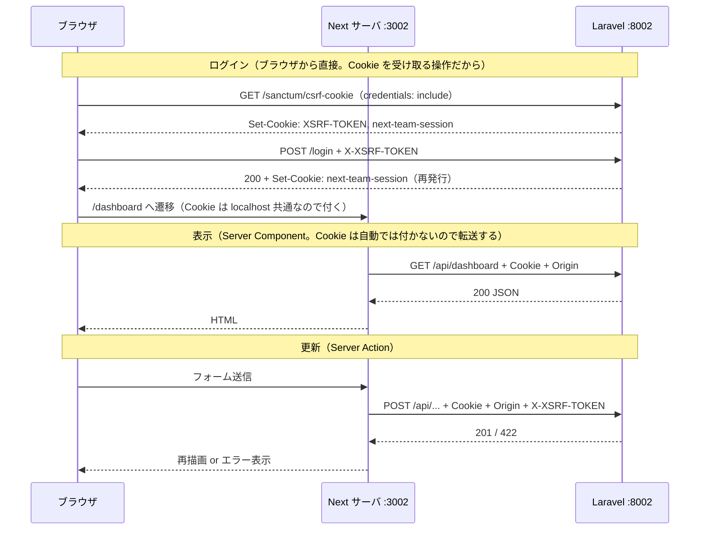

# 技術仕様（契約）— 第3弾 `next_team`

作成日: 2026-10-01 / ステータス: **P0 時点の契約**。実装でずれたら、実装ではなくまずこの文書を直す（ずれた理由も書く）。

- 要件の正: [`../../00_要件定義.md`](../../00_要件定義.md)
- 決定の経緯: [`00_計画と決定事項.md`](00_計画と決定事項.md)
- 非同期の詳細: [`03_非同期処理の設計.md`](03_非同期処理の設計.md)

この文書は「担当が互いのコードを読まなくても結合できる」ための契約です。**api 担当と web 担当の境界は 6 章（API 契約）だけ**です。web 担当は `api/` のコードを読まず、6 章と実際のレスポンスだけを見て作ります。

第2弾 `ecc_team` は README とテーブル構造だけを参考にし、コードは見ていません（決定14）。

---

## 1. 構成

| 項目 | 内容 |
|---|---|
| `api/` | Laravel 13 / PHP 8.4。**JSON API 専用**（Blade の画面は持たない） |
| `web/` | Next.js 16（App Router）/ React 19 / TypeScript / Tailwind CSS 4 |
| DB | SQLite（`api/database/database.sqlite`。テストは in-memory） |
| キュー・キャッシュ | Redis（Docker。非同期の実装時に導入） |
| メール | Mailpit（Docker。非同期の実装時に導入） |
| 認証 | Sanctum SPA 認証（Cookie + CSRF）＋ Fortify ヘッドレス。ワーカーは Sanctum の API トークン（5.3） |
| `mobile/` | ワーカーアプリ。Flutter（安定版。導入したバージョンを `mobile/README.md` に書く）/ Dart。**iOS を先に作り、Android は後で動作確認だけ**（docs/00 の決定 56）。`flutter create --org io.github.hatajunnosuke --project-name worker_app --platforms ios,android mobile`（Bundle ID は `io.github.hatajunnosuke.workerApp`。決定 67）。接続先は `--dart-define=API_BASE_URL=http://localhost:8002` で渡す（7A.2）。計画は [`05_ワーカーアプリ学習計画.md`](05_ワーカーアプリ学習計画.md) |

### ポート

| 用途 | URL | 備考 |
|---|---|---|
| API | http://localhost:8002 | 8000 は第1弾、8001 は第2弾が使う |
| 画面 | http://localhost:3002 | 3000 は別プロジェクトの Docker が使っている |
| Mailpit | http://localhost:8025 | SMTP は 1025 |
| Redis | localhost:6379 | |
| Horizon | http://localhost:8002/horizon | P4-01b（2026-10-02）から。ローカル環境 かつ ログイン済み管理者のみ |
| Telescope | http://localhost:8002/telescope | P4-01b（2026-10-02）から。ローカル環境 かつ ログイン済み管理者のみ（Telescope 自体もローカルでしか登録しない） |

### 使うパッケージ（これ以外を入れるときは人に確認する）

| 場所 | パッケージ | いつ | 用途 |
|---|---|---|---|
| api | `laravel/sanctum` | P1 | SPA 認証（`php artisan install:api` で入る） |
| api | `laravel/fortify` | P1 | ログイン・ログアウト・スロットル |
| api | `laravel-lang/common` | P1 | バリデーションメッセージの日本語 |
| api | `laravel/horizon` | P4 | キューワーカーと監視画面 |
| api | `laravel/telescope`（dev） | P4 | リクエスト・クエリ・ジョブ・メールの観察 |
| api | `laravel/reverb` | P6（Could） | WebSocket サーバ |
| web | `zod` | P1 | API レスポンスの検証と型の導出 |
| web | `prettier` `prettier-plugin-tailwindcss`（dev） | 導入済み | 整形 |
| web | `laravel-echo` `pusher-js` | P6（Could） | WebSocket クライアント |
| mobile | `flutter_lints`（dev） | Step 3 | 静的解析のルール集（`flutter create` の雛形に最初から入っている） |
| mobile | `go_router` | Step 3 | 画面遷移と下タブ（`StatefulShellRoute`） |
| mobile | `flutter_riverpod` `riverpod_annotation`、dev: `riverpod_generator` `build_runner` | Step 4 | 状態管理（docs/00 の決定 58）とコード生成 |
| mobile | `dio` | Step 6 | API の呼び出し（インターセプタでトークンを付け、401 を扱う） |
| mobile | `flutter_secure_storage` | Step 6 | トークンの保存（iOS では Keychain） |
| mobile | `freezed_annotation` `json_annotation`、dev: `freezed` `json_serializable` | Step 7 | レスポンスの型と `fromJson` の生成 |
| mobile | `firebase_core` `firebase_messaging` | Step 10 | プッシュ通知（要件の外の学習。docs/00 の決定 59） |
| api | `laravel-notification-channels/fcm` | Step 10 | プッシュ通知の送信（同上） |

UI コンポーネントライブラリ、状態管理ライブラリ、データ取得ライブラリ（SWR / TanStack Query）は `web/` に入れません（決定8）。`mobile/` の行は「いつ」の Step より前に入れません。バージョンは入れるときの安定版に固定し、`mobile/pubspec.lock` をコミットします（`composer.lock` や `package-lock.json` と同じ扱い）。

---

## 2. 環境変数

`.env` はフックが編集を止めます。エージェントは `.env.example` を直し、人が `.env` に反映します。**P1〜P3 の値は 2026-10-01 に反映済み**です。P4 の値は P4 の開始時に人が反映します。

### `api/.env`

| キー | 値 | いつ | 理由 |
|---|---|---|---|
| `APP_NAME` | `next_team` | P1 | セッション Cookie 名が `next-team-session` になり（`Str::slug(APP_NAME)` なのでハイフン区切り。P1-03 で実物を確認）、他の弾（同じ `localhost`）と混ざらない |
| `APP_URL` | `http://localhost:8002` | P1 | 署名付きURL の生成に使われる |
| `FRONTEND_URL` | `http://localhost:3002` | P1 | CORS の許可オリジン、メール本文のリンク先 |
| `APP_LOCALE` / `APP_FALLBACK_LOCALE` | `ja` / `en` | P1 | エラーメッセージを日本語に |
| `APP_FAKER_LOCALE` | `ja_JP` | P1 | シードの名前を日本語に（**テストは `phpunit.xml` で `en_US` に固定**。第2弾の教訓） |
| `APP_TIMEZONE` | `Asia/Tokyo` | P1 | `config/app.php` の `timezone` を `env('APP_TIMEZONE', 'Asia/Tokyo')` にする |
| `SANCTUM_STATEFUL_DOMAINS` | `localhost:3002` | P1 | このオリジンからのリクエストだけセッション認証を有効にする |
| `SESSION_DOMAIN` | `localhost` | P1 | Cookie をポート違いの画面と共有する |
| `MYTEAM_MIN_WAGE` | `1226` | P2 | F-05 の最低賃金（`config/myteam.php`） |
| `QUEUE_CONNECTION` | `redis` | **P4** | それまでは `database` のまま（何も積まない） |
| `CACHE_STORE` | `redis` | **P4** | それまでは `database` |
| `MAIL_MAILER` / `MAIL_HOST` / `MAIL_PORT` | `smtp` / `127.0.0.1` / `1025` | **P4** | Mailpit |
| `MAIL_FROM_ADDRESS` | `no-reply@myteam.example` | **P4** | |
| `MYTEAM_REMINDER_TIME` | `18:00` | **P4** | F-22 の送信時刻 |
| `MYTEAM_MAILS_PER_MINUTE` | `60` | P4（任意） | メールの流量（全社・全種類で 1 つの枠） |
| `MYTEAM_MAIL_RETRY_UNTIL_MINUTES` | `60` | P4（任意） | メールのジョブを打ち切るまでの時間 |
| `MYTEAM_REPORT_EXPORT_STALE_MINUTES` | `30` | P4（任意） | 生成中のまま止まった出力を失敗にするまでの時間（下限 5） |
| `MYTEAM_DASHBOARD_CACHE_SECONDS` | `300` | P4（任意） | ダッシュボードのキャッシュの秒数（0 以下でキャッシュしない） |
| `MYTEAM_WORKER_INVITATION_DAYS` | `7` | ワーカー Step 5（任意） | 招待コードの有効期限の日数（F-26） |
| `MYTEAM_WORKER_TOKEN_DAYS` | `30` | ワーカー Step 5（任意） | ワーカーのトークンの有効期限の日数（5.3） |
| `CACHE_PREFIX` / `REDIS_PREFIX` / `HORIZON_PREFIX` | `next-team-cache-` / `next-team-database-` / `next-team-horizon:` | **P4** | 同じ Redis を他の弾と共有したときのキーの衝突を防ぐ |

### `web/.env.local`

| キー | 値 | 使う場所 |
|---|---|---|
| `API_URL` | `http://localhost:8002` | サーバ側（Server Component / Server Action / Route Handler） |
| `NEXT_PUBLIC_API_URL` | `http://localhost:8002` | ブラウザ側（ログイン・ログアウトだけ） |
| `WEB_ORIGIN` | `http://localhost:3002` | サーバ側 fetch に付ける `Origin` / `Referer` |

---

## 3. テーブル定義

全テーブルに `id`（bigint PK）と `created_at` / `updated_at` があります。金額は円の整数、時間は分の整数です。

### 3.1 業務テーブル（P2 で作り、基盤確定後にロック）

**companies**

| 列 | 型 | 制約 |
|---|---|---|
| name | string | NOT NULL |
| code | string | ワーカー Step 5 で新しいマイグレーションで足す。**UNIQUE**。既存の行は同じマイグレーションで埋め、以後 NOT NULL（企業コード。ワーカーのログインに使う。docs/00 の決定 68） |

企業コードは 6 文字（紛らわしい `0` `O` `1` `I` `L` を除いた英大文字と数字）。大文字で保存し、入力は大文字に直してから比べる。秘密ではなく識別子なので、招待メールと管理者の画面（`/api/user` の `company.code`）に出してよい。企業を作るのは今はシーダーだけなので、`Company` の `creating` で作る（重なったら作り直す）。

**users**（管理者）

| 列 | 型 | 制約 |
|---|---|---|
| company_id | FK → companies | NOT NULL、restrictOnDelete |
| name | string | NOT NULL |
| email | string | NOT NULL、UNIQUE |
| password | string | NOT NULL（hashed cast） |
| remember_token | string | NULL |

Fortify の 2FA 用の列は作りません（`features` が空なので使わない）。

**locations**（拠点）

| 列 | 型 | 制約 |
|---|---|---|
| company_id | FK | NOT NULL、INDEX |
| name | string | NOT NULL |
| address | string | NULL |

**workers**（ワーカー）

| 列 | 型 | 制約 |
|---|---|---|
| company_id | FK | NOT NULL |
| name | string | NOT NULL |
| email | string | **NOT NULL**（第3弾から必須。通知の宛先） |
| phone | string | NULL |
| is_active | boolean | NOT NULL、default true |

INDEX: `(company_id, is_active)`、`(company_id, name)`。`email` には一意制約を付けません（未登録のワーカーは同じメールでもよい）。登録済みのワーカーの一意は、下の `login_email` で守ります。

**ワーカーアプリ（docs/05 の Step 5）で足す列**（新しいマイグレーションファイルで足す。既存のファイルは触らない）:

| 列 | 型 | 制約 |
|---|---|---|
| password | string | NULL（hashed cast。初回登録で入る。`#[Hidden]`） |
| login_email | string | NULL（初回登録のときに `email` を小文字にして写す。ログインの識別子）。**UNIQUE `(company_id, login_email)`** |
| registered_at | datetime | NULL（初回登録の日時。NULL なら未登録） |

ログインの識別子（docs/00 の決定 68。決定 64 を変更）: ワーカーは企業ごとに管理し、同じ人が別の企業でも働くなら企業ごとに別のアカウントにする。ログインは**企業コード ＋ メール ＋ パスワード**。登録を済ませたワーカーのメールを**同じ企業の中で一意**にするため、`(company_id, login_email)` に UNIQUE を付ける。未登録のワーカーは NULL なので縛らない（NULL は UNIQUE で重なってよい。SQLite も MySQL も同じ）。部分インデックス（`WHERE registered_at IS NOT NULL`）は MySQL にないので使わない（12 章の方針と同じ）。メールは小文字にして保存し、照合も小文字で行う（SQLite の UNIQUE は大文字と小文字を区別するため）。管理者がワーカーのメールを直したとき（F-02 の PUT）は `WorkerService::update()` が扱う（4.5）: 登録済みなら `login_email` も同じ値に直し、同じ企業のほかの登録済みワーカーと重なれば 422。未登録なら使える招待を取り消し、有効なワーカーなら新しいメール宛に招待を発行する（**無効なワーカーは取り消すだけで発行しない**。有効に戻したら F-27 で送り直す）。未登録でも、新しいメールが同じ企業の登録済みワーカーの `login_email` と重なるなら 422（初回登録が必ず失敗するため）。重複の確認は自社の中だけで閉じるので、他社の登録状況は分からない。

**job_postings**（募集）

| 列 | 型 | 制約 |
|---|---|---|
| company_id | FK | NOT NULL |
| location_id | FK → locations | NOT NULL、**restrictOnDelete**（F-01: 使われている拠点は消せない） |
| job_title | string | NOT NULL |
| work_date | date | NOT NULL |
| start_time | time | NOT NULL |
| end_time | time | NOT NULL |
| capacity | unsigned int | NOT NULL（1 以上は検証で守る） |
| hourly_wage | unsigned int | NOT NULL |
| transport_allowance | unsigned int | NOT NULL、default 0 |
| status | string | NOT NULL、default `open`（`open` / `closed` / `cancelled`） |

INDEX: `(company_id, work_date)`、`(company_id, status)`、`(location_id)`。

**applications**（応募）

| 列 | 型 | 制約 |
|---|---|---|
| company_id | FK | NOT NULL |
| job_posting_id | FK → job_postings | NOT NULL、restrictOnDelete |
| worker_id | FK → workers | NOT NULL、restrictOnDelete |
| status | string | NOT NULL、default `applied`（`applied` / `confirmed` / `rejected` / `cancelled`） |
| confirmed_at | datetime | NULL |
| confirmed_hourly_wage | unsigned int | NULL（確定時に募集の値をコピーして固定） |
| confirmed_transport_allowance | unsigned int | NULL（同上） |
| cancel_reason | string | NULL（`company` / `worker`） |
| cancelled_at | datetime | NULL |

**UNIQUE `(job_posting_id, worker_id)`**（F-09: 二重応募の禁止を DB でも守る）。INDEX: `(job_posting_id, status)`、`(company_id, status)`、`(worker_id)`（SQLite は FK に索引を作らないので、ワーカー側からの参照と restrictOnDelete の検査用。P2-01 の database-reviewer で決定）。

**attendances**（勤怠）

| 列 | 型 | 制約 |
|---|---|---|
| company_id | FK | NOT NULL |
| application_id | FK → applications | NOT NULL、**UNIQUE**（1 対 1） |
| clock_in | datetime | NOT NULL |
| clock_out | datetime | NOT NULL（深夜跨ぎは翌日の日付になる） |
| break_minutes | unsigned int | NOT NULL、default 0 |
| worked_minutes | unsigned int | NOT NULL（保存時に確定） |
| wage_pay | unsigned int | NOT NULL（同上。交通費を含まない） |
| total_pay | unsigned int | NOT NULL（同上。交通費を含む） |

INDEX: `(company_id, clock_in)`（勤怠の日時での参照用。月次集計の絞り込みは 4.6 のとおり `job_postings (company_id, work_date)` が効く）。

`work_date` はモデル経由でも `Y-m-d`（時刻なし）で保存する。SQLite は文字列で比べるので、書式が混ざると半開区間や等号の比較から漏れる（P2-01 の database-reviewer の指摘）。

### 3.2 非同期用のテーブル（P4・P5 で足す。新しいマイグレーションファイルとして追加）

**notification_logs**（通知の記録。F-20〜F-24 の冪等性と履歴）

| 列 | 型 | 制約 |
|---|---|---|
| company_id | FK | NOT NULL |
| kind | string | NOT NULL（`application_confirmed` / `posting_cancelled` / `shift_reminder` / `export_ready`。ワーカー Step 5 で `worker_invitation` を足す） |
| recipient_type / recipient_id | morphs | NOT NULL（`worker` または `user`） |
| subject_type / subject_id | morphs | NOT NULL（`application` または `report_export`。ワーカー Step 5 で `worker_invitation` を足す。募集は対象にしない（中止通知も対象は応募）。issue #25 で `job_posting` を外した） |
| recipient_email | string | NOT NULL（送信時点の宛先を残す） |
| dedupe_key | string | NOT NULL、**UNIQUE**（例: `shift_reminder:application:15`） |
| status | string | NOT NULL、default `pending`（`pending` / `sent` / `failed`） |
| sent_at | datetime | NULL |
| failed_at | datetime | NULL |
| error | text | NULL |

INDEX: `(company_id, created_at)`。`*_type` には morph map の短い名前が入ります（クラス名は入れない）。

（P4-01 で決定）`dedupe_key` は `{kind}:{subject_type}:{subject_id}`（`NotificationLogService::dedupeKey()` の 1 箇所）で、UNIQUE は全社で一意（ID は全社の通し番号なので衝突しない。企業ごとにすると、企業を取り違えたジョブが同じ相手に 2 通目を送れてしまう）。**中止通知の subject は応募**（宛先ごとに 1 通にするため。募集を subject にすると 2 人目以降が潰れる）。`claim()` は宛先と対象が今の企業のものでなければ LogicException。`error` 列には例外のクラス名と固定の日本語だけを残し、生のメッセージは failed_jobs と Log に任せる（SQL やメールサーバーの認証情報を画面に出さない）。

**同時実行について（P4-01 で決定。人の確認待ち）**: UNIQUE が保証するのは「一度送った後の再実行・再投入で 2 通目を送らない」こと。同じ通知のジョブが同時に 2 つ走るのを止めるのは `WithoutOverlapping`（キャッシュのロック）で、保証は at-least-once の範囲。DB で厳密に止めたいなら `claimed_at` 列を足して条件付き UPDATE で取る案（新しいマイグレーションで後から足せる）。

**report_exports**（集計出力の依頼。F-23）

| 列 | 型 | 制約 |
|---|---|---|
| company_id | FK | NOT NULL |
| user_id | FK → users | NOT NULL（依頼した管理者） |
| month | char(7) | NOT NULL（`YYYY-MM`） |
| status | string | NOT NULL、default `queued`（`queued` / `processing` / `completed` / `failed`） |
| batch_id | string | NULL（`job_batches.id`） |
| file_path | string | NULL（`Storage::disk('local')` 上の相対パス） |
| row_count | unsigned int | NULL |
| completed_at | datetime | NULL |
| failed_at | datetime | NULL |

**worker_invitations**（招待。F-26〜F-28。ワーカー Step 5 で足す）

| 列 | 型 | 制約 |
|---|---|---|
| company_id | FK | NOT NULL |
| worker_id | FK → workers | NOT NULL、restrictOnDelete、INDEX |
| code_hash | string | NOT NULL、**UNIQUE**（`hash_hmac('sha256', 招待コード, 'worker-invitation:' . APP_KEY)`。用途の接頭辞で暗号化の鍵と分ける。登録のときにこれで引く） |
| code | text | NULL（`encrypted` cast。メールに書くためだけに持つ。使ったとき・取り消したときに NULL にする） |
| expires_at | datetime | NOT NULL（発行から `config('myteam.worker_invitation_days')` 日） |
| used_at | datetime | NULL |
| revoked_at | datetime | NULL（送り直したとき、前の招待に入れる） |

- 招待コードは 8 文字（紛らわしい `0` `O` `1` `I` `L` を除いた英大文字と数字。約 8.5×10^11 通り）。`Str::random()` ではなく `random_int()` で 1 文字ずつ選ぶ。`code_hash` が UNIQUE で重なったら作り直す。**入力は前後の空白を除いて大文字に直してから** HMAC にかける（スマホで小文字が入っても通るように）。`APP_KEY` を入れ替えると発行済みのコードは使えなくなる（送り直しで直す）
- `code_hash` は bcrypt ではなく HMAC にする（bcrypt は毎回違う値になるので、コードから行を引けない）。総当たりは 5.3 のレート制限と、メールとの一致で防ぐ
- 生のコードは `code` 列（暗号化）にだけ置き、**ジョブには招待の ID だけを渡す**（ペイロードとログに秘密を入れない。`rules/common/security.md`）
- 使えるのは `used_at` と `revoked_at` が NULL で、`expires_at` が未来のものだけ（`WorkerInvitation::isUsable()` の 1 箇所）
- `BelongsToCompany` を使う（4.2）

### 3.3 フレームワークのテーブル

| テーブル | 用途 | 備考 |
|---|---|---|
| `sessions` | セッション（`SESSION_DRIVER=database`） | 雛形のまま |
| `cache` / `cache_locks` | P3 まで使った。P4 で Redis に切り替え | 雛形のまま |
| `jobs` | 使わない（キューは Redis） | 雛形のまま残す |
| `job_batches` | `Bus::batch()` の進捗（F-23） | Redis キューでも DB に持つ |
| `failed_jobs` | 失敗ジョブの記録 | Redis キューでも DB に持つ |
| `notifications` | 管理者向けアプリ内通知（database チャネル） | P4 で `php artisan make:notifications-table` |
| `personal_access_tokens` | Sanctum の API トークン | 管理者は使わない（SPA 認証は Cookie）。**ワーカーのトークンに使う**（ワーカー Step 5。5.3）。`tokenable_type` には morph map の `worker` が入る |
| `telescope_entries` ほか | Telescope | P4 |

### 3.4 SQLite の設定（`api/config/database.php`）

| キー | 値 | 理由 |
|---|---|---|
| `journal_mode` | `WAL` | Web とキューワーカーが同時に読み書きする（P4）。WAL なら読み取りが書き込みを待たない |
| `busy_timeout` | `5000` | ロック待ちを即エラーにせず 5 秒待つ |
| `transaction_mode` | `IMMEDIATE` | トランザクション開始時に書き込みロックを取る。**定員チェックの一貫性をこれで保証する**（12 章） |
| `foreign_key_constraints` | `true` | 既定のまま |

---

## 4. ドメイン（`api/app/`）

### 4.1 Enum（`app/Enums/`）

すべて string の backed enum で、`label(): string`（日本語）を持ちます。

| Enum | 値 → ラベル |
|---|---|
| `JobPostingStatus` | `open` 募集中 / `closed` 締切 / `cancelled` 中止 |
| `ApplicationStatus` | `applied` 応募中 / `confirmed` 確定 / `rejected` 却下 / `cancelled` キャンセル |
| `CancelReason` | `company` 企業都合 / `worker` ワーカー都合 |
| `NotificationKind`（P4） | `application_confirmed` 確定通知 / `posting_cancelled` 中止通知 / `shift_reminder` 前日リマインド / `export_ready` 出力完了 / `worker_invitation` 招待（ワーカー Step 5） |
| `NotificationStatus`（P4） | `pending` 送信待ち / `sent` 送信済み / `failed` 失敗 |
| `ReportExportStatus`（P4） | `queued` 受付 / `processing` 生成中 / `completed` 完了 / `failed` 失敗 |

遷移（P4-01 で決定）: `NotificationStatus` は `pending → sent / failed`、`failed → sent / failed`（再送）、`sent` は終端。`ReportExportStatus` は `queued → processing / completed / failed`、`processing → completed / failed`、`completed` と `failed` は終端（`isInProgress()` は queued と processing）。集計出力の「再実行」は、失敗した依頼を直すのではなく同じ月の新しい依頼を出す（生成中でなければ受け付ける）。

状態遷移（F-14）は `ApplicationStatus::canTransitionTo(self $next): bool` の **1 箇所** に置きます。

```
applied   → confirmed / rejected
confirmed → cancelled
rejected / cancelled → （終端）
```

`JobPostingStatus::canTransitionTo()` も同じ形です: `open → closed / cancelled`、`closed → cancelled`。

### 4.2 テナント分離（`app/Support/CurrentCompany.php`、`app/Models/Concerns/BelongsToCompany.php`）

「今どの企業として動いているか」を 1 箇所で持ちます。Rails の `Current.company` に当たります。

```php
final class CurrentCompany
{
    public static function set(int $companyId): void;      // Context::add('company_id', ...)
    public static function id(): int;                       // 未設定なら LogicException（黙って全件を返さない）
    public static function check(): bool;
    public static function runAs(int $companyId, Closure $callback): mixed;  // 一時的に切り替えて戻す
}
```

- 中身は Laravel の `Context` ファサードです。**Context はキューに積んだジョブへ自動で引き継がれる** ので、リクエスト中に積んだジョブは同じ企業として動きます
- 設定する場所は 4 つだけです
  1. HTTP: ミドルウェア `SetCurrentCompany`（`auth:sanctum` の後ろ）がログイン中の管理者の `company_id` を入れる
  2. HTTP（ワーカー。Step 5）: ミドルウェア `AuthenticateWorker`（別名 `worker`。`auth:worker` の後ろ）が、ログイン中のワーカーの `company_id` を入れる。認証の外の `register` と `login` は、サービスが招待・企業を引いた直後に `CurrentCompany::runAs()` で入れる（5.3）
  3. スケジューラ: コマンドが企業ごとに `CurrentCompany::runAs()` で回す（F-22）
  4. テスト: `TestCase::actingAsAdmin()`、`ActsAsWorker::actingAsWorker()`（9.4）と、サービスを直接呼ぶテストの `setUp`
- `BelongsToCompany` トレイト（`Location` / `Worker` / `JobPosting` / `Application` / `Attendance` / `NotificationLog` / `ReportExport`。ワーカー Step 5 で `WorkerInvitation`）
  - グローバルスコープ `company`: `where company_id = CurrentCompany::id()`
  - `creating`: `company_id` を `CurrentCompany::id()` で埋める
- 他社のIDを URL に入れるとルートモデルバインディングが見つけられず **404** になります。Policy は作りません（第2弾で学習済み。状態による可否は業務ルールとしてサービスが 422 を返す）
- `withoutGlobalScopes()` を使ってよいのは、企業が決まる前に行を読む必要がある場所だけです（署名付きURL のダウンロード。ワーカー Step 5 では、初回登録で `code_hash` から招待を引く所と、Sanctum がトークンの持ち主のワーカーを読む所の 2 つ。5.3。ログインは企業コードで `Company`（スコープなし）を引いてから `CurrentCompany::runAs()` で動くので、外さない）。**外して引くのは最初の 1 行だけ**にし、引いたらすぐ `CurrentCompany::runAs($row->company_id, ...)` で残りを動かす。スケジューラの企業一覧は `Company` にスコープがないので `withoutGlobalScopes()` は不要（P4-04 で確認）。**使う行に理由コメントを必ず書く**

### 4.3 モデル（`app/Models/`）

- `#[Fillable([...])]` 属性を使い、**`company_id` と `status` は入れない**
- `Application::transitionTo(ApplicationStatus $next, array $attributes = []): void` が `status` を変える唯一の入口。遷移できなければ `DomainException`。`JobPosting::transitionTo()` も同じ
- `Application` の `$attributes = ['status' => 'applied']`、`JobPosting` の `$attributes = ['status' => 'open']`（`create()` 直後のメモリ上の値を DB の既定値と揃える。第2弾の教訓）
- cast は `casts()` メソッド。日付は `immutable_date` / `immutable_datetime`
- morph map を `AppServiceProvider::boot()` で強制する（P4）:
  `Relation::enforceMorphMap(['worker' => Worker::class, 'user' => User::class, 'application' => Application::class, 'report_export' => ReportExport::class])`（ワーカー Step 5 で `'worker_invitation' => WorkerInvitation::class` を足す）

### 4.4 例外（`app/Exceptions/DomainException.php`）

業務ルール違反はすべて `App\Exceptions\DomainException`（メッセージは日本語、画面にそのまま出る）。`bootstrap/app.php` で **422** `{"message": "...", "errors": {}}` に変換します。入力欄に紐づけたいときは `new DomainException('...', field: 'worker_id')` とし、`errors.worker_id` に入れます。

### 4.5 サービス契約（`app/Services/`）

コントローラは「FormRequest で検証 → サービスを呼ぶ → Resource を返す」だけです。

| サービス | メソッド | 戻り値 | 投げる `DomainException` |
|---|---|---|---|
| `LocationService` | `delete(Location $location): void` | | 募集に使われている拠点は削除できません。 |
| `JobPostingService` | `update(JobPosting $p, array $data): JobPosting` | 更新後 | 中止した募集は編集できません。／募集人数は確定数（N名）より少なくできません。 |
| | `close(JobPosting $p): JobPosting` | | 遷移不可 |
| | `cancel(JobPosting $p): JobPosting` | | 遷移不可。**確定は企業都合キャンセルに、応募中は却下に自動遷移**。コミット後に `JobPostingCancelled` を発火 |
| | `duplicate(JobPosting $p, CarbonImmutable $workDate): JobPosting` | 新しい募集（`open`） | |
| `ApplicationService` | `apply(JobPosting $p, Worker $w): Application` | | 募集中でない／無効ワーカー／二重応募（`field: worker_id`） |
| | `confirm(Application $a): Application` | | 定員に達しているため承認できません。／遷移不可。コミット後に `ApplicationConfirmed` を発火 |
| | `reject(Application $a): Application` | | 遷移不可 |
| | `cancel(Application $a, CancelReason $reason): Application` | | 遷移不可（確定済みのみ） |
| `AttendanceService` | `save(Application $a, string $clockIn, string $clockOut, int $breakMinutes): Attendance` | 作成または更新 | 確定済みの応募にだけ勤怠を入力できます。／出勤と退勤が同じ時刻です。（`field: clock_out`）／休憩が労働時間を超えています。（`field: break_minutes`） |
| `PayrollCalculator` | `calculate(int $workedMinutes, int $hourlyWage, int $transport): PayrollResult` | `PayrollResult{workedMinutes, wagePay, totalPay}`（readonly） | |
| `MonthlyReportService` | `build(string $month): MonthlyReport` | `MonthlyReport{month, byWorker[], byLocation[], totalShifts, totalWorkedMinutes, totalPay}` | |
| | `csvRows(string $month, ?int $locationId = null): iterable` | CSV の行（ヘッダなし） | |
| `DashboardService` | `summary(): array` | 6 章の形 | |
| | `forget(int $companyId): void`（呼ぶのは Observer だけ。キャッシュの有効期限は「設定の秒数後」と「翌日 0:00」の早い方。キーは `dashboard:{company_id}` のままで、日付またぎで前日の一覧が残らない。P4-07 で決定） | | |
| `ReportExportService`（P4） | `request(User $u, string $month): ReportExport` | 受け付けた行（読み直した後の状態。Redis では `processing`、拠点 0 件は `queued`、積むのに失敗したら `failed`、sync のテストでは `completed` のこともある。P4-05 で決定） | 同じ月の出力が生成中です。 |
| `WorkerService`（ワーカー Step 5。F-02 の登録と編集を担う。今の `WorkerController` の登録・編集をここへ移す） | `create(array $data): Worker`（同じトランザクションで `WorkerInvitationService::issue()`） | 作ったワーカー | |
| | `update(Worker $w, array $data): Worker`（メールが変わったとき: 登録済みなら `login_email` を小文字で追従させる。未登録なら使える招待を取り消し、有効なら `issue()` で新しい招待を発行する（無効なら発行しない）） | 更新後 | このメールアドレスは、この企業の別のワーカーのログインに使われています。（`field: email`。新しいメールが同じ企業の登録済みワーカーの `login_email` と重なるとき。登録済み・未登録を問わない。UNIQUE 違反も同じ文言にする） |
| `WorkerInvitationService`（ワーカー Step 5） | `issue(Worker $w): WorkerInvitation`（ワーカーの行を `lockForUpdate()` し、使える前の招待に `revoked_at` を入れて `code` を NULL にし、新しい招待を作る。コミット後に `WorkerInvited` を発火。`WorkerService` と F-27 の送り直しから呼ぶ） | 作った招待 | 無効のワーカーには招待を送れません。／このワーカーはすでに初回登録を済ませています。 |
| `WorkerAuthService`（ワーカー Step 5） | `register(string $email, string $code, string $password, string $deviceName): array{worker: Worker, token: string}`（トランザクション。**判定はこの順**: ① `code_hash` で招待を引く（スコープを外す。ここだけ）→ `CurrentCompany::runAs()` ② 使えるか・入力のメールが**今の** `workers.email` と小文字で一致するか ③ 無効ワーカーか ④ 同じ企業の登録済みワーカーと `login_email` が重ならないか。通れば招待を使用済みにして `code` を NULL にし、`password` `login_email`（小文字）`registered_at` を入れてトークンを発行する。**FormRequest に `unique` の規則を書かない**（①より前に重複を答えると、認証なしでメールの登録状況が分かるため）） | | 招待コードが正しくないか、有効期限が切れています。（`field: code`。②まで。見つからない・メール不一致・使用済み・取り消し・期限切れを区別しない）／このアカウントは現在利用できません。管理者にお問い合わせください。（③。`field: email`）／このメールアドレスは、この企業の別のワーカーのログインに使われています。（④。`field: email`） |
| | `login(string $companyCode, string $email, string $password, string $deviceName): array{worker: Worker, token: string}`（企業コードを大文字に直して `Company` を引き、`runAs()` で `login_email`（小文字）のワーカーを引いて `Hash::check()` → `createToken()`。**全体を `Illuminate\Support\Timebox` で包み**、見つからないときも同じ時間で返す（応答時間でメールの登録状況が分からないように。Fortify の `attempt()` と同じ守り）） | | 企業コード・メールアドレス・パスワードのいずれかが正しくありません。（`field: email`。どれが誤りかを明かさない）／このアカウントは現在利用できません。管理者にお問い合わせください。（パスワードが合ったうえで無効のとき。`field: email`） |
| | `logout(Worker $w): void`（今のトークンだけ消す） | | |
| `WorkerPortalService`（ワーカー Step 5） | `searchPostings(array $filters): LengthAwarePaginator`（自社の募集中・勤務日が今日以降。勤務日 → 開始時刻の昇順。`confirmed_count` を `withCount` で数える） | | |
| | `findPosting(Worker $w, JobPosting $p): JobPosting`（募集中かつ今日以降、または自分の応募がある募集だけ。ほかは `ModelNotFoundException`（404）） | | |
| | `applications(Worker $w, ?ApplicationStatus $status): LengthAwarePaginator`（自分の応募だけ。勤務日の昇順） | | |
| `ApplicationService` | `applyAsWorker(JobPosting $p, Worker $w): Application`（ワーカー Step 5。**判定と例外は `applyAsWorker` が自分で投げ、行を作る処理だけを `apply()` と共有する**（`apply()` の文言は管理者向けで `errors.worker_id` に入るため）。トランザクションの中で確定数を数え、`確定数 >= capacity` なら拒否する。同時に 2 回押したときの UNIQUE 違反も「この募集にはすでに応募しています。」にする。勤務日は日付だけで比べる（今日の勤務は開始後も応募できる。F-30 の「今日以降」と同じ読み）） | | 募集が締め切られているため応募できません。／募集が中止されたため応募できません。／勤務日が過ぎた募集には応募できません。／残り枠がないため応募できません。／この募集にはすでに応募しています。（どれも `errors` は空。ワーカーの画面には `worker_id` の入力欄がないため） |
| `NotificationLogService`（P4） | `claim(NotificationKind $k, Model $recipient, Model $subject): ?NotificationLog`（宛先のアドレスは $recipient->email から決める。宛先・対象が未保存・company_id なし・他社なら LogicException。P4-01 で決定） | 送ってよいなら行、送信済みなら `null` | |
| | `markSent(NotificationLog $l): void` / `markFailed(NotificationLog $l, ?Throwable $e): void`（送信済みなら何もしない） | | |
| | `markFailedByKey(string $dedupeKey, ?Throwable $e): bool`（ジョブの `failed()` 用。行があれば failed にして `true`（送信済みなら変えないが `true`）、行がなければ何もせず `false`。`false` なら呼び出し側がまだ送るべき対象かを確かめて `recordFailure()`）/ `static dedupeKey(NotificationKind, Model $subject): string` | | |

### 4.6 業務ルールの決定（要件の解釈）

| 論点 | 決定 |
|---|---|
| 定員（F-11） | 承認はトランザクション内で確定数を数え、`確定数 >= capacity` なら拒否。キャンセルで 1 枠空く。却下は定員に影響しない |
| 時給の固定（6 章） | 確定時に `confirmed_hourly_wage` / `confirmed_transport_allowance` へコピー。報酬計算はこの値だけを見る |
| 締切と中止（F-07） | 締切 = 新規応募の受付停止。**締切後も応募中の応募は承認できる**。中止 = 確定は企業都合キャンセルに、応募中は却下に |
| 削除（7 章） | 物理削除は「募集に使われていない拠点」だけ |
| 報酬（F-16） | 労働分 = 退勤 − 出勤 − 休憩。賃金 = `intdiv(労働分 × 時給 + 59, 60)`（円未満切り上げ）。合計 = 賃金 + 交通費 |
| 深夜跨ぎ（F-15） | 入力は `HH:MM`。退勤 ≤ 出勤なら翌日扱い、同時刻はエラー。判定は `AttendanceService` の 1 箇所 |
| 月の範囲（F-17） | 勤務日（`job_postings.work_date`）が対象月に入る勤怠を集計。範囲は**半開区間**（`>= 月初 AND < 翌月初`）。`whereBetween` と `whereDate` は使わない |
| 集計の方法 | （実測 P2-06: 統計なしの SQLite では起点が `applications (company_id, status)`、そこから `attendances.application_id` の UNIQUE と各表の主キーでたどる。全表走査はない。`job_postings (company_id, work_date)` は統計がないと使われなかった）SQL の join + GROUP BY + SUM。`attendances` の保存済みの値を合計する。join 先にはグローバルスコープが効かないので `company_id` 条件を明示する |
| CSV（F-18 / F-23） | 列: ワーカー名, 拠点名, 勤務日, 労働分, 賃金, 交通費, 合計。UTF-8（BOM つき）。`=` `+` `-` `@` タブ CR で始まるセルは先頭に `'` を付ける。行の並びは同期（F-18）が勤務日 → 拠点、非同期（F-23）は拠点ごとのチャンクを連結するので拠点 → 勤務日（行の集合は一致。P4-05 で決定）（タブと CR は OWASP の推奨で P2-06 に追加。全角記号は Excel が数式にしないので対象外）。`shifts` は「確定の応募のうち勤怠が入力済みのもの」の件数 |
| 最低賃金（F-05） | `config('myteam.min_wage')` 以上 |
| 前日リマインド（F-22） | 「同じ勤務」は応募（1 枠）と読む。dedupe_key は `shift_reminder:application:{応募ID}` で勤務日を含まないので、送った後に勤務日が変わっても新しい日付では送らない。設定時刻（既定 18:00）の後に確定した翌日の勤務にはリマインドが届かない（確定通知は届く）。勤務日が過ぎたジョブは送らない（P4-04 で決定。人の確認待ち） |
| 無効ワーカー（F-03） | 新規応募できない。既存の確定・応募は影響を受けない |
| 残り枠（F-30・F-32。ワーカー Step 5） | 残り枠 = `max(capacity − confirmed_count, 0)`。**ワーカー本人の応募（F-32）だけ**、残り枠 0 なら拒否する。管理者の代行入力（F-09）にはこの制約を課さない（要件 4.8）。判定は `ApplicationService::applyAsWorker()` の 1 箇所 |
| 無効ワーカーのログイン（F-29。ワーカー Step 5） | 無効ワーカーはログイン・初回登録ができない。ログイン中に無効にされたら、`worker` ミドルウェアが次のリクエストで 401 を返す（トークンは消さない。有効に戻せばそのまま使える） |

---

## 5. 認証（Sanctum SPA + Fortify ヘッドレス）

### 5.1 サーバ側

| 設定 | 内容 |
|---|---|
| `config/fortify.php` | `'views' => false`、`'features' => []`、`'limiters' => ['login' => 'login']` |
| `FortifyServiceProvider` | `RateLimiter::for('login', ...)`: メール + IP で 1 分 5 回。画面の登録はしない |
| `bootstrap/app.php` | `$middleware->statefulApi()`、`api:` に `routes/api.php`、ミドルウェア別名 `company` => `SetCurrentCompany` |
| `config/cors.php` | `paths`: `api/*` `login` `logout` `sanctum/csrf-cookie`。`allowed_origins`: `[env('FRONTEND_URL')]`。`supports_credentials`: `true` |
| `config/sanctum.php` | `stateful` は `SANCTUM_STATEFUL_DOMAINS` から |

| メソッド | パス | 提供元 | 成功 | 失敗 |
|---|---|---|---|---|
| GET | `/sanctum/csrf-cookie` | Sanctum | 204（`XSRF-TOKEN` Cookie を発行） | |
| POST | `/login` | Fortify | 200 `{"two_factor": false}` | 422 `errors.email`、6 回目から 429 |
| POST | `/logout` | Fortify | 204 | |
| GET | `/api/user` | 自前 | 200 `{"data": {id, name, email, company: {id, name}}}`（ワーカー Step 5 で `company.code` を足す。管理者がワーカーに企業コードを伝えるため） | 401 |

未ログインで `/api/*` を叩くと **401** `{"message": "Unauthenticated."}` が返ります。リダイレクトはしません。

### 5.2 クライアント側の流れ



- ログインとログアウトだけはブラウザから Laravel を直接叩きます（`web/lib/browser-api.ts`）。Cookie を受け取る／消す操作だからです
- それ以外はすべて Next サーバから叩きます（`web/lib/api.ts`）。ブラウザは Laravel を直接叩きません
- サーバ側 fetch には `Cookie`（転送）、`Origin` と `Referer`（`WEB_ORIGIN`。Sanctum が「stateful なリクエスト」と判定するのに必要）、更新系には `X-XSRF-TOKEN`（`XSRF-TOKEN` Cookie を URL デコードした値）を付けます

### 5.3 ワーカーの認証（Sanctum の API トークン。ワーカー Step 5）

ワーカーアプリ（`mobile/`）は Cookie と CSRF を使わず、`Authorization: Bearer <トークン>` で認証します（docs/00 の決定 57）。ログインは Fortify を通さず、Sanctum の公式手順（「モバイルアプリケーション認証」: `Hash::check()` → `createToken()`）で書きます。`rules/common/security.md` の「`Auth::attempt()` を自前で書かない」の例外です。

| 設定 | 内容 |
|---|---|
| `config/auth.php` | provider `workers`（`eloquent`、`App\Models\Worker`）を足す。guard `worker`（`driver: sanctum`、`provider: workers`）を足す。**guard `sanctum` に `provider: users` を付ける**（管理者の API にワーカーのトークンで入れないため） |
| `Worker` モデル | `Authenticatable` を継承し `HasApiTokens` を使う。`password` は `#[Hidden]`・hashed cast。`#[Fillable]` に `password` `login_email` `registered_at` を入れない（サービスが `forceFill()` で入れる） |
| トークンのモデル | `App\Models\PersonalAccessToken`（Sanctum のモデルを継承）を `Sanctum::usePersonalAccessTokenModel()` で使う。`tokenable()` を `morphTo()->withoutGlobalScope('company')` にする（**理由のコメント**: Sanctum が持ち主を読む時点では企業がまだ決まっておらず、`Worker` のグローバルスコープが `CurrentCompany::id()` で例外になるため） |
| トークン | 名前は入力の `device_name`（例: `iPhone 16`）、ability は `['worker']`（`worker` ミドルウェアが `tokenCan('worker')` を確かめる）、有効期限は `config('myteam.worker_token_days')` 日（既定 30。`createToken()` の第 3 引数）。期限切れは `routes/console.php` で毎日 `sanctum:prune-expired --hours=24`。1 人あたりのトークンの数の上限と、端末をなくしたときに管理者が全トークンを消す手段は後の弾の課題 |
| ミドルウェア `AuthenticateWorker`（別名 `worker`） | `auth:worker` の後ろ。`$request->user('worker')` が `Worker` でない（stateful なリクエストでは Sanctum が web ガードの `User` を**必ず**返すので、これが唯一の守り。13 章の 9）・`tokenCan('worker')` でない・`registered_at` が NULL・無効なら **401**（無効のときは `{"message": "このアカウントは現在利用できません。管理者にお問い合わせください。", "errors": {}}`）。通れば `CurrentCompany::set($worker->company_id)`。`SubstituteBindings` より前に動くよう、`bootstrap/app.php` のミドルウェアの優先順に入れる（`company` と同じ扱い） |
| ミドルウェア `SetCurrentCompany`（既存。別名 `company`） | `$request->user()` が `User` でなければ **401** にする（guard の provider と合わせた 2 重の守り。13 章の 7・9） |
| レート制限（`RateLimiter::for`） | `worker-login`: 入力の企業コード（大文字）+ メール（小文字）+ IP で 1 分 5 回。`worker-register`: 入力のメール（小文字）+ IP で 1 分 5 回。超えたら 429（IP を大量に替える総当たりへの備えは、必要になったら「メールだけで 1 時間 20 回」を足す） |
| Telescope（`TelescopeServiceProvider`） | `hideRequestParameters` に `code` `password_confirmation`、`hideResponseParameters` に `data.token` を足す（トークンと招待コードを記録に残さない）。招待メールの本文（コード入り）はメールの監視に残るが、Telescope はローカルの管理者だけが見られるので許容する（Mailpit にも同じものが届く） |

| メソッド | パス | ミドルウェア | 成功 | 失敗 |
|---|---|---|---|---|
| POST | `/api/worker/register` | `throttle:worker-register` | 201 `{"data": {"token": "…", "worker": WorkerMeResource}}` | 422（6.11）、429 |
| POST | `/api/worker/login` | `throttle:worker-login` | 200 同上 | 422、429 |

| POST | `/api/worker/logout` | `auth:worker` `worker` | 204（今のトークンだけ消す。ほかの端末はそのまま） | 401 |

**守りを試すテストは本物のトークンで書く**（`$this->withToken($plainTextToken)`）。`Sanctum::actingAs()` は guard の provider の確認（`hasValidProvider`）を通らないので、5.3 の守りを試せない。

**入れないことの確認**（9.4 のテストで守る）:

| 何で | どこへ | 結果 |
|---|---|---|
| ワーカーのトークン | 管理者の API（`/api/user`、`/api/job-postings` など） | 401 |
| 管理者の Cookie（stateful） | `/api/worker/*`（register・login 以外） | 401 |
| 無効にされたワーカーのトークン | `/api/worker/me` など | 401 |
| 期限切れ・ログアウト済みのトークン | 同上 | 401 |

---

## 6. API 契約（api 担当と web 担当の境界）

### 6.1 共通

| 項目 | 形式 |
|---|---|
| 成功（単体） | `{"data": {...}}` |
| 成功（一覧・ページあり） | `{"data": [...], "meta": {"current_page", "last_page", "per_page", "total"}, "links": {...}}` |
| 成功（一覧・ページなし） | `{"data": [...]}` |
| エラー | `{"message": "日本語の理由", "errors": {"項目名": ["..."]}}`（`errors` は空オブジェクトのことがある） |
| 日付 | `"2026-09-20"` |
| 時刻 | `"09:00"` |
| 日時 | `"2026-09-20T09:00:00+09:00"`（ISO 8601） |
| 金額・分 | 整数 |
| 状態などの Enum | `{"value": "confirmed", "label": "確定"}`。**ラベルは API が返す**。色の対応だけ `web/lib/status.ts` に置く |
| ページ指定 | `?page=1&per_page=20`（`per_page` は最大 100） |

| ステータス | 意味 |
|---|---|
| 200 / 201 / 204 | 成功 / 作成 / 本文なし |
| 202 | 受付だけ完了（F-23） |
| 401 | 未ログイン → 画面は `/login` へ |
| 404 | 存在しない、または他社のデータ |
| 422 | 入力エラー、または業務ルール違反 |
| 429 | ログイン（管理者・ワーカー）と初回登録の試行回数超過 |

管理者向けの `/api/*` はすべて `auth:sanctum` と `company` ミドルウェアの中にあります（6.9 のダウンロードだけ例外）。ワーカー向けの `/api/worker/*`（ワーカー Step 5）は `auth:worker` と `worker` ミドルウェアの中にあり、`register` と `login` だけが認証の外です（5.3・6.11）。

### 6.2 拠点（F-01）

| メソッド | パス | 入力 | 成功 |
|---|---|---|---|
| GET | `/api/locations` | `page` `per_page` | 一覧 |
| POST | `/api/locations` | `name`（必須）`address` | 201 |
| GET | `/api/locations/{id}` | | 200 |
| PUT | `/api/locations/{id}` | 同上 | 200 |
| DELETE | `/api/locations/{id}` | | 204。使われていれば 422 |

`LocationResource`: `{id, name, address, job_postings_count, deletable}`

### 6.3 ワーカー（F-02〜F-04）

| メソッド | パス | 入力 | 成功 |
|---|---|---|---|
| GET | `/api/workers` | `q`（氏名の部分一致）`is_active` `page` `per_page` | 一覧 |
| POST | `/api/workers` | `name`（必須）`email`（必須・メール形式）`phone` | 201 |
| GET | `/api/workers/{id}` | | 200 |
| PUT | `/api/workers/{id}` | 同上 | 200 |
| PATCH | `/api/workers/{id}/active` | `is_active`（boolean） | 200 |

`WorkerResource`: `{id, name, email, phone, is_active}`（ワーカー Step 5 で `registered_at`（日時 | null）・`invitation_expires_at`（使える招待の期限 | null）・`can: {invite}`（未登録かつ有効のとき true）を足す）

ワーカー Step 5 で足すもの:

| メソッド | パス | 入力 | 成功 |
|---|---|---|---|
| POST | `/api/workers` | （既存）| 201。`WorkerService::create()` が**登録と同じトランザクションで招待を発行し、コミット後に招待メールを積む**（F-26。応答はメールの送信を待たない） |
| PUT | `/api/workers/{id}` | （既存）| 200。`WorkerService::update()`。メールが変わったら 3.1 のとおり（登録済みは `login_email` が追従、重なれば 422 `errors.email`。未登録は招待を送り直す） |
| POST | `/api/workers/{id}/invitation` | | 200 `WorkerResource`（F-27 の送り直し。前の招待は使えなくなる）。無効・登録済みは 422（4.5 の文言） |

一覧の絞り込み: `q` は前後の空白を除いて氏名の部分一致（`%` `_` も文字として扱う。空白だけなら絞り込まない）。`is_active` は `1` / `0` / `true` / `false` のいずれか（空・未指定なら絞り込まない。それ以外は 422）。登録・更新（POST / PUT）では `is_active` を受け付けず、切り替えは PATCH だけ（P2-02 で決定）。

### 6.4 募集（F-05〜F-08）

| メソッド | パス | 入力 | 成功 |
|---|---|---|---|
| GET | `/api/job-postings` | `date_from` `date_to` `location_id` `status` `page` `per_page` | 一覧（勤務日の昇順） |
| POST | `/api/job-postings` | `location_id` `job_title` `work_date` `start_time` `end_time` `capacity` `hourly_wage` `transport_allowance` | 201 |
| GET | `/api/job-postings/{id}` | | 200 |
| PUT | `/api/job-postings/{id}` | 同上 | 200。中止済みなどは 422 |
| POST | `/api/job-postings/{id}/close` | | 200 |
| POST | `/api/job-postings/{id}/cancel` | | 200 |
| POST | `/api/job-postings/{id}/duplicate` | `work_date` | 201（新しい募集） |
| GET | `/api/job-postings/{id}/applicable-workers` | | 一覧（ページなし）。**有効で、まだ応募していないワーカー** `{id, name}` |

`JobPostingResource`: `{id, location: {id, name}, job_title, work_date, start_time, end_time, capacity, hourly_wage, transport_allowance, status: {value, label}, applications_count, confirmed_count, can: {edit, close, cancel, apply}}`

`applications_count` は却下・キャンセルを含む全件の応募数、`confirmed_count` は確定の数（P2-03 で決定）。`can.edit` は中止以外、`can.apply` は募集中のときだけ（`JobPostingStatus::isEditable()` / `acceptsApplications()` の 1 箇所）。

複製（duplicate）: 勤務日は元の募集と別の日（同じ日は 422）。元の時給が今の最低賃金未満なら 422。

検証: 終了は開始より後。`capacity` は 1〜1000、`hourly_wage` と `transport_allowance` は 100000 以下。`hourly_wage >= config('myteam.min_wage')`。`location_id` は自社の拠点（`Rule::exists()` はグローバルスコープを通らないので `->where('company_id', CurrentCompany::id())` を必ず付ける。`worker_id`（6.5）も同じ。ルートに含まれる親の ID はリクエスト本文から取らずルートモデルバインディングの値を使う）。モデルの `saving` でも、親が自社でなければ例外にする（P2-01 の二重の守り）。

### 6.5 応募・確定（F-09〜F-14）

| メソッド | パス | 入力 | 成功 |
|---|---|---|---|
| GET | `/api/job-postings/{id}/applications` | | 一覧（ページなし） |
| POST | `/api/job-postings/{id}/applications` | `worker_id` | 201 |
| POST | `/api/applications/{id}/confirm` | | 200。定員超過・遷移不可は 422 |
| POST | `/api/applications/{id}/reject` | | 200 |
| POST | `/api/applications/{id}/cancel` | `reason`（`company` / `worker`。必須） | 200 |

`ApplicationResource`: `{id, worker: {id, name}, status: {value, label}, confirmed_at, confirmed_hourly_wage, confirmed_transport_allowance, cancel_reason: {value, label} | null, cancelled_at, attendance: AttendanceResource | null, can: {confirm, reject, cancel, attend}}`

422 の文言（P2-04 で決定。遷移できないときはすべて 422）: 応募は「締め切られた募集には応募できません。」「中止された募集には応募できません。」「無効のワーカーは応募できません。」（`errors.worker_id`）「このワーカーはすでにこの募集に応募しています。」（`errors.worker_id`）。承認は「この応募はすでに確定しています。」「却下された応募は承認できません。」「キャンセルされた応募は承認できません。」「中止された募集の応募は承認できません。」「定員に達しているため承認できません。」。却下は「確定した応募は却下できません。」「この応募はすでに却下されています。」「キャンセルされた応募は却下できません。」。キャンセルは「確定済みの応募だけキャンセルできます。」「この応募はすでにキャンセルされています。」。業務ルール違反は `errors` が空（`worker_id` のものを除く）。入力の検証エラー（`worker_id` / `reason`）は項目のキーに入る。

`can` は「状態として可能か」だけを返します（定員は見ない）。画面はこれでボタンを出し分け、定員エラーは 422 のメッセージで表示します。

### 6.6 勤怠・報酬（F-15、F-16）

| メソッド | パス | 入力 | 成功 |
|---|---|---|---|
| PUT | `/api/applications/{id}/attendance` | `clock_in`（`HH:MM`）`clock_out`（`HH:MM`）`break_minutes` | 200（作成でも更新でも） |

`AttendanceResource`: `{clock_in, clock_out, is_overnight, break_minutes, worked_minutes, wage_pay, transport_allowance, total_pay}`（`clock_in` / `clock_out` は日時）

422 の項目: 形式エラーは `errors.clock_in` / `errors.clock_out` / `errors.break_minutes`（`break_minutes` は必須・0〜1440 の整数）。同時刻は `errors.clock_out`、休憩超過は `errors.break_minutes`、確定済みでない応募は `errors` が空で `message` だけ。`transport_allowance` は保存済みの `total_pay - wage_pay`（保存時に「合計 = 賃金 + 交通費」で決めているので確定時の交通費と同じ値。P2-05 で決定）。

月次集計（6.7）に含めるのは、応募が `confirmed` の勤怠だけ（勤怠の後にキャンセルされた応募の勤怠は行が残るが集計しない。P2-05 のレビューで決定）。

### 6.7 月次集計（F-17、F-18）

| メソッド | パス | 入力 | 成功 |
|---|---|---|---|
| GET | `/api/reports/monthly` | `month`（`YYYY-MM`。必須） | 200 |
| GET | `/api/reports/monthly/csv` | `month` | 200 `text/csv; charset=UTF-8`（同期。F-18）。`Content-Disposition: attachment; filename=monthly-report-{month}.csv` |

```json
{"data": {
  "month": "2026-09",
  "by_worker":   [{"worker_id": 1, "name": "…", "shifts": 1, "worked_minutes": 420, "total_pay": 9600}],
  "by_location": [{"location_id": 1, "name": "…", "shifts": 3, "worked_minutes": 1260, "total_pay": 28800}],
  "total": {"shifts": 3, "worked_minutes": 1260, "total_pay": 28800}
}}
```

### 6.8 ダッシュボード（F-19）

`GET /api/dashboard`

```json
{"data": {
  "upcoming_postings": [{"id": 1, "work_date": "2026-09-20", "start_time": "09:00", "end_time": "17:00",
                         "job_title": "ピッキング", "location_name": "東京倉庫",
                         "capacity": 3, "confirmed_count": 2, "fill_rate": 67}],
  "pending_applications_count": 4,
  "generated_at": "2026-10-01T10:00:00+09:00"
}}
```

`pending_applications_count` は自社の応募中の応募すべて（勤務日・募集の状態を問わない。勤務日が過ぎて応募中のまま残った応募も「未処理」として数える）。`fill_rate` は四捨五入だが、確定数 < 定員なら上限 99（満員でないのに 100% と出さない。P2-06 で決定）。`upcoming_postings` は今日以降の募集中・締切の募集（勤務日の昇順、最大 20 件）。`fill_rate` は整数の％（四捨五入）。P4 でキャッシュします（8 章）。`generated_at` はキャッシュされた時刻なので、画面で「いつの値か」が分かります。

### 6.9 非同期出力（F-23。P4）

| メソッド | パス | 入力 | 成功 |
|---|---|---|---|
| POST | `/api/report-exports` | `month` | **202**（受付だけ） |
| GET | `/api/report-exports` | | 一覧（新しい順、最大 20 件） |
| GET | `/api/report-exports/{id}` | | 200（進捗の確認に使う） |
| GET | `/api/report-exports/{id}/download?expires=…&signature=…` | | 200 `text/csv`。**認証なし・署名で保護**。期限切れ・改ざんは 403。`Content-Disposition: attachment; filename=monthly-report-{month}.csv`（同期 CSV と同じ名前） |

`ReportExportResource`: `{id, month, status: {value, label}, progress, row_count, requested_at, completed_at, download_url}`

- `progress` は 0〜100（`job_batches` の進捗）。意味を持つのは queued / processing のときだけ（failed は止まった時点の値のまま。画面は status で判断する）。202 の応答の status は queued とは限らない（4.5）
- `download_url` は `completed` のときだけ入ります。**取得のたびに 30 分有効の署名付きURL を新しく作って返します**
- ダウンロードのルートだけ `auth:sanctum` の外に置きます。URL を持っていること自体が認可です（ブラウザから直接開くため。直接の遷移では Sanctum の Origin / Referer の判定を満たせない）。**メールには署名付き URL を入れず、管理画面の出力一覧へのリンクだけを入れる**（転送されても漏れない。P4-05 で決定）
- 生成中（queued / processing）のまま 30 分（`myteam.report_export_stale_minutes`）を過ぎた出力は、次の依頼のときに failed にして受け付ける（ワーカーが落ちて止まった出力で月が塞がらないように。P4-05 の database-reviewer の指摘）
- 署名が無効・期限切れの 403 は `{"message":"リンクの有効期限が切れたか、正しくありません。","errors":{}}`

### 6.10 通知履歴（F-24。P5・Could）

`GET /api/notification-logs?kind=&status=&page=&per_page=`（per_page は 6.1 の共通どおり最大 100）

`NotificationLogResource`: `{id, kind: {value, label}, recipient: {type: {value, label}, name, email}, subject: {type: {value, label}, id, label}, status: {value, label}, sent_at, failed_at, error, created_at}`（type の value は morph の短い名前、label は「ワーカー」「管理者」「応募」「集計出力」。null になりうるのは sent_at（送信済みのときだけ入る）と failed_at・error（失敗のときだけ入る）の 3 つ。subject.label の勤務日は表示用の `2026/10/10（土）` の形。P5-01 で決定）

（P5-01 で決定）新しい順（created_at → id の降順）でページング。`kind` / `status` は Enum で検証（不正は 422、空は絞り込まない）。`recipient.email` は記録時の `recipient_email`（実際に送った先）、`recipient.name` と label の名前は今の値（名前を直したら新しい名前で出る）。`subject.label` は応募が「{職種} {勤務日} / {ワーカー名}」、集計出力が「{月} の月次集計」、招待（ワーカー Step 5）が「{ワーカー名} への招待」（type の label は「招待」）。宛先・対象の行が消えていたら `name` は記録時のアドレス、`label` は「削除された応募」などを返す。

### 6.11 ワーカー用 API（F-26〜F-33。ワーカー Step 5。docs/05 の付録 A）

ワーカーアプリ（`mobile/`）とだけ結ぶ契約です。共通の形（6.1）はそのまま使います。**業務ルールの判定はすべて API が行い、アプリは 422 の `message` を表示するだけ**です。

| メソッド | パス | 入力 | 成功 | 要件 |
|---|---|---|---|---|
| POST | `/api/worker/register` | `email`（必須・メール形式）`code`（必須・8 文字）`password`（必須・8 文字以上）`password_confirmation` `device_name`（必須・255 文字以内） | 201 `{"data": {"token", "worker": WorkerMeResource}}` | F-28 |
| POST | `/api/worker/login` | `company_code` `email` `password` `device_name`（すべて必須） | 200 同上 | F-29 |
| POST | `/api/worker/logout` | | 204 | F-29 |
| GET | `/api/worker/me` | | 200 `WorkerMeResource` | F-29 |
| GET | `/api/worker/job-postings` | `date_from` `date_to`（`YYYY-MM-DD`）`location_id` `page` `per_page` | 一覧（ページあり。各要素は `WorkerJobPostingResource`。**自社の募集中で、勤務日が今日以降**。勤務日 → 開始時刻の昇順） | F-30 |
| GET | `/api/worker/locations` | | 一覧（ページなし）`{id, name}`（絞り込みの選択肢。自社の拠点すべて） | F-30 |
| GET | `/api/worker/job-postings/{id}` | | 200 `WorkerJobPostingResource`。募集中かつ今日以降、または自分の応募がある募集だけ。ほかは 404 | F-31 |
| POST | `/api/worker/job-postings/{id}/applications` | | 201 `WorkerApplicationResource` | F-32 |
| GET | `/api/worker/applications` | `status`（`applied` / `confirmed` / `rejected` / `cancelled`。空は絞り込まない。それ以外は 422）`page` `per_page` | 一覧（ページあり。自分の応募だけ。勤務日の昇順） | F-33 |

失敗（共通の 401 のほか）:

| エンドポイント | 失敗 |
|---|---|
| `register` / `login` | 422（下の表）、429 |
| `GET job-postings` | 422（`date_from` `date_to` の形式、`date_from > date_to`、自社にない `location_id`。`Rule::exists()` に `company_id` の条件を付ける。6.4 と同じ） |
| `GET job-postings/{id}` | 404（他社・存在しない・条件を満たさない募集） |
| `POST job-postings/{id}/applications` | 404（他社・存在しない募集）、422（4.5 の `applyAsWorker()` の 5 つ） |
| `GET applications` | 422（`status` が Enum にない値） |

`WorkerMeResource`: `{id, name, email, company: {id, name, code}}`（`email` は `login_email`。アプリは `company.code` を覚えておき、次のログインの入力欄に入れておく）

`WorkerJobPostingResource`: `{id, location: {id, name}, job_title, work_date, start_time, end_time, hourly_wage, transport_allowance, capacity, remaining, status: {value, label}, my_application: {id, status: {value, label}} | null, can: {apply}}`

- `remaining` は 4.6 の残り枠。`can.apply` は「募集中 かつ 勤務日が今日以降 かつ 残り枠 > 0 かつ 自分の応募がない」（`can` は表示の出し分けにだけ使い、可否の最終判定は 422）
- **ほかのワーカーの氏名・応募数・応募の内訳は返さない**（`applications_count` も返さない。管理者用の `JobPostingResource` とは別の Resource にする）

`WorkerApplicationResource`: `{id, job_posting: {id, job_title, work_date, start_time, end_time, location: {id, name}}, status: {value, label}, applied_at, confirmed_at, confirmed_hourly_wage, confirmed_transport_allowance, cancel_reason: {value, label} | null, cancelled_at}`（`applied_at` は応募の `created_at`。勤怠と報酬は返さない。後の弾で決める）

422 の文言:

| 場面 | `message` | `errors` |
|---|---|---|
| 初回登録: コードが見つからない・メールと合わない・使用済み・取り消し・期限切れ | 招待コードが正しくないか、有効期限が切れています。 | `code` |
| 初回登録: 無効ワーカー | このアカウントは現在利用できません。管理者にお問い合わせください。 | `email` |
| 初回登録: 同じ企業の登録済みのワーカーとメールが重なる | このメールアドレスは、この企業の別のワーカーのログインに使われています。 | `email` |
| ログイン: 企業コード・メール・パスワードのどれかが誤り | 企業コード・メールアドレス・パスワードのいずれかが正しくありません。 | `email` |
| ログイン: 無効ワーカー（パスワードは合っている） | このアカウントは現在利用できません。管理者にお問い合わせください。 | `email` |
| 応募 | 4.5 の `applyAsWorker()` の 5 つ | 空 |
| 入力の検証 | Laravel の既定（日本語） | 項目のキー |

401 の文言: 未ログイン・トークンが無効は `{"message": "Unauthenticated."}`（6.1 と同じ）。無効にされたワーカーは 5.3 の文言。アプリはどちらもトークンを消してログイン画面に戻る。

---

## 7. フロント契約（`web/`）

**Next.js 16 は学習データと違う部分があります。書く前に `web/node_modules/next/dist/docs/` の該当ページを読むこと**（`web/AGENTS.md`）。特に: `middleware.ts` は `proxy.ts` に改名、`cookies()` は `await` が必要、`fetch` は既定でキャッシュされない。

### 7.1 ディレクトリ

```
web/
├── proxy.ts                      セッション Cookie がなければ /login へ（楽観的な検査だけ。本当の判定は API の 401）
├── app/
│   ├── layout.tsx                <html lang="ja">
│   ├── page.tsx                  /dashboard へ redirect
│   ├── (auth)/login/page.tsx     ログイン（Client Component）
│   └── (admin)/
│       ├── layout.tsx            GET /api/user → サイドバー（企業名・メニュー・管理者名・ログアウト）。401 なら /login
│       ├── dashboard/page.tsx
│       ├── locations/            page.tsx / new/page.tsx / [id]/edit/page.tsx
│       ├── workers/              page.tsx / new/page.tsx / [id]/edit/page.tsx
│       ├── job-postings/         page.tsx / new/page.tsx / [id]/page.tsx / [id]/edit/page.tsx
│       ├── reports/monthly/      page.tsx / csv/route.ts（F-18 の中継。Route Handler）
│       ├── reports/exports/      page.tsx（P4）
│       └── notifications/        page.tsx（P5・Could）
├── components/ui/                Table / Field / Button / Alert / Badge / Pagination / LogoutButton（ログアウトだけは Client Component が要るため）/ NavLink（現在の画面に aria-current。Client）/ PageHeader / Card
│                                 Pagination: 範囲外の page では 1 ページ目へのリンクだけを出す。itemCount（data.length）は必須。空の文言は emptyText() で差し替える
├── components/<機能>/            フォームなど機能ごとの Client Component
└── lib/
    ├── api.ts                    サーバ側の唯一の fetch 入口（server-only）。422 → FormState の変換 toFormState もここ
    ├── browser-api.ts            ブラウザ側（login / logout だけ）
    ├── schemas/                  zod スキーマ（機能ごとに 1 ファイル）
    ├── actions/                  Server Action（機能ごとに 1 ファイル。先頭に "use server"）
    ├── form-state.ts             FormState 型だけ（Client から import できるように）
    ├── status.ts                 状態の value → バッジの色（唯一の対応表）
    └── format.ts                 金額・日付・分 → 表示文字列
```

### 7.2 `lib/api.ts`（直 fetch は禁止。必ずこれを通す）

```ts
import "server-only";

export class ApiError extends Error {
  status: number;                       // 404 / 422 など
  errors: Record<string, string[]>;     // 422 の errors
}

// 成功したら schema.parse した結果を返す。401 は redirect("/login")。それ以外の失敗は ApiError を投げる
export async function apiGet<T>(path: string, schema: z.ZodType<T>): Promise<T>;
export async function apiSend<T>(method: "POST" | "PUT" | "PATCH" | "DELETE", path: string,
                                 body: unknown, schema?: z.ZodType<T>): Promise<T>;
```

- `await cookies()` で受け取った Cookie を `Cookie` ヘッダに転送する
- `Origin` と `Referer` に `WEB_ORIGIN`、`Accept: application/json` を付ける
- 更新系は `XSRF-TOKEN` Cookie を `decodeURIComponent` して `X-XSRF-TOKEN` に付ける
- `cache: "no-store"`（管理画面は常に最新を見る）
- レスポンスは **必ず zod で `parse`** する。型は `z.infer` で導出し、手書きの型定義を置かない

### 7.3 Server Action と `FormState`

```ts
export type FormState = { ok?: boolean; message?: string; errors?: Record<string, string[]>; values?: Record<string, string> };
```

- フォームは `useActionState(action, {})` で組む。422 は `FormState` にして返し、`Field` が `errors[name]` を表示する
- 422 のときは送った値を `values` に入れて返し、入力欄は `defaultValue={state.values?.[name] ?? 元の値}` にする（React 19 の `<form action>` は終了時にフォームをリセットするため。P1-03 のレビューで決定）。`password` と `$ACTION_` で始まるキーは返さない
- 項目に紐づかないエラー（`errors` が空の 422、業務ルール違反）は `Alert`、項目エラーは `Field` に出す。判定は `Alert` の中の 1 箇所
- 検証はサーバ（Laravel）を正とする。**クライアント側に同じ検証を二重に書かない**（HTML の `required` 程度は可）
- 成功したら `revalidatePath()` して `redirect()`。状態ボタン（承認・却下など）は `redirect` せず同じページを再検証する
- Server Action は公開エンドポイントと同じ扱い。認可は Laravel の 401 / 404 / 422 に任せ、Action 側で勝手に判定しない

### 7.4 画面と使う API

| 画面 | パス | 使う API | 要件 |
|---|---|---|---|
| ログイン | `/login` | csrf-cookie、login | 動線 1 |
| ダッシュボード | `/dashboard` | dashboard | F-19 |
| 拠点一覧・登録・編集 | `/locations` … | locations | F-01 |
| ワーカー一覧・登録・編集 | `/workers` … | workers | F-02〜F-04 |
| 募集一覧・登録・編集 | `/job-postings` … | job-postings、locations | F-05、F-06 |
| 募集詳細 | `/job-postings/[id]` | job-postings、applications、applicable-workers、attendance | F-07〜F-16 |
| 月次集計 | `/reports/monthly` | reports/monthly、report-exports（POST。非同期出力の依頼） | F-17、F-18、F-23 |
| 非同期出力 | `/reports/exports` | report-exports | F-23 |
| 通知履歴 | `/notifications` | notification-logs | F-24 |

募集詳細が中心の画面です。応募の追加、承認・却下・キャンセル、勤怠の入力、報酬の表示をすべてここで行います。

### 7.5 表示の規約

- UI の文言は要件 2 章の用語（企業 / 管理者 / 拠点 / ワーカー / 募集 / 応募 / 確定 / 却下 / キャンセル / 勤怠 / 報酬）
- 金額は `9,600円`、労働時間は `7時間00分`、日付は `2026/09/20（日）`
- 表のセル・バッジ・ボタンは `whitespace-nowrap`（第2弾の教訓: 折り返しで崩れた）
- 状態の色は `lib/status.ts` の 1 箇所。ラベルは API の `label` をそのまま出す
- 色は `app/globals.css` の `@theme` のトークン（`canvas` `surface` `ink` `accent` `sidebar` `tone-*` など）経由で書く。生の `blue-600` などと `dark:` は書かない（issue #3 で決定。ライト固定）
- 例外（issue #3 で決定）: ワーカーの有効/無効は API が boolean で `{value, label}` を返さないので、ラベル（有効 / 無効）を web に置く。色は `lib/status.ts` の `toneClasses` を使う
- 例外（P3-02 で決定）: 一覧の「状態で絞り込む」選択肢だけは、API に Enum の一覧を返す口がないので、ラベルを `lib/status.ts` の隣（絞り込み部品）に置く。値は docs/01 4.1 と同じ。表のバッジは API の label を出す
- 例外（P3-02 で決定）: 入力欄のない項目の 422（例: 複製フォームの `errors.hourly_wage`）は、そのフォームの下にまとめて出す（Alert は項目エラーがあると出さないため）
- 拠点の選択肢は `per_page=100` の 1 ページ分（101 件以上は想定しない）
- 例外（P5-01 で決定）: 通知履歴の「種別」「状態」の絞り込みの選択肢（NotificationKind / NotificationStatus）のラベルも、同じ理由で web に置く。表の表示は API の label を出す
- 例外（P5-02 で決定）: 通知履歴のエラー列だけは折り返す（`whitespace-pre-wrap` と幅の上限を中の要素に付け、空白のない長い語も切る）。共通部品の `Td` は折り返さないので、この列だけ `<td>` を直接書く
- 例外（P3-03 で決定）: キャンセル理由の選択肢（company 企業都合 / worker ワーカー都合）のラベルも、状態の絞り込みと同じ理由で web に置く。表示は API の label を出す
- 表の中の操作（承認・却下・キャンセル・勤怠・締切・中止）の 404 は not-found 画面にせず、行の Alert に API の message を出す

---

## 7A. アプリ契約（`mobile/`。ワーカーアプリ）

ワーカーアプリと api の境界は 5.3 と 6.11 だけです。**`mobile/` を書くときは `api/` のコードを読まず**、契約と実際のレスポンスだけを見ます（CLAUDE.md の絶対ルール 4）。書き方（コメント多め、1 機能 = 1 コミットで止まって変更点を案内する）は `mobile/CLAUDE.md` と docs/05 の 1・2 章に従います。

### 7A.1 ディレクトリ（Step 3 で作る。機能ごとにまとめる）

```
mobile/
├── CLAUDE.md                     コメントのルールと進め方（docs/05 の 1・2 章を写す）
├── analysis_options.yaml         flutter_lints ＋ 厳しめのルール（strict-casts / strict-raw-types / strict-inference、avoid_print など）
├── pubspec.yaml / pubspec.lock   依存（Rails の Gemfile / Gemfile.lock）
├── assets/jobs.json              偽データ（Step 3。Step 7 で使わなくなる）
└── lib/
    ├── main.dart                 起動するだけ
    ├── app.dart                  MaterialApp.router とテーマ（Next.js の app/layout.tsx）
    ├── core/
    │   ├── router.dart           go_router の定義（Next.js の app/ フォルダの構造）
    │   ├── theme.dart
    │   └── api/                  Step 6: ApiClient（dio）・AuthInterceptor・TokenStorage・ApiError
    └── features/                 機能ごと（web/ の components/ と lib/ を機能で束ねた形）
        ├── jobs/                 さがす（data/ リポジトリ、domain/ モデル、presentation/ 画面と Widget）
        ├── schedule/             よてい（自分の応募）
        ├── notices/              おしらせ（Step 10 まで中身なし）
        └── account/              マイページ・ログイン・初回登録（Step 6）
```

- `data/` のリポジトリは抽象（`JobRepository`）と実装（Step 3〜5 は `FakeJobRepository`、Step 7 から `ApiJobRepository`）に分け、Riverpod の Provider で差し替える（Step 4。差し替えは Provider の 1 行だけ）
- テストは Step 9 から `mobile/test/`（`rules/common/testing.md`）

### 7A.2 接続先と起動

| 項目 | 内容 |
|---|---|
| 接続先 | `--dart-define=API_BASE_URL=...` で渡し、コードでは `String.fromEnvironment('API_BASE_URL')` で読む。既定値は置かない（渡し忘れに気づけるように、**Step 6 で `ApiClient` を作ってから**は空なら起動時にエラーを出す。API を使わない Step 3〜5 では渡さなくても起動できる） |
| iOS シミュレータ | `http://localhost:8002`（Mac の API にそのまま届く）。`http://` に繋がらないときは、Info.plist の App Transport Security にローカル開発だけの例外を足す（Step 6 で確かめる。13 章の 10） |
| Android エミュレータ | `http://10.0.2.2:8002`（エミュレータから見た Mac の localhost） |
| 起動 | `make mobile-run`（`flutter run -d ios --dart-define=API_BASE_URL=http://localhost:8002`）。静的解析は `make mobile-analyze`（`flutter analyze`）。**この 2 つは Step 3 で足す**。`make mobile-test` と、`make verify`・CI・Stop フックへの組み込みは Step 9 |
| 秘密 | `--dart-define` に秘密を入れない（ビルドに埋め込まれる。`rules/common/security.md`） |

### 7A.3 ルート（go_router）

| パス | 画面 | タブ | Step | 使う API（6.11） |
|---|---|---|---|---|
| `/jobs` | 募集一覧（さがす） | さがす | 3（偽データ）→ 7 | `GET /api/worker/job-postings`、`GET /api/worker/locations` |
| `/jobs/:id` | 募集の詳細・応募 | さがす | 3 → 7 | `GET /api/worker/job-postings/{id}`、`POST /api/worker/job-postings/{id}/applications` |
| `/schedule` | 自分の応募（よてい） | よてい | 3（空）→ 8 | `GET /api/worker/applications` |
| `/notices` | おしらせ | おしらせ | 3（空）→ 10 | （Step 10 で決める） |
| `/account` | マイページ・ログアウト | マイページ | 3（空）→ 6 | `GET /api/worker/me`、`POST /api/worker/logout` |
| `/login` | ログイン | タブの外 | 6 | `POST /api/worker/login` |
| `/register` | 初回登録 | タブの外 | 6 | `POST /api/worker/register` |

- 下タブの 4 画面は `StatefulShellRoute.indexedStack`（タブを切り替えても各タブの画面の状態が残る。Next.js の `layout.tsx` に近い）
- Step 6 から、`redirect` で未ログインなら `/login` へ（Next.js の `proxy.ts`。本当の判定は API の 401）

### 7A.4 規約

| 項目 | 内容 |
|---|---|
| 業務ルールと検証 | **アプリに書かない**（CLAUDE.md の絶対ルール 1）。定員・二重応募・状態遷移・応募できるかは API が判定し、アプリは 422 の `message` を表示する。入力欄の下には `errors` の同じキーの文言を出す。ボタンを出すかどうかは `can.apply` を見る |
| 残り枠 | API の `remaining` をそのまま出す。Step 3 の偽データの画面だけは学習のためアプリで計算してよいが、Step 7 で API の値に置き換える |
| 状態の文言 | API が返す `{value, label}` の `label` を出す。色だけアプリが持つ（web の `lib/status.ts` と同じ考え方） |
| API の呼び出し | `core/api/` の `ApiClient` だけが `dio` を持つ（web の `lib/api.ts` と同じ。Step 6）。リポジトリは `ApiClient` を通す |
| レスポンスの型 | JSON を `Map` のまま使わず、モデルの `fromJson` で型に変えてから使う（Step 3 は手書き、Step 7 から `freezed` + `json_serializable`）。形が合わなければ例外にして、契約のずれとして報告する（web で zod の parse が落ちるのと同じ） |
| 401 | トークンを消して `/login` へ戻す（`AuthInterceptor`）。無効にされたワーカーは 401 の `message` を出す |
| トークン | `flutter_secure_storage` にだけ置く。ログに出さない（`rules/common/security.md`） |
| 企業コード | ログイン後に `WorkerMeResource.company.code` を覚えておき、次のログインの入力欄に入れておく（秘密ではない） |
| 日付と時刻 | 6.1 の形（`"2026-09-20"` `"09:00"` ISO 8601）を受け取り、表示は `2026/09/20（日）` `09:00〜17:00` の形にする（web の 7.5 と揃える） |

## 8. 非同期の契約（P4。詳細は [`03_非同期処理の設計.md`](03_非同期処理の設計.md)）

| 要件 | きっかけ | 積むもの | キュー |
|---|---|---|---|
| F-20 確定通知 | `ApplicationConfirmed`（コミット後） | `SendApplicationConfirmedMail(applicationId)` | `mails` |
| F-21 中止通知 | `JobPostingCancelled`（コミット後） | 確定済みだった応募ごとに `SendPostingCancelledMail(applicationId)` | `mails` |
| F-22 前日リマインド | スケジューラ → `app:send-reminders` | 翌日勤務の確定応募ごとに `SendShiftReminderMail(applicationId, workDate)`（ID と日付の文字列だけ。モデルは渡さない。どの日の勤務を知らせるジョブかを決めるため。P4-04 で決定） | `mails` |
| F-23 CSV 出力 | `POST /api/report-exports` | `Bus::batch([BuildLocationCsvChunk × 拠点数])` → `then`: `FinalizeReportExport` | `default` |
| F-26 招待（ワーカー Step 5） | `WorkerInvited`（コミット後。登録・メールの変更・送り直し。**イベントは招待の ID だけを持つ**） | `SendWorkerInvitationMail(invitationId)`（ID だけ。コードは実行時に `code` 列から読む。使用済み・取り消し・期限切れ、またはワーカーが無効なら送らない。ほかのメールのジョブと同じく `claim()` → 送信 → `markSent()`、失敗は `failed()` で記録し再実行できる。**メールはジョブの中で `Mail::to()->send()` で送り、`WorkerInvitationMail` を `ShouldQueue` にしない**（キューのペイロードにコードが入らないように）。本文には招待コード・有効期限・企業コードを書く。docs/03 には Step 5 の実装と一緒に F-26 の節を足す） | `mails` |
| F-19 キャッシュ | `Application` / `JobPosting` / `Location`（拠点名を表示するため。P4-07 で追加）の保存・削除（コミット後） | （ジョブなし）`DashboardCacheObserver` → `DashboardService::forget($model->company_id)` | |

規約:

- ジョブには **ID を渡す**。モデルを渡さない（実行時点の最新状態を読むため）
- ジョブの中に業務ルールを書かない。サービスを呼ぶだけ
- メールを送るジョブは必ず `NotificationLogService::claim()` → 送信 → `markSent()` の順（冪等性）
- イベントは `ShouldDispatchAfterCommit`。ロールバックされたら通知は出ない
- キャッシュのキーには企業ID を含める（`dashboard:{company_id}`）。破棄は `DashboardService::forget()` の 1 箇所で、呼ぶのは Observer（`ShouldHandleEventsAfterCommit`）だけ
- 同じキーのジョブを同時に走らせない（`WithoutOverlapping`）。リマインドのジョブは `ShouldBeUnique`

---

## 9. テスト契約

`web/` のテストは書きません（決定9）。画面は README の手動チェックリストで確認します。

### 9.1 必須のテストファイル（Stop フックが存在を検査する）

| ファイル | 守るもの | 検査が始まるフェーズ |
|---|---|---|
| `api/tests/Feature/ApplicationTest.php` | 定員超過の拒否（要件 7 章） | 3 |
| `api/tests/Unit/PayrollCalculatorTest.php` | 報酬計算（要件 7 章） | 3 |
| `api/tests/Unit/ApplicationStatusTest.php` | 状態遷移の拒否（要件 7 章） | 3 |
| `api/tests/Feature/AcceptanceScenarioTest.php` | 動線 10 ステップを API 経由で 1 本 | 3 |
| `api/tests/Feature/NotificationIdempotencyTest.php` | 同じ通知を二重に送らない | 5 |
| `api/tests/Feature/FailedJobTest.php` | 失敗が記録され再実行できる | 5 |

### 9.2 `tests/TestCase.php`

- `RefreshDatabase` を適用
- `$this->company` / `$this->admin` を `setUp` で作り、`CurrentCompany::set($this->company->id)` する
- `actingAsAdmin(): static` — `$this->actingAs($this->admin)`（`auth:sanctum` は web ガードのログインを受け付ける）
- HTTP は `getJson` / `postJson` / `putJson` / `patchJson` / `deleteJson` を使う
- `phpunit.xml` に `APP_FAKER_LOCALE=en_US`、`TELESCOPE_ENABLED=false`

### 9.3 書き方

- テスト名は仕様が読める日本語（`test_定員に達していると承認できない`）
- 1 つの受け入れ条件 = 1 テスト。異常系を必ず含める
- 他社データの分離は機能ごとに 1 本（404 になること）
- 非同期は `Queue::fake()` / `Bus::fake()` / `Mail::fake()` で「積まれる・積まれない」を、ジョブ単体は `handle()` を直接実行して結果を検証する

---

### 9.4 ワーカー Step 5 で足すテスト（予定）

`tests/TestCase.php` は基盤の所有でロック後は触らないので、ワーカーとしてのログインは `tests/Concerns/ActsAsWorker.php`（トレイト。`actingAsWorker(Worker $w): static` が `Sanctum::actingAs($w, ['worker'], 'worker')`）に置きます。

| ファイル | 守るもの |
|---|---|
| `Feature/WorkerInvitationTest.php` | 登録で招待が積まれる（`Queue::fake()`）／送り直しで前のコードが使えなくなる／未登録のワーカーのメールを直すと前のコードが使えなくなり、新しい招待が積まれる／無効で未登録のワーカーのメールは直せて、招待は積まれない（前の招待は使えなくなる）／無効・登録済みは 422／ジョブがコード・有効期限・企業コードを含むメールを送り通知の記録が残る（`handle()` を直接）／`handle()` を 2 回呼んでも 1 通／`failed()` で記録が failed になり、再実行で sent になる／使用済み・取り消し・期限切れの招待と、無効になったワーカーには送らない／他社のワーカーは 404 |
| `Feature/WorkerTest.php`（既存に足す） | 登録済みのワーカーのメールを直すと `login_email` が追従する／同じ企業の登録済みワーカーと重なると 422（`errors.email`）／**別の企業の登録済みワーカーと同じメールにしても 422 にならない**（他社の登録状況が分からない） |
| `Feature/WorkerAuthTest.php` | 初回登録の成功（トークンが返り、同じコードはもう使えない）／招待コードを小文字や前後の空白つきで入れても通る／期限切れ・使用済み・取り消し・メール不一致は同じ 422／無効ワーカーは登録もログインもできない／同じ企業の登録済みのメールと重なると 422、**別の企業なら登録できる**（同じメールで 2 社のアカウント）／ログインの成功と失敗（企業コード・メール・パスワードのどれが誤りかを明かさない。企業コードの大文字と小文字は問わない）／同じメールの 2 社のアカウントは、企業コードでどちらにログインするかが決まる／ログインと初回登録は 6 回目から 429／ログアウトで今のトークンだけ消える／**5.3 の「入れないことの確認」の 4 行（本物のトークンで）**／期限切れのトークンは 401 |
| `Feature/WorkerJobPostingTest.php` | 自社の募集中・今日以降だけが並ぶ／日付と拠点で絞れる／`remaining` と `my_application` と `can.apply`／詳細は条件を満たさなければ 404、自分の応募がある締切・中止の募集は見られる／**他社の募集は 404**／応答にほかのワーカーの氏名が出ない（`assertJsonPath` か `JSON_UNESCAPED_UNICODE` で確かめる。`testing.md`） |
| `Feature/WorkerApplicationTest.php` | 応募できる（管理者の応募一覧に応募中で出る）／残り枠 0・締切・中止・勤務日が過ぎた・二重は 422（文言は 4.5 のもの。`errors` は空）／残り枠 0 でも管理者の代行入力（F-09）はできる／**無効にされたワーカーの応募は 401 で、応募は作られない**／自分の応募だけが並び、状態で絞れる。キャンセルは理由区分（企業都合）が出る／**他社の募集への応募は 404** |
| `Feature/WorkerAcceptanceScenarioTest.php` | 要件 4.8 の動線（docs/05 の付録 A.3）を API 経由で 1 本。キューは sync のまま `Mail::fake()` で「届く」を確かめ、招待コードは送られた `WorkerInvitationMail` から取る。勤務日は `travelTo()` で今日を固定して決める |

## 10. 担当と所有ファイル

並列に作業するのは P2（api）と P3（web）だけです。基盤は直列で作り、確定したらロックします。

### 10.1 P1・P2 基盤（直列。`implementer-api` 1 体）

`api/database/migrations/*`、`api/app/Models/*`、`api/app/Enums/*`、`api/app/Support/*`、`api/app/Exceptions/*`、`api/app/Http/Middleware/*`、`api/app/Providers/*`、`api/bootstrap/app.php`、`api/config/*`、`api/routes/api.php`（**全ルートを先に登録**し、未実装のコントローラは 501 を返す）、`api/routes/console.php`（スケジューラ。`app:send-reminders`・`telescope:prune`・`horizon:snapshot`。P4 以降は該当タスクの `implementer-api` が編集し、テストは `api/tests/Feature/ScheduleTest.php` に置く）、`api/database/factories/*`、`api/database/seeders/*`、`api/tests/TestCase.php`、`api/lang/*`

基盤が `database-reviewer` のレビューを通ったら、人が `.claude/.migrations-locked` を置きます。以後、既存のマイグレーションは編集できません（新しいファイルを足すのは可）。

### 10.2 P2 の並列担当（api）

| 担当 | 範囲 | 所有ファイル |
|---|---|---|
| A マスタ | F-01〜F-04 | `LocationController` `WorkerController` `LocationService`、対応する `Requests` `Resources`、`tests/Feature/{Location,Worker}Test.php` |
| B 募集・応募 | F-05〜F-14 | `JobPostingController` `ApplicationController` `JobPostingService` `ApplicationService` `Events/*`、対応する `Requests` `Resources`、`tests/Feature/{JobPosting,Application}Test.php` `tests/Unit/ApplicationStatusTest.php` |
| C 勤怠・集計 | F-15〜F-19 | `AttendanceController` `MonthlyReportController` `DashboardController` `AttendanceService` `PayrollCalculator` `PayrollResult` `MonthlyReportService` `MonthlyReport` `DashboardService`、対応する `Requests` `Resources`、`tests/Feature/{Attendance,MonthlyReport,Dashboard}Test.php` `tests/Unit/PayrollCalculatorTest.php` |

B と C の境界: C の `AttendanceService::save()` は B の `Application`（確定済みで `confirmed_hourly_wage` が入っている）を読むだけです。C は応募の状態を変えません。

`AcceptanceScenarioTest.php` は A・B・C が終わった後にリードが `tester` に書かせます。

### 10.3 P1・P3 の web

| 担当 | 範囲 | 所有ファイル |
|---|---|---|
| 基盤（直列。P1） | 共通部品・ログイン・拠点 | `proxy.ts` `app/layout.tsx` `app/page.tsx` `app/(auth)/*` `app/(admin)/layout.tsx` `app/(admin)/locations/*` `components/ui/*` `lib/api.ts` `lib/browser-api.ts` `lib/form-state.ts` `lib/status.ts` `lib/format.ts` `lib/schemas/{common,user,location}.ts` `lib/actions/location.ts` |
| WA | ワーカー | `app/(admin)/workers/*` `components/workers/*` `lib/schemas/worker.ts` `lib/actions/worker.ts` |
| WB | 募集・応募・勤怠 | `app/(admin)/job-postings/*` `components/job-postings/*` `lib/schemas/{job-posting,application,attendance}.ts` `lib/actions/{job-posting,application,attendance}.ts` `lib/actions/helpers.ts`（P3-03 で追加。Action の共通の小関数。"use server" ではない） |
| WC | 集計・ダッシュボード | `app/(admin)/dashboard/*` `app/(admin)/reports/*` `components/reports/*` `lib/schemas/{report,dashboard}.ts` |

`components/ui/*` と `lib/api.ts` は基盤の所有です。WA〜WC が変えたくなったらリードに報告して止まります。

### 10.4 P4・P5（直列）

非同期は学習の主題なので並列にしません。F-20 → F-21 → F-22 → F-23 → F-19 キャッシュ → 通知履歴の順に、1 つずつ `/issue-flow` を回します。

### 10.5 同時に動かす数の上限

実装は最大 3 体、レビューは最大 4 体まで（第2弾で 12 体を同時に動かしてセッション上限に達した）。同じファイルを触る担当は同時に 1 体だけです。

### 10.6 ワーカー Step 5（直列。`implementer-api` 1 体 → web の WA）

ワーカーアプリの API は 1 つの issue で直列に作ります（docs/05 の Step 5）。基盤のファイルにも手が入るので、並列にしません。

| 担当 | 所有ファイル |
|---|---|
| api（`implementer-api`） | 新しいマイグレーション（`companies.code`（既存の行を埋める）・workers の列・`worker_invitations`）、`app/Models/{Worker,WorkerInvitation,PersonalAccessToken}.php`、`app/Enums/NotificationKind.php`、`app/Http/Middleware/{AuthenticateWorker,SetCurrentCompany}.php`、`config/{auth,myteam}.php`、`bootstrap/app.php`（別名と優先順）、`routes/api.php`、`routes/console.php`（`sanctum:prune-expired`）、`app/Providers/AppServiceProvider.php`（morph map・レート制限・トークンのモデル）、`app/Http/Controllers/Worker/*`、`app/Http/Requests/Worker/*`、`app/Http/Resources/Worker/*`、`app/Services/{WorkerInvitationService,WorkerAuthService,WorkerPortalService}.php`、`app/Services/ApplicationService.php`（`applyAsWorker()` を足すだけ）、`app/Events/WorkerInvited.php`、`app/Jobs/SendWorkerInvitationMail.php`、`app/Mail/WorkerInvitationMail.php`、`app/Http/Controllers/WorkerController.php` と `WorkerResource`（招待の発行と送り直し）、`app/Services/WorkerService.php`（新規）、`app/Models/Company.php`（企業コード）、`app/Http/Resources/UserResource.php`（`company.code`）、`app/Providers/TelescopeServiceProvider.php`（隠す項目）、`database/factories/{Worker,WorkerInvitation}Factory.php`、`database/seeders/*`（企業コード）、`tests/Concerns/ActsAsWorker.php`、9.4 のテスト |
| web（`implementer-web`。api の後） | `app/(admin)/workers/*` `components/workers/*` `lib/schemas/worker.ts` `lib/actions/worker.ts`（一覧と詳細に招待の状態、「招待を送り直す」ボタン）、`lib/schemas/user.ts` と画面のヘッダかワーカー一覧（企業コードを出す）、`components/notifications/NotificationFilters.tsx` と `lib/status.ts`（通知の種別「招待」） |

マイグレーションを足したら `database-reviewer` に見せます（非同期のテーブルを足したときと同じ）。

### 10.7 `mobile/`（ワーカーアプリ。docs/05 の Step 3・4・6〜10）

| 担当 | 所有ファイル | 進め方 |
|---|---|---|
| リード（専用の implementer は作らない。docs/00 の決定 66） | `mobile/**`、`Makefile` の `mobile-*` のターゲット | 1 機能 = 1 コミットで止まって変更点を案内し、人の「次」を待つ（docs/05 の 1 章、決定 61）。push・PR・CI は、そのステップの機能がそろってから止まらずに進める |

- レビューは `spec-reviewer` ∥ `code-reviewer`（`mobile/CLAUDE.md` をプロンプトで渡す）。トークンの扱いを変えたステップ（Step 6）は `security-reviewer` も
- `tester` は使わない（mobile のテストは Step 9 から。そのときに担当を決める）
- `mobile/` は Step 9 まで `make verify` と CI に入らない。`flutter analyze` の 0 件は手元の出力を PR に貼って示す

---

## 11. フェーズ（P0〜P6 の区切り）

実装の順番の区切りです。2026-10-15 の issue #8 で、フェーズの番号でフックの動きを変える仕組みは廃止しました（docs/00 決定 46）。今は 1 issue = 1 ブランチで進め、必須テスト 6 本は常に検査されます。

| フェーズ | 内容 | 終わりの条件 |
|---|---|---|
| 0 | ハーネス構築・ゲート確認 | `docs/04` 7 章のゲート 5 項目が通る |
| 1 | API 骨格。認証と拠点を API → 画面まで縦に 1 本 | ログインして拠点を登録・一覧できる。未ログインで API が 401 |
| 2 | ドメイン（api）。基盤 → A / B / C | F-01〜F-19 の API が通り、7 章の 3 種と動線テストが緑 |
| 3 | フロント（web）。WA / WB / WC | 動線 10 ステップが画面で通る（**前半完了**） |
| 4 | 非同期 | F-20〜F-23 と F-19 のキャッシュが動く |
| 5 | 仕上げ | 通知履歴、README、docs の「想定と実際」 |
| 6 | Could | F-25 Broadcasting |

ワーカーアプリ（docs/05）は上のフェーズとは別に、Step の番号で進めます。1 Step = 1 issue が目安です。

| Step（docs/05） | 内容 | 主に触る所 | 契約 |
|---|---|---|---|
| 0〜1 | 環境構築と TODO アプリ（`next_team/` の外） | — | — |
| 3 | 偽データで画面を作る（issue #31 の T6） | `mobile/` | 7A |
| 4 | Riverpod | `mobile/` | 7A.1 |
| 5 | ワーカーの認証とワーカー用 API | `api/`、`web/`（WA） | 3.1・3.2・4.2・4.5・5.1・5.3・6.3・6.10・6.11・8・9.4・10.6 |
| 6 | アプリでログイン | `mobile/` | 5.3・6.11・7A.2〜7A.4 |
| 7 | 本物の API で検索・応募 | `mobile/` | 6.11・7A.4 |
| 8 | 予定・取り下げ・キャンセル（要件 4.8 と F-14 を先に改訂。docs/00 の決定 63） | `api/` `mobile/` | Step 8 の issue で足す |
| 9 | mobile のテスト（`make verify` と CI に入れる） | `mobile/test/`、`Makefile`、CI、Stop フック | Step 9 の issue で足す |
| 10 | プッシュ通知（要件の外の学習。決定 59） | `api/` `mobile/` | Step 10 の issue で足す |

---

## 12. 設計判断と理由

| 論点 | 判断 | 理由 |
|---|---|---|
| 定員チェックの一貫性 | SQLite の `transaction_mode=IMMEDIATE` で、承認のトランザクションを開始時点で直列化する | SQLite は `lockForUpdate()` を無視する。`IMMEDIATE` なら 2 つの承認が同時に来ても、後の方は先の方のコミットを待ってから確定数を数える。`lockForUpdate()` も意図を示すために書く（MySQL に移せばそのまま効く） |
| テナント分離の持ち方 | `CurrentCompany`（Context）＋グローバルスコープ。未設定なら例外 | `auth()->user()` に頼ると、ログインユーザーのいないキューのジョブで条件が外れて全社のデータが見えてしまう。Context はジョブに引き継がれる |
| Policy を作らない | 他社は 404、状態による可否は 422 | 第2弾で学習済み。今回は API・Next・非同期に時間を使う |
| Enum のラベルを API が返す | `{value, label}` | 日本語の文言を 2 箇所に書かない。web は色だけ持つ |
| ログイン以外はブラウザから API を叩かない | Next サーバが中継 | Cookie と CSRF を扱う場所を `lib/api.ts` の 1 箇所にできる。CORS で通すオリジンも 1 つで済む |
| 署名付きURL を認証の外に置く | 署名＋30 分の期限で保護 | ブラウザの直接遷移では Sanctum の stateful 判定（Origin / Referer）を満たせない。URL は取得のたびに作り直し、メールには入れない（P4-05） |
| 同じ月の出力の同時依頼 | トランザクションの先頭で企業の行を `lockForUpdate()` してから生成中を確認 | SQLite では IMMEDIATE で直列化される。MySQL に移してもそのまま効く（部分インデックスの UNIQUE は MySQL にないので使わない。P4-05） |
| 同期 CSV（F-18）は Route Handler で中継 | `app/(admin)/reports/monthly/csv/route.ts` | 上と同じ理由。こちらは署名を使わず、Next サーバが Cookie を転送して取ってくる。**同じ「ファイルを渡す」を 2 通りで実装して比べる** |
| キャッシュの破棄を Observer に | `Application` / `JobPosting` / `Location` の Observer がコミット後に破棄 | サービスの各メソッドに書くと経路を足したとき漏れる。担当 B が担当 C のキャッシュを知らなくて済む。Observer は担当 C の所有（`app/Observers/`）で、P4 に足す |
| 通知の記録を自前のテーブルに | `notification_logs`（ポリモーフィック）＋ `dedupe_key` の UNIQUE | 冪等性を DB 制約で保証できる。Laravel の `notifications` テーブルは「管理者のアプリ内通知」にだけ使う |
| ジョブに ID を渡す | `SerializesModels` に頼らない | 実行時点の最新状態を読む。確定後すぐキャンセルされた応募に確定通知を送らない |
| ワーカーの認証を管理者と分ける（ワーカー Step 5） | ワーカーは Sanctum の API トークン、guard `worker`。管理者の guard `sanctum` は provider を `users` に絞り、`company` ミドルウェアでも `User` かを確かめる | スマホアプリでは Cookie と CSRF を前提にできない。`auth:sanctum` はトークンの持ち主のモデルを問わないので、絞らないとワーカーのトークンで管理者の API に入れてしまう。provider だけに頼らず、ミドルウェアでも型を確かめて 2 重に守る |
| ログインの識別子を「企業コード ＋ `login_email`」に（ワーカー Step 5） | 初回登録で `email` を小文字で写す NULL 可の列に、UNIQUE `(company_id, login_email)` | 同じ人が別の企業で働くなら別のアカウントにする（docs/00 の決定 68）。「登録済みのワーカーだけ企業の中で一意」を、MySQL にない部分インデックスを使わずに DB で守れる。全社で一意にすると、メールの変更の 422 で他社の登録状況が分かり、先取りで他社の初回登録を塞げてしまう（T3 の security-reviewer の指摘で決定 64 から変えた） |
| 招待コードを HMAC と暗号化の 2 本で持つ（ワーカー Step 5） | `code_hash`（HMAC、UNIQUE）で引き、`code`（`encrypted` cast）はメールにだけ使う | bcrypt では入力から行を引けない。ジョブに生のコードを渡さずに済む（ペイロードに秘密を入れない） |
| ワーカーの応募の持ち主の確認（ワーカー Step 5） | 今回は Policy を作らない。応募の一覧は `worker_id` で絞り、応募 ID を受け取る API を作らない | 決定 24 と同じ。応募 ID を受け取る取り下げ・キャンセル（docs/05 の Step 8）を足すときに、Policy を使うかを決める |
| `/horizon` `/telescope` の入口を「ローカル かつ ログイン済み管理者」に（P4-01b で 2 章の表を更新） | `HorizonServiceProvider` / `TelescopeServiceProvider` の `authorization()` を上書き | 2 章の表は Telescope を「ローカルのみ」と書いていたが、パッケージの既定（親の `authorization()`）は「ローカル環境 または Gate」で、ローカルなら未ログインでも通る。`rules/common/security.md`（ログイン済み管理者・ローカル環境に限定）に合わせ、両方とも「ログイン済み かつ Gate（ローカル）」にした。テストは `api/tests/Feature/HorizonAccessTest.php` |

---

## 13. 実装時に確かめること（未確認の前提）

書いた時点で実物を確かめていない前提です。着手したら最初に確かめ、違っていたらこの文書を直します。

| # | 前提 | 確かめ方 |
|---|---|---|
| 1 | **確認済み（P1-01）: 前提どおり。** Fortify の `/login` は `Accept: application/json` なら 200 の JSON、`/logout` は 204 を返す | P1 で `LoginTest` を書いて確認 |
| 2 | **確認済み（P1-01）: 前提どおり。** `actingAs($user)` で `auth:sanctum` を通る | 同上 |
| 3 | **確認済み（P2-01）: 効く（PHP 8.4 以上）。2026-10-02 に Horizon 2 + 2 プロセスと 4 ワーカーの組み込みサーバーで同時に承認しても、確定は定員ちょうどで `database is locked` は 0 件（docs/03 10 章）。** `transaction_mode=IMMEDIATE` が `DB::transaction()` に効く | `php artisan tinker` で `DB::enableQueryLog()` か、2 つのターミナルで待たされるのを見る |
| 4 | **確認済み（P4-02）: `queue:work` で引き継がれ、`failed()` の中でも戻る。** `Context` に入れた値がキューのジョブに引き継がれる | P4 の最初のジョブのテストで確認 |
| 5 | **確認済み（P1-03）: 届く。** `Cookie` だけだと 401、`Origin` か `Referer` のどちらかがあれば 200。更新系は `X-XSRF-TOKEN` がないと 419。前提: Next 16 のサーバ側 fetch に付けた `Origin` ヘッダがそのまま Laravel に届く | P1 で Telescope なしなら `Log::info(request()->headers->all())` を一時的に入れて確認（終わったら消す） |
| 6 | 同じブラウザで第2弾（`localhost:8001`）を開いていると `XSRF-TOKEN` Cookie が上書きし合う | 手動確認のときは第2弾のタブを閉じるか、別のブラウザプロファイルを使う |
| 7 | guard `sanctum` に `provider: users` を付けると、ワーカー（`Worker`）のトークンは管理者の API で拒否される（Sanctum の `Guard::hasValidProvider()`）。Cookie（stateful）での管理者のログインには影響しない | ワーカー Step 5 の最初のテスト（`WorkerAuthTest` の「ワーカーのトークンで `/api/user` が 401」と、既存の `LoginTest` が緑のまま） |
| 8 | `PersonalAccessToken::tokenable()` で `withoutGlobalScope('company')` にすれば、企業が決まる前でもトークンから `Worker` を読める（外さないと `CurrentCompany::id()` が例外） | 同上（`actingAsWorker()` ではなく、本物のトークンを `withToken()` で付けたテストを 1 本書く） |
| 9 | 管理者の Cookie（stateful）で `/api/worker/me` を叩くと、Sanctum の guard `worker` は web ガードの `User` を返す（`Guard::__invoke` の stateful の分岐は provider を見ない。T3 の security-reviewer がソースで確認）。`worker` ミドルウェアの型の確認で 401 になる | 同上（`actingAsAdmin()` してから `/api/worker/me` が 401） |
| 10 | iOS シミュレータのアプリから `http://localhost:8002` に、App Transport Security の例外なしで繋がるか | Step 6 で `ApiClient` を作ったとき、最初のリクエストで確かめる。繋がらなければ Info.plist に `NSAllowsLocalNetworking` を足し、7A.2 を直す |
