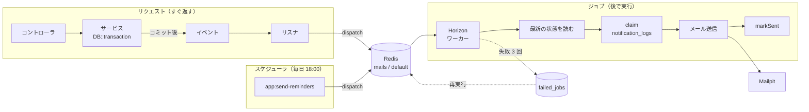
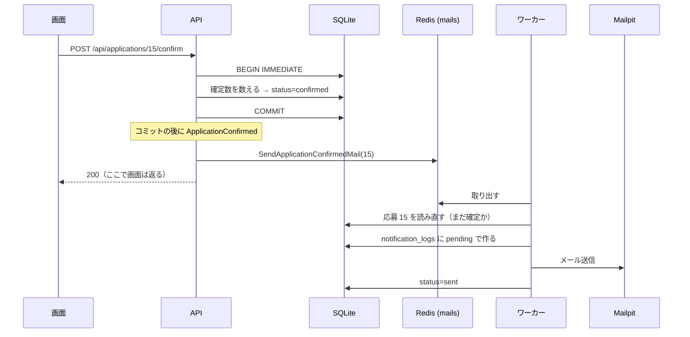
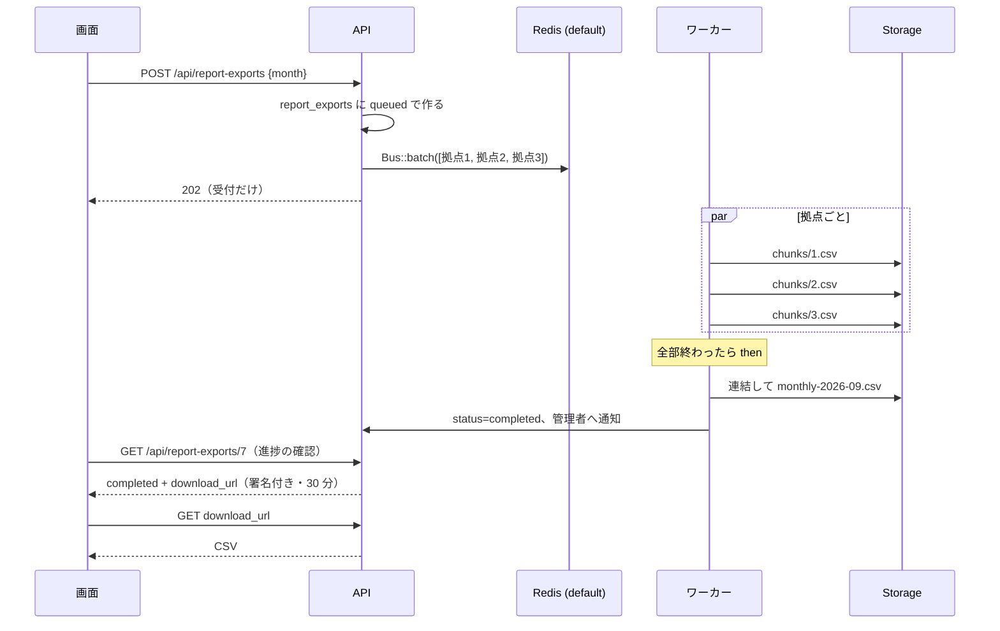
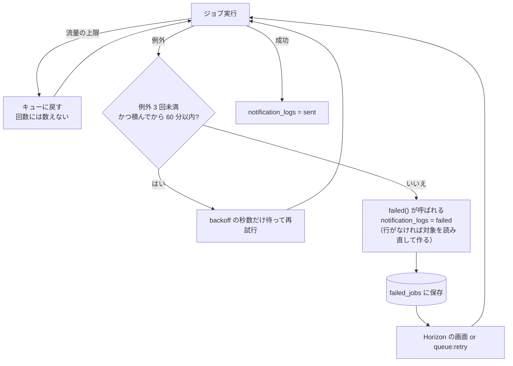

# 非同期処理の設計 — 第3弾の主題（Job / Queue / メール / スケジューラ / バッチ）

作成日: 2026-10-01 / ステータス: **P4・P5 の実装後（2026-10-02）**。1〜9 章は実装に合わせて更新済み、10 章に「想定と実際」を書きました。

> 学習用ドキュメントです。読めば「確定ボタンを押してからメールが届くまで」を頭の中で 1 周できる粒度を目指しています。
> 契約（クラス名・テーブル）は [`01_技術仕様_next.md`](01_技術仕様_next.md) の 3.2 と 8 章、書くときの型は `.claude/skills/async-rules/SKILL.md` にあります。

---

## 1. なぜ非同期にするのか

要件 4.7 と 7 章が求めているのは 3 つです。

| 要件 | 意味 | 同期のままだと何が困るか |
|---|---|---|
| 操作の応答が送信を待たない | 承認ボタンを押したらすぐ画面が返る | メールサーバが遅い・落ちていると、承認そのものが遅い・失敗する |
| 同じ通知を二重に送らない | 再試行しても、コマンドを 2 回実行しても 1 通 | 失敗して再試行する仕組みを入れた瞬間に、二重送信の危険が生まれる |
| 失敗が記録され、再実行できる | 誰に届いていないかが後から分かり、送り直せる | 例外でログに出るだけだと、気づけないし送り直せない |

2 つ目が今回いちばん考える点です。**「再試行できる」と「二重に送らない」は放っておくと両立しません。** 両立させる仕組みが冪等性（4 章）です。

Rails で言うと、Active Job + Sidekiq + Action Mailer の `deliver_later` に当たります。

---

## 2. 全体図



登場するもの:

| 部品 | 役割 | 実体 |
|---|---|---|
| キュー | ジョブを溜める場所 | Redis。`mails`（メール）と `default`（CSV 生成）の 2 本 |
| ワーカー | キューからジョブを取り出して実行する常駐プロセス | `php artisan horizon`（`make horizon`） |
| Horizon | ワーカーの管理と監視画面 | http://localhost:8002/horizon |
| スケジューラ | 決まった時刻にコマンドを起動する | `php artisan schedule:work`（`make schedule`） |
| Mailpit | 開発用のメール受信箱 | http://localhost:8025 |
| Telescope | 1 つのリクエストやジョブの中で何が起きたかを見る | http://localhost:8002/telescope |

**ワーカーを起動していないと、ジョブは積まれるだけで実行されません。** 手動チェックリストの A-2 はこれを逆手に取って「応答が送信を待っていない」ことを確かめます。

---

## 3. 題材ごとの流れ

### 3.1 F-20 確定通知（キューの基本）



学ぶ点:

| テーマ | 内容 |
|---|---|
| コミット後に積む | イベントに `ShouldDispatchAfterCommit` を付ける。付けないと、ワーカーがコミット前に動いて「応募が見つからない」になり得るし、ロールバックされた確定の通知が出てしまう |
| ID を渡す | ジョブには応募のID だけを渡す。実行時に読み直すので、確定の直後にキャンセルされていたら送らない |
| サービスはメールを知らない | サービスは `event(new ApplicationConfirmed($id))` を呼ぶだけ。積むのはリスナ |

**学習の進め方**: 最初は「キューに入る Mailable」だけで作ります（`Mail::to(...)->queue(new ApplicationConfirmedMail(...))`）。これがいちばん短い形で、Horizon にジョブが見えるところまで体験できます。次に F-21 に進む前に、4 章の冪等性を入れるためジョブに包み直します。**なぜ包み直す必要があるかを体験するのが狙い**です。

### 3.2 F-21 募集中止時の一括通知（失敗の分離）

確定済みワーカーが 3 名いる募集を中止すると、ジョブを **3 つ** 積みます。1 つのジョブで 3 通送りません。

| 1 ジョブで 3 通 | 3 ジョブで 1 通ずつ（採用） |
|---|---|
| 2 通目で失敗すると 3 通目が送られない | 2 通目が失敗しても 1 通目と 3 通目は届く |
| 再試行すると 1 通目がもう一度送られる | 失敗した 1 つだけが再試行される |

学ぶ点:

| テーマ | 内容 |
|---|---|
| `$tries = 0` + `$maxExceptions = 3` + `retryUntil()` | 送信の例外が 3 回出たら打ち切る。流量制限（RateLimited）で戻された回は数えない。積んでから 60 分（`myteam.mail_retry_until_minutes`）過ぎても送れなければ打ち切る（P4-03 で決定。`$tries = 3` だと流量で戻された回も数えられ、claim の前に failed になって「届いていない」記録が残らなかった） |
| `backoff()` | `[10, 60]`。1 回目の再試行は 10 秒後、2 回目は 60 秒後。すぐ再試行しても同じ理由で失敗するため |
| `failed()` | 打ち切った後に 1 回だけ呼ばれる。ここで `notification_logs` を `failed` にする |
| `failed_jobs` | 失敗したジョブが丸ごと残るテーブル。Horizon の画面か `php artisan queue:retry <id>` で再実行できる |
| `RateLimited` ミドルウェア | 一度に大量に積んでも、1 分あたりの送信数を抑える。既定 60 通/分（`myteam.mails_per_minute`）で、**全社・全種類のメールで共通の 1 つの枠**（メールサーバー側の制約なので企業ごとに分けない。P4-03 で決定）。副作用として、1 社が大人数の募集を中止すると他社のメールが後ろで待たされる（遅れるだけで失われない。60 分を過ぎたら failed になり記録に残る） |

`JobPostingCancelled` イベントは「この中止でキャンセルになった応募のID の配列」を持ちます。中止の後に応募を読むと全部キャンセル済みで、どれが今回の中止によるものか区別できないからです。

### 3.3 F-22 前日リマインド（定時実行と「2 回送らない」）

```
routes/console.php:
  Schedule::command('app:send-reminders')->dailyAt(config('myteam.reminder_time'))->withoutOverlapping();

app:send-reminders {--date=}:
  対象日 = --date があればそれ、なければ明日
  企業ごとに CurrentCompany::runAs(...) で
    勤務日が対象日 かつ 確定 の応募ごとに SendShiftReminderMail(応募ID) を積む
```

「2 回送らない」を 3 段で守ります。

| 段 | 仕組み | 何を防ぐか |
|---|---|---|
| 1 | `withoutOverlapping()` | 前回の実行が終わらないうちに次が始まる |
| 2 | ジョブの `ShouldBeUnique`（`uniqueId` は応募ID） | コマンドを 2 回実行したとき、同じジョブを 2 つ **積む** |
| 3 | `notification_logs.dedupe_key` の UNIQUE | 一度送った（sent になった）後の再実行・再投入で、2 通目を **送る** |

1 と 2 はキャッシュのロックなので、キャッシュを消せば外れます。DB の UNIQUE 制約は外れません。

**ただし 3 が防ぐのは「送信済みの後」だけです**（P4-01 の database-reviewer の指摘で書き直した）。2 つのジョブが**同時に**同じ送信待ちの行を受け取ると、両方が送ります。これを止めているのはジョブの `WithoutOverlapping`（キャッシュのロック）で、保証は at-least-once（少なくとも 1 回）の範囲です。DB で厳密に止めたい場合は、`claimed_at` 列を足して「条件付き UPDATE の影響行数が 1 のときだけ送る」形にします（新しいマイグレーションで後から足せる。人の判断待ち）。

処理を Artisan コマンドに書くのは、手で実行できるようにするためです（`php artisan app:send-reminders --date=2026-09-20`）。スケジューラの時刻を待たずに確かめられ、テストからも `$this->artisan(...)` で呼べます。Rails の rake タスクに当たります。

### 3.4 F-23 月次集計の非同期出力（バッチ）



学ぶ点:

| テーマ | 内容 |
|---|---|
| 202 Accepted | 「受け付けたが、まだ終わっていない」を表すステータス。画面は受付番号（出力ID）を受け取る |
| `Bus::batch()` | 複数のジョブを 1 つのまとまりとして扱う。進捗（何％終わったか）が取れる |
| `then` / `catch` | 全部成功したら `then`、どれかが失敗したら `catch`。ここで出力の状態を `completed` / `failed` にする |
| `job_batches` | バッチの進捗を持つテーブル。キューが Redis でも DB に置かれる |
| Storage | ファイルの置き場所を抽象化する。今回は `local` ディスク（`storage/app/private`）。コードを変えずに S3 に替えられる |
| 署名付きURL | URL に期限と署名が入っている。**URL を持っていること自体が認可**。署名は `APP_KEY` で作るので、改ざんすると合わなくなる |
| Notification | 完了の通知は Mailable ではなく Notification で書く。1 つの通知を `mail` と `database`（と P6 の `broadcast`）の複数チャネルに出せる |

進捗の見せ方は、画面を開き直すと最新の状態が出る形にします（Server Component なので再読み込みすれば取り直す）。自動で切り替わるのは F-25（Could）です。

拠点が 0 件のときは空のバッチを作らず、連結の処理を直接呼びます（ヘッダだけの CSV ができる）。

### 3.5 F-19 ダッシュボードのキャッシュ

```
取得: Cache::remember("dashboard:{企業ID}", 有効期限, fn () => 集計する)
      有効期限 = 「設定の秒数後（myteam.dashboard_cache_seconds、既定 300）」と「翌日 0:00」の早い方
破棄: Application / JobPosting / Location が保存・削除された後（コミット後）に DashboardService::forget($model->company_id)
```

| テーマ | 内容 |
|---|---|
| キーに企業ID | 入れないと、A 社の集計が B 社に見える |
| 破棄はコミット後 | トランザクションの途中で破棄すると、別のリクエストがコミット前の古い値でキャッシュを作り直してしまう。Observer に `ShouldHandleEventsAfterCommit` を付ける |
| 破棄を Observer に置く | サービスの各メソッドに `forget()` を書くと、新しい経路を足したときに漏れる。モデルが変わったら必ず破棄される形にする |
| `generated_at` | いつ集計した値かを応答に入れる。キャッシュが効いているかが画面で分かる |
| テストは `array` ストア | Redis がなくても同じコードで動く |
| 日付をまたぐ（P4-07 で決定） | 「今日以降の募集」は作った時点の日付で決まるので、有効期限を翌日 0:00 で切る。キーに日付を入れる案は、`forget()` がどの日のキーを消すかを計算する必要があり、0:00 をまたいだ破棄で前日のキーが残るので採らない |
| Location も対象（P4-07 で追加） | 一覧に拠点名を出しているので、拠点名の変更でも破棄する |
| 消すのは持ち主の企業 | Observer は CurrentCompany ではなく、変更されたモデルの `company_id` の企業のキャッシュを消す |
| 設定が 0 以下 | キャッシュしない（毎回集計する） |
| 既知の制限 | 集計の途中に別の更新がコミットされると、その古い集計が後から書き込まれ、最長で設定の秒数だけ古い値が残る。一括の `query()->update()` はモデルのイベントを出さないので Observer を通らない（今のサービスには一括更新はない） |
| Redis のキーの衝突 | 同じ Redis を他の弾と共有するときに備え、`CACHE_PREFIX` / `REDIS_PREFIX` / `HORIZON_PREFIX` を `.env.example` に明記する（既定は APP_NAME 由来で、書き忘れると別アプリの `dashboard:1` と同じキーになる） |

---

## 4. 冪等性（同じ通知を二重に送らない）

### 4.1 何が起きると二重になるか

| きっかけ | 例 |
|---|---|
| 再試行 | メール送信がタイムアウトで例外になったが、実は届いていた → 再試行でもう 1 通 |
| 二重投入 | コマンドを 2 回実行した。ボタンを 2 回押した |
| 手動の再実行 | `failed_jobs` から再実行した |
| ワーカーの異常終了 | 実行中にプロセスが落ち、タイムアウト後に別のワーカーが同じジョブを拾った |

### 4.2 守り方

`notification_logs` に「何を誰に送ったか」を 1 通 1 行で持ち、`dedupe_key` に UNIQUE 制約を付けます。

```
claim(キー):
  行がない          → pending で作って返す（送ってよい）
  行があって sent    → null を返す（送らない）
  行があって pending / failed → その行を返す（送り直してよい）

ジョブ:
  log = claim(...)
  if log == null: return
  メール送信
  markSent(log)
```

| 通知 | `dedupe_key` |
|---|---|
| 確定通知 | `application_confirmed:application:{応募ID}` |
| 中止通知 | `posting_cancelled:application:{応募ID}` |
| 前日リマインド | `shift_reminder:application:{応募ID}` |
| 出力完了 | `export_ready:report_export:{出力ID}` |

同じキーのジョブが同時に 2 つ走るのは、ジョブミドルウェア `WithoutOverlapping(キー)` で防ぎます。

### 4.3 正直な限界

「メール送信」と「`sent` と記録する」は別々の操作で、1 つのトランザクションにできません。順序は 2 通りあり、どちらにも穴があります。

| 順序 | 送信の後・記録の前に落ちたら | 性質 |
|---|---|---|
| **送信 → 記録**（採用） | 再試行でもう 1 通送る | 最低 1 回は届く（at-least-once）。まれに 2 通 |
| 記録 → 送信 | `sent` になっているので送らない | 最大 1 回（at-most-once）。まれに 0 通 |

確定通知やリマインドは「届かない」より「まれに 2 通届く」方が害が小さいので、送信 → 記録を選びます。**「絶対に 1 回だけ」は、相手（メールサーバ）と同じトランザクションに入れない限り作れません。** テストで示すのは「ジョブを 2 回実行しても 1 通」「コマンドを 2 回実行しても 1 通」の 2 つで、これが要件 7 章の「設計で保証し、テストで示す」に当たります。

---

## 5. 失敗したとき



| 見る場所 | 分かること |
|---|---|
| Horizon の Failed Jobs | 失敗したジョブ、例外のメッセージ、再実行ボタン |
| `failed_jobs` テーブル | 同じものの実体。`php artisan queue:failed` で一覧 |
| `notification_logs` | 業務の言葉での記録。「誰への何の通知が失敗したか」。F-24 の画面はこれを出す |
| Telescope の Jobs / Mail | 1 つのジョブが発行したクエリと送ったメール |

`failed_jobs` と `notification_logs` の両方に残すのは役割が違うからです。前者は「ジョブをもう一度実行する」ための技術的な記録、後者は「管理者が誰に届いていないかを知る」ための業務の記録です。

**わざと失敗させる方法**（手動チェックリスト A-4）: `docker compose stop mailpit` で SMTP を止めてから募集を中止する → 3 回失敗するのを Horizon で見る → `docker compose start mailpit` → Horizon から再実行 → 届く。

---

## 6. テナント（どの企業として動くか）

ジョブにはログインユーザーがいません。`auth()->user()` で企業を決めていると、ジョブの中では条件が外れます。

| きっかけ | 企業の決まり方 |
|---|---|
| リクエスト中に積んだジョブ（F-20、F-21、F-23） | ミドルウェアが `CurrentCompany::set()` → Laravel の Context に入る → **Context は積んだジョブに自動で引き継がれる** |
| スケジューラが積んだジョブ（F-22） | コマンドが企業ごとに `CurrentCompany::runAs()` の中で積む → 同じく Context で引き継がれる |
| 署名付きURL のダウンロード | ログインも Context もない。出力ID から行を `withoutGlobalScopes()` で読む（署名で認可済み。理由をコメントに書く） |

`CurrentCompany::id()` は未設定なら例外を投げます。黙って全件を返すより、止まる方が安全だからです。

Rails の `ActiveSupport::CurrentAttributes` に当たります。Rails では Sidekiq のジョブに `Current` を引き継ぐのに自前のミドルウェアが要りますが、Laravel の Context は標準で引き継ぎます。

---

## 7. SQLite と同時書き込み

P4 から、同じ SQLite ファイルに Web（`artisan serve`）、ワーカー（Horizon）、Telescope が同時に書きます。SQLite は書き込みを同時に 1 本しか通しません。

| 設定 | 値 | 効果 |
|---|---|---|
| `journal_mode` | `WAL` | 読み取りが書き込みを待たない |
| `busy_timeout` | `5000` | 書き込みが重なったとき、5 秒まで待つ |
| `transaction_mode` | `IMMEDIATE` | トランザクションの開始時に書き込みロックを取る。途中で「昇格できずに失敗」が起きない |
| Horizon のプロセス数 | `mails` 2、`default` 2 | 同時に書くワーカーを少なくする |

ジョブ側の規約: **トランザクションを短くする。メール送信やファイル書き込みをトランザクションの中でしない。**

`database is locked` が出たら、まず Telescope を止めます（`TELESCOPE_ENABLED=false`）。それでも出るなら Horizon のプロセス数を 1 にします。

---

## 8. Horizon と Telescope

| | Horizon | Telescope |
|---|---|---|
| 見るもの | キューの今（溜まっている数、処理速度、失敗） | 1 つのリクエストやジョブの中身（クエリ、メール、キャッシュ、例外） |
| 役割 | ワーカーの起動と制御も兼ねる | 見るだけ |
| 認証 | `viewHorizon` Gate: ローカル環境かつログイン済み管理者 | `viewTelescope` Gate: 同じ |
| 本番 | 使う | 通常は使わない（開発用） |

Horizon の設定（`config/horizon.php` の `local` 環境）:

| スーパーバイザ | キュー | プロセス数 | tries |
|---|---|---|---|
| `supervisor-mails` | `mails` | 最大 2 | 3 |
| `supervisor-default` | `default` | 最大 2 | ジョブ側の `$tries = 3` が優先（チャンクは拠点ごとのファイルを上書きするので再試行しても行は二重にならない。最後まで失敗したら `catch` で受ける。P4-05 で決定） |

Horizon の画面はブラウザから Laravel を直接開きます。管理画面にログインしていれば、セッション Cookie が `localhost` 共通なのでそのまま入れます。

Rails で言うと、Horizon が Sidekiq の Web UI とプロセス管理、Telescope が rack-mini-profiler とログビューアを合わせたものです。

---

## 9. 実装の順番（P4）

1 つずつ `/issue-flow` で回します。並列にしません。

| # | タスク | 学ぶこと | 終わりの確認 |
|---|---|---|---|
| N0 | 基盤: `.env` 切り替え（人）、Horizon、Telescope、`notification_logs` とサービス、morph map | Redis キュー、Horizon の起動、ポリモーフィック | `make horizon` が動き、画面に入れる。未ログインだと 403 |
| N1 | F-20: まず「キューに入る Mailable」で → ジョブに包み直す | キューの基本、after-commit、冪等性 | A-1、A-2。`NotificationIdempotencyTest` |
| N2 | F-21 | 失敗の分離、`tries` / `backoff` / `failed`、再実行 | A-3、A-4。`FailedJobTest` |
| N3 | F-22 | Artisan コマンド、スケジューラ、`ShouldBeUnique` | A-5、A-6 |
| N4 | F-23（api）→ 画面（web） | バッチ、Storage、署名付きURL、Notification、202 | A-7、A-8 |
| N5 | F-19 のキャッシュ化 | `Cache::remember`、Observer、コミット後の破棄 | A-9 |

P5 で F-24（通知履歴の API と画面）を足します。データは N0 からすでに溜まっています。

---

## 10. 想定と実際（P4・P5 の後に追記）

2026-10-02 に P4・P5 の実装を終えた時点の記録です。**Horizon / Telescope は人の承認待ち（P4-01b）で未導入、`api/.env` もまだ P4 の値に切り替わっていない**ため、Redis・Horizon・Telescope の実物で確かめる行は「未確認」と書いています。テストで確かめたことと、実物で確かめたことを分けて書きます。

| 観点 | 想定（2026-10-01） | 実際 | 差の理由 |
|---|---|---|---|
| Context がジョブに引き継がれる | 何も書かなくても引き継がれる | **想定どおり引き継がれた。** P4-02 で `php artisan queue:work --once` を使い実物で確認した（docs/01 13 章 #4）。さらに `failed()` の時点でも `CurrentCompany` は戻っていた。テストは `ApplicationConfirmedMailTest::test_ジョブはcontextから企業を引き継ぐ` と `::test_3回失敗するとfailedが積んだジョブのcontextで呼ばれnotification_logsがfailedになる` | 差はない。想定より 1 つ多く分かったのは、ワーカーが `JobProcessing` の時点で Context を戻してから試行回数の超過を判定するので、`failed()` の中でも企業が分かること。これで `failed()` から `notification_logs` を自社の行として更新できた |
| `transaction_mode=IMMEDIATE` で `database is locked` が出ない | Horizon 2 + 2 プロセスなら出ない | **Horizon での同時書き込みは未確認。** 確かめたのは P2-01 の 2 プロセス（後の `DB::transaction()` が開始で約 2 秒待った = `BEGIN IMMEDIATE`）だけ。その過程で、PHP 8.3 では `transaction_mode` が黙って効かないことが分かり、`composer.json` を `^8.4` にした | Horizon が未導入で、`.env` のキューもまだ `database`。P4-01b の後に A-1〜A-4 を回すときに見る |
| F-20 を Mailable からジョブに包み直す手間 | 30 分程度 | **時間は測っていない。** 作業量で言うと、Mailable 版（`Mail::to()->queue()`）は 3 ファイル・テスト 1 本で緑になった。ジョブ化では、ジョブ 1 本の追加（`claim` → 送信 → `markSent`、`failed()`、`WithoutOverlapping`、`backoff`）、リスナの書き換え、Mailable から `Queueable` / `SerializesModels` を外す、テストを `Mail::assertQueued` から「`Queue::assertPushedOn` で積まれたか」と「`handle()` を直接呼んで実行したらどうなるか」の 2 本に分け直す、が要った（STATE の P4-02 の備考） | 手間の中心は「包む」ことではなく、テストの書き方が変わることだった。Mailable 版はキューを意識しないテストで済むが、ジョブ版は「積まれたか」と「実行したらどうなるか」を別々に検証する（`rules/common/testing.md`）。冪等性を入れると、送信済みのとき・失敗したときのテストも増える。`Mail::shouldReceive()` の後に `Mail::fake()` を呼ぶと落ちる、という fake の落とし穴にも当たった（learnings） |
| 再試行で二重送信が起きる場面 | テストでしか再現できない | **テストで「ジョブを 2 回実行しても 1 通」「コマンドを 2 回実行しても 1 通」「失敗後の再送で 1 通」を示した**（`NotificationIdempotencyTest`）。実物（Redis + ワーカー）での再現はしていない。レビューで分かったのは別の穴が 2 つ: ① 同時に 2 本走ると DB の UNIQUE では止まらない（database-reviewer）→ `WithoutOverlapping` で抑え at-least-once と明記（3.3）② 流量制限で戻された回も `$tries` に数えられ、送らないまま failed になり記録が残らない（tester が再現）→ `$tries = 0` + `$maxExceptions` + `retryUntil()` | 想定は「再試行で二重に送る」側だけを考えていたが、実際に問題になったのは「同時に 2 本」と「送らないまま失敗」だった。どちらも Laravel のキューの数え方（後回し・戻しも 1 回の試行に数える）を知らないと気づけない |
| `failed_jobs` からの再実行 | Horizon のボタン 1 つ | **Horizon が未導入で未確認**（A-4）。テストでは `FailedJobTest` で「`failed()` が呼ばれると `notification_logs` が failed になり error が残る」「失敗した通知を `handle()` で再実行すると sent になる」「1 件の失敗は他の応募のジョブに影響しない」を示した。`php artisan queue:retry` も実物では試していない | P4-01b の後に人が確かめる。再実行で sent になる仕組み（`claim()` が failed の行を返す）はテストで担保した |
| バッチの進捗 | `job_batches` から 0〜100 が取れる | **取れた。** `ReportExportResource` が `job_batches` から「(全ジョブ - 残り) / 全ジョブ」（`Batch::progress()` と同じ式）を返し、`completed` は 100。ただし sync キュー（テスト）では `dispatch()` の中で `then` まで走り、バッチ全体が 1 つのトランザクションに入るので、`catch` で入れた failed は巻き戻った → processing への切り替えは `before()`、失敗は `dispatch()` の呼び出し側で入れる形にした | 進捗の取り方は想定どおり。想定外だったのは、キューの接続（sync と Redis）でコールバックの動く場所とトランザクションの範囲が違うこと。どちらでも同じ順（batch_id → processing → チャンク）になるよう書いた |
| 署名付きURL を認証の外に置いたこと | 問題なく動く | **テストでは動いた**（ダウンロードできる、31 分後は 403、`signature` の改ざんは 403、他社は 404）。ブラウザでの確認（A-8）はまだ。実装中に足したもの: 403 の文言を日本語に、応答に `no-store`、URL は取得のたびに作り直してメールには入れない、ダウンロードの判定はサービスに置き、`withoutGlobalScopes()` で読むのは `file_path` だけ | 「URL を持っていること自体が認可」なので、URL が長く残る場所（メール）に入れないことを実装中に決めた |
| Telescope と SQLite の相性 | 書き込みが増えるが実用になる | **Telescope が未導入で未確認** | P4-01b の後に確かめる。`phpunit.xml` には `TELESCOPE_ENABLED=false` を先に入れてある |
| P4 の所要時間 | 12h | **作業時間は測っていない。** コミットの時刻では「P4 開始」（2026-10-01 22:09）から P4-07（2026-10-02 10:49）まで。これは人が不在の夜間を含む壁時計の時間で、作業時間ではない。STATE の見積は P4 全体で 14.5h だった | 計測の仕組みを用意していなかった。差し戻しは P4-01（security の重大）、P4-03（tester の再現）、P4-05（database の重大）の 3 タスクで 1 周ずつ |
| 通知履歴の一覧（P5 で追加） | `morphWith` で N+1 を避ける（docs/02 5-1） | **想定どおり。** `NotificationLogController` で `with()` の中に `morphTo` ごとの読み方を書き、宛先の `User` は `constrain()` で企業に絞り、対象が応募のときだけ `morphWith()` で募集とワーカーを続けて読む。宛先・対象の行がもうないときも落とさない | 差はない。レビューで足したのは「読む側でも宛先を企業で絞る」こと（書く側の `claim()` の検査に加えて二重に守る） |

---

## 参考（日本語ドキュメント）

- キュー: https://readouble.com/laravel/13.x/ja/queues.html
- Horizon: https://readouble.com/laravel/13.x/ja/horizon.html
- メール: https://readouble.com/laravel/13.x/ja/mail.html
- 通知: https://readouble.com/laravel/13.x/ja/notifications.html
- イベント: https://readouble.com/laravel/13.x/ja/events.html
- タスクスケジュール: https://readouble.com/laravel/13.x/ja/scheduling.html
- Artisan コンソール: https://readouble.com/laravel/13.x/ja/artisan.html
- キャッシュ: https://readouble.com/laravel/13.x/ja/cache.html
- ファイルストレージ: https://readouble.com/laravel/13.x/ja/filesystem.html
- URL 生成（署名付きURL）: https://readouble.com/laravel/13.x/ja/urls.html
- Context: https://readouble.com/laravel/13.x/ja/context.html
- Telescope: https://readouble.com/laravel/13.x/ja/telescope.html
- Eloquent リレーション（ポリモーフィック）: https://readouble.com/laravel/13.x/ja/eloquent-relationships.html
