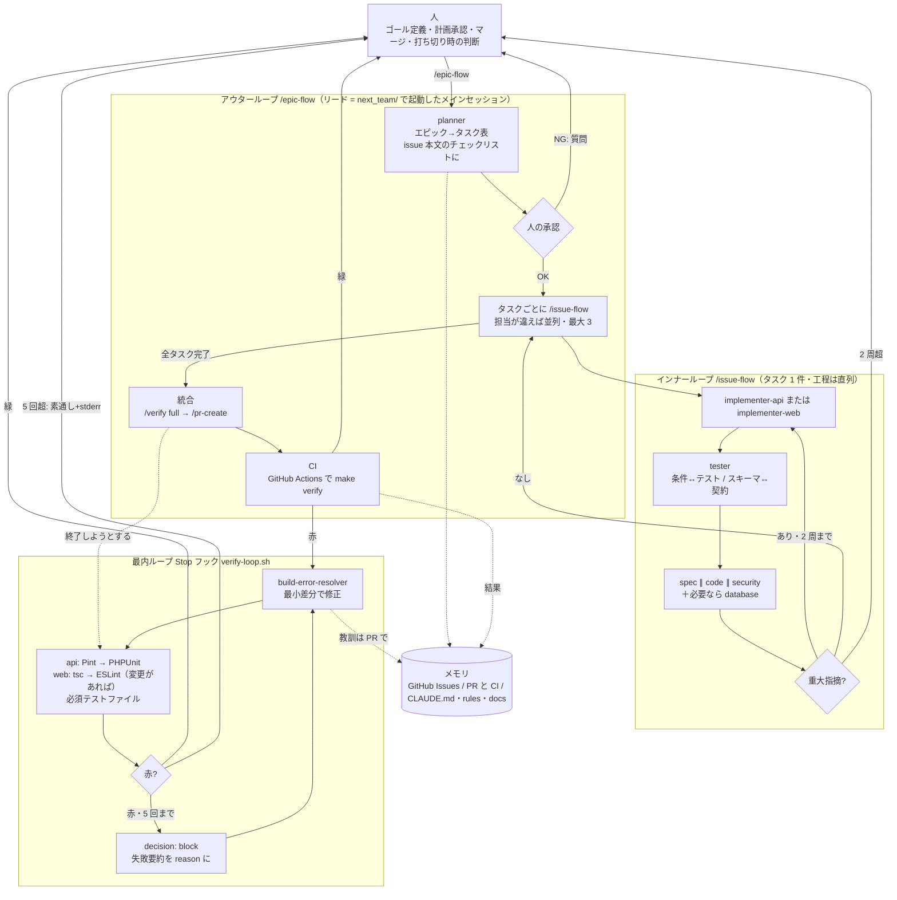
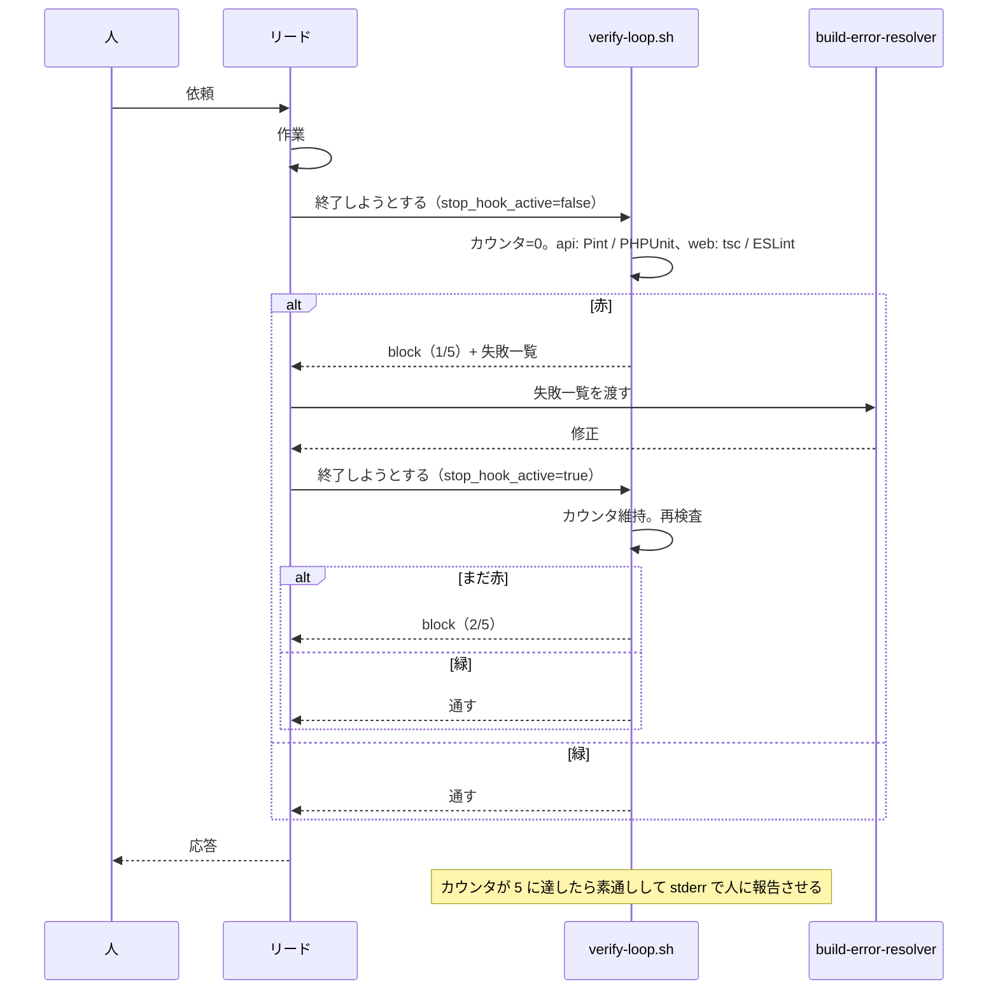

# ループエンジニアリング — 第3弾で「3 層のループ」がどう動くか

作成日: 2026-10-01 / 更新: 2026-10-02 / ステータス: **P1〜P5 の実績を 9 章に記入済み**。1〜8 章は P0 時点の想定のままで、実際と違った点は 9 章に書いています。

> 学習用ドキュメントです。読めば頭の中で 1 周回せる粒度を目指しています。
> 第2弾 `ecc_team/docs/04_ループエンジニアリング.md` からの差分更新です。理論（1 章）は同じで、動作仕様（3 章以降）が 2 スタックに変わっています。

**最初に読む人へ**: いちばん大事なのは 7 章のゲート確認です。第2弾では、セッションを親フォルダで起動したためにフックが 1 回も発火しませんでした。今回は開発に入る前に「セッションの中でループが回ること」を確かめます。

---

## 1. 用語と理論

### 1.1 ループエンジニアリングとは

「AI に指示を出す」のをやめ、**AI に指示を出し続ける仕組み（ループ）を設計する**ことです。人はゴールを定義し、仕組みの中で AI が自分で実行・検証・次の判断を繰り返します。ゴールに到達するまで止まらず、詰まったら決められた条件で人に戻します。

| 世代 | 名前 | 設計対象 | 第3弾での対応 |
|---|---|---|---|
| 1 | プロンプトエンジニアリング | 1 回の指示文 | エージェント定義の本文、スキルの手順 |
| 2 | コンテキストエンジニアリング | モデルに見せる情報 | `CLAUDE.md`、rules、docs/01 の契約、Next 16 の同梱ドキュメント |
| 3 | ハーネスエンジニアリング | 制約・ツール・検証の環境 | hooks（強制）、permissions、agents の tools 制限、`Makefile` |
| 4 | ループエンジニアリング | 環境を自動で回し続ける仕組み | epic-flow / issue-flow / Stop フックの 3 層 + `state/` のメモリ |

上位の世代は下位を内包します。

### 1.2 理論的土台

- **ReAct**: 考える → 行動する → 観測する → また考える。「書く → 実行 → エラーを見る → 直す → テストが通る」
- **Reflexion**: 失敗を言葉にして記録し、次の試行で活かす。このプロジェクトでは、教訓を効かせたい場所（`CLAUDE.md`・`.claude/rules/`・スキル・docs）に PR で直接書く（2026-10-15 までは専用の記録ファイルに貯めていた。10 章）

### 1.3 5+1 の部品とこのプロジェクトでの実体

| 部品 | 役割 | 実体 |
|---|---|---|
| 1 自動化 | ループを起動する | Stop フック `verify-loop.sh`、SubagentStop、PostToolUse。人は `/epic-flow` でアウターループを起動 |
| 2 ワークツリー | 並列作業の衝突を防ぐ | docs/01 10 章の所有ファイル表 + `protect-files.sh` のロック。P0 では「git ワークツリーは使わない」（docs/00 5 章）としたが、**実際は P2 と P3 の並列で git worktree を使った**（docs/00 決定 35、9 章） |
| 3 スキル | プロジェクト固有の手順を永続化 | `.claude/skills/` の 14 個 |
| 4 コネクター | 外部ツールとの接続 | 意図的に最小（git、gh、make、Docker。MCP なし）。チームの関門として GitHub Actions の CI |
| 5 サブエージェント | 作る役と確認する役の分離 | `.claude/agents/` の 9 体。レビュー系は読み取り専用 |
| +1 メモリ | セッションの外に状態を残す | GitHub Issues（タスク）、CI と PR（合否と差し戻しの履歴）、`CLAUDE.md`・rules・docs（教訓）。`session-context.sh` が起動時に open の issue と直近のコミットを読み戻す |

### 1.4 ルール定義の 4 要件 → `.claude/rules/common/loop-rules.md`

| 要件 | 意味 | 実装 |
|---|---|---|
| 明確なゴール定義 | 完了が一言で言える | api はテスト名、web は tsc / ESLint の緑と手動チェック項目の番号 |
| 安全な作業環境 | 失敗しても全体を壊さない | 所有ファイル、ロック、`guard-bash.sh`、`protect-files.sh` |
| 機械的な成功判定 | 合否を自動で判定 | Pint・PHPUnit・tsc・ESLint を Stop フックが強制実行し、PR では CI が同じ `make verify` を回す |
| ハードストップ | 無限ループ・暴走の防止 | 検証ループ 5 回、レビュー 2 周、質問 2 往復。超えたら `requires-human` |

「AI はスーパーエンジニアではなく **粘り強いジュニアのチーム**」。曖昧な指示だと変な方向に行き、制限がないと無限にやる。だからルールを定義します。

---

## 2. 3 層のループの全体図



実線は制御の流れ、点線はメモリへの書き込みです。

人が現れる場所は 5 つです: 起動、計画の承認、最終確認とマージ、ハードストップ、フックと `settings.json` の変更の承認。2026-10-15 まではフェーズの移行もありました（10 章）。

---

## 3. 層ごとの動作仕様

### 3.1 アウターループ `/epic-flow`

| 項目 | 内容 |
|---|---|
| 起動条件 | 人が `/epic-flow <issue 番号>` を打つ（`disable-model-invocation: true` なので AI は勝手に始めない） |
| 入力 | エピック = タスクが複数ある GitHub issue 1 つ（P1〜P5 はフェーズ名 `p1-skeleton` などだった） |
| 読むもの | `../00_要件定義.md`、`docs/01_技術仕様_next.md`、`gh issue view <番号>` |
| 書くもの | issue 本文（タスク表のチェックリスト。リードが書く）、`git switch -c issue/<番号>`、最後に PR（`Closes #<番号>`） |
| 判定基準 | issue 本文のタスクが全部チェック済み かつ `/verify full` が緑 |
| 戻し先 | planner の質問 → 人。`requires-human` ラベル → 人 |
| 停止条件 | 質問 2 往復で未解消、同一タスクが 2 回人の判断待ち |
| 人の介入 | 計画承認（チェックポイント 1。**リードは代行しない**）、最終確認と `main` へのマージ（チェックポイント 2）、フェーズ移行 |
| 並列の上限 | 実装 3 体・レビュー 4 体 |

### 3.2 インナーループ `/issue-flow`

| 項目 | 内容 |
|---|---|
| 起動条件 | epic-flow から、または人が単発で `/issue-flow <issue 番号> [タスクID]` |
| 入力 | issue 本文のタスク 1 件（担当・所有ファイル・完了条件）。小さな issue ならその issue そのもの |
| ステップ | ① implementer（api は RED→GREEN→REFACTOR、web はスキーマ→ページ→Action→フォーム）② tester ③ spec / code / security（＋ database）を **並列** ④ 重大指摘があれば ① へ（最大 2 周）⑤ 完了。**①②③④ の間は直列** |
| 読むファイル | docs/01、`myteam-domain-rules`、`laravel-api-standards` または `next-coding-standards`、P4 は `async-rules` |
| 書くファイル | 所有ファイルのみ。完了時にリードが issue 本文のチェックを 1 回付ける（工程ごとの状態は書かない） |
| 判定基準 | api: `make api-test FILTER=<担当クラス>` と Pint が緑。web: tsc と ESLint が緑。レビュー表に `重大` なし |
| 戻し先 | `重大` → implementer。tester の「実装不具合の疑い」→ implementer |
| 停止条件 | 2 周で `重大` が残る → issue に `requires-human` ラベル + 指摘をコメント |
| 副作用 | SubagentStop フックが担当の終了時に、変更した PHP の `php -l` + Pint、変更した TS の ESLint だけ検査（全テスト・全体の型チェックは回さない） |

### 3.3 最内ループ Stop フック `verify-loop.sh`

| 項目 | 内容 |
|---|---|
| 起動条件 | リード（メインセッション）が応答を終えようとするたび。人は何もしない |
| 入力 | stdin JSON の `stop_hook_active`（true = このフックの差し戻しで継続中 / false = ユーザー起点の終了） |
| 手順 | (0) 依存がどちらも未導入なら素通し (0.5) 担当が動いている印（`.claude/.running/`）があれば素通し (1) `stop_hook_active=false` ならカウンタを 0 に (2) カウンタ ≥ 5 なら打ち切り (3) 検査 (4) 赤ならカウンタ +1、`block` (5) 緑ならカウンタと web の印を消して終了 |
| 検査の中身 | **api**: `pint --test` → `php artisan test --compact`（毎回）。**web**: `next typegen` → `tsc --noEmit` → `eslint .`（web に変更があるときだけ）。**必須テストファイル**: 常に 6 つ |
| web に変更があるかの判断 | `.claude/.dirty-web` がある（`format.sh` が web の編集時に置く）、または `git status -- web` に変更がある |
| 回さないもの | `next build`（遅い）。`/verify full` で回す |
| 出力 | 赤: `{"decision":"block","reason":"検証ループ N/5: ..."}`。reason の見出しが `## api: ...` / `## web: ...` で、どちらのスタックかが分かる |
| ハードストップ | 5 回。素通しして stderr に「打ち切りました。人に報告し、issue に requires-human ラベルを」 |
| タイムアウト | 300 秒（`settings.json`） |

第2弾との違い:

| | 第2弾 | 第3弾 | 理由 |
|---|---|---|---|
| 段階による素通し | 初期のフェーズは素通し | **段階を持たず、常に回す** | ゲートで「わざと赤にして差し戻される」ことを確かめるため。2026-10-15 にフェーズの仕組みごと廃止（10 章） |
| 対象 | Pint + PHPUnit | + tsc + ESLint | 2 スタック |
| web の検査 | — | 変更があるときだけ | api だけ触っているときに毎回 10 秒待たないため |
| 必須ファイル | 3 種 + 動線 | + 冪等性 + 失敗ジョブ（常に 6 つ） | 要件 7 章の非同期の非機能要件 |
| 差し戻しの記録 | ファイルに追記 | **残さない** | チームの合否と履歴は CI と PR で見る（10 章） |

Stop フックと CI の関係: Stop フックは **手元の速い合否**（Claude が応答を終えるたびに、その場で差し戻す）、CI は **チームの関門**（PR ごとに同じ `make verify` を回し、main のブランチ保護で必須にする）。Stop フックは Claude が終了するときにしか走らず、人が手で書いたコミットや別の環境の違いは見えないので、最後の判定は CI に置きます。

### 3.4 その他のフック

| フック | いつ | 何をする |
|---|---|---|
| `session-context.sh`（SessionStart） | 起動・再開・圧縮後 | 起動場所（`next_team/` でなければ警告）、テスト数、未コミット数、ポート 8002 / 3002 を別の場所のプロセスが使っていないか、redis の起動、直近のコミット、今の issue と open の issue を出す。ループのカウンタを 0 に |
| `guard-bash.sh`（PreToolUse: Bash） | コマンド実行前 | deny: 広すぎる `rm -rf`、`git push --force`、`git reset --hard`、`git clean -f`、`DROP TABLE`、`db:wipe`、`docker compose down -v`、`main` への push。ask: Redis の全消去、失敗ジョブの消去、パッケージの追加。`issue/<番号>` への push は確認しない（合否は `make verify` と CI） |
| `protect-files.sh`（PreToolUse: Edit / Write） | 編集前 | deny: `.env`、ロックファイル、`vendor/`、`node_modules/`、`.next/`、`storage/`、SQLite ファイル、ロック後のマイグレーション。ask: フックと `settings.json`（毎回人が承認する） |
| `format.sh`（PostToolUse: Edit / Write） | 編集後 | api の PHP を Pint、web の TS / CSS / JSON を Prettier で整形。web を編集した印を置く |
| `detect-debug.sh`（PostToolUse: Edit / Write） | 編集後 | api の `dd()` `dump()` `var_dump()` `ray()`、web の `console.log()` が残っていたら block |
| `subagent-start.sh`（SubagentStart） | 担当の起動時 | 担当が動いている印を `.claude/.running/<agent_id>` に置く。印がある間、リードの Stop フックは検査を飛ばす |
| `subagent-check.sh`（SubagentStop） | 担当の終了時 | 変更ファイルだけの軽い検査（3.2 の副作用）。上限 2 回。稼働中の印は最初に消し、差し戻すときだけ置き直す（timeout で殺されても印が残らない）。差し戻しの回数は担当ごとに数える |

---

## 4. 具体シナリオのウォークスルー（想定）

P2 の担当 B「F-11 承認（確定）」を例に、1 周を追います。

1. 人が issue（例: #10「P2 ドメイン F-01〜F-19」）を作り、`/epic-flow 10` を打つ
2. `planner` が docs/01 の 10.2 を読み、issue 本文の下書きを返す。リードが issue に書く。その 1 件:
   ```
   - [ ] **B-3** F-11 承認
     - 担当: B / 所有ファイル: ApplicationController, ApplicationService, tests/Feature/ApplicationTest.php
     - 完了条件: test_定員に達していると承認できない ほか 3 件 / 依存: B-2
   ```
3. リードがタスク表を要約して人に見せる。人が承認する
4. リードが `/issue-flow 10 B-3` を実行する
5. `implementer-api` が `test_定員に達していると承認できない` を書く → `make api-test FILTER=定員に達していると承認できない` で赤 → `ApplicationService::confirm()` を実装 → 緑
6. implementer が終わる → SubagentStop フックが変更した PHP を `php -l` と Pint で検査 → 緑
7. `tester` が受け入れ条件と突き合わせ、「確定日時が記録される」のテストがないと報告して追加する
8. `spec-reviewer`・`code-reviewer`・`security-reviewer`・`database-reviewer` を同時に起動する
9. `database-reviewer` が「確定数を数えるクエリがトランザクションの外にある」を `重大` で指摘
10. リードが指摘表を `implementer-api` に戻す（1 周目）→ 修正 → tester → レビュー → 重大なし
11. issue 本文の B-3 にチェックを付ける（issue を更新するのはここだけ）。コミットメッセージに「レビュー 2 周」。次から防げる教訓があれば rules か docs に同じ PR で書き足す
12. リードが応答を終えようとする → Stop フックが api の Pint と全テストを回す → 担当 C の未完成のテストが赤 → block
13. （これは並列中にリードが終了しようとしたのが原因。リードは全担当の完了まで終了しない）

web のタスク（P3 の WB「募集詳細画面」）では、5 が「Next 16 の同梱ドキュメントを読む → zod スキーマ → ページ → Action → フォーム」、6 が ESLint、7 が「zod スキーマと docs/01 の 6 章の突き合わせ表」に変わります。12 の Stop フックは web の tsc と ESLint も回します。

---

## 5. Stop フック検証ループのシーケンス



### block メッセージの例（2026-10-01 に単体実行で確認した実物）

```
検証ループ 2/5: 以下を修正してから終了してください。修正後にもう一度終了すると再検証します。

## api: PHPUnit 失敗（make api-test FILTER=<テスト名> で再現）
  1 件失敗 / 3 件中
  FAILED Tests\Unit\GateTest::test_わざと落とす
    Failed asserting that 2 is identical to 1.
    /…/next_team/api/tests/Unit/GateTest.php:11

## web: 型エラー（make web-typecheck で再現）
lib/gate.ts(1,14): error TS2322: Type 'string' is not assignable to type 'number'.
```

### `verify-loop.sh` の読み方

| 番号 | 何をしているか |
|---|---|
| (0) | `api/vendor` も `web/node_modules` もなければ素通し |
| (0.5) | 担当が動いている印があれば素通し（待ち時間の終了では検査しない）。数えるのは 60 分以内の通常ファイルだけ。飛ばしたことは `systemMessage` で表示する |
| — | web を検査するかを決める（印か git の変更） |
| (1) | ユーザー起点の終了ならカウンタを 0 に |
| (2) | カウンタが 5 以上なら打ち切り |
| (3) | 検査。失敗を `FAIL` に見出しつきで溜める。`require` で必須ファイル 6 つを確かめる |
| (4) | 赤ならカウンタ +1、block |
| (5) | 緑ならカウンタと web の印を消す |

`stop_hook_active=true` のときに即終了してしまうと 1 周しか回りません。カウンタで周回を数えるのが要点です。

---

## 6. 状態ファイルの仕様（メモリ）

### GitHub Issues（タスクの状態。2026-10-13 から）
タスクの状態は GitHub Issues が正です。

| 何を | どこに |
|---|---|
| エピック | タスクが複数ある issue 1 つ。ブランチは `issue/<番号>` |
| タスク表 | issue 本文のチェックリスト `- [ ] **ID** タスク`（下に担当・所有ファイル・完了条件・依存）。planner が下書きし、リードが `gh issue edit` で書く |
| 完了 | リードがチェックを付ける（1 タスク 1 回）。最後は PR の `Closes #<番号>` で、人がマージすると閉じる |
| 人の判断待ち | `requires-human` ラベル + 理由のコメント |

`session-context.sh` は起動時に、ブランチ名から今の issue 番号と、`gh issue list` の open の issue（`requires-human` 付きは印つき）を出します。オフラインでは 5 秒で諦めます。

**なぜ `STATE.md` をやめたか**（issue #4）: 工程ごと（未着手 → 進行中 → レビュー中 → 完了）にエージェントが表を読み書きするので、手間とトークンがかかり、毎回の更新がうるさかった。git で管理するファイルなので、worktree やブランチを分けて並列に作業すると衝突する。issue と二重管理にもなっていた。そこで「状態は工程ごとには書かず、完了時に 1 回だけ」「置き場所は git の外（GitHub）」にした。P0〜P5 の記録は `.claude/state/archive/STATE_P0-P5.md` に凍結してあり、9 章の実績はそれを材料にしています。

### CI と PR（合否と差し戻しの履歴。2026-10-15 から）
`.github/workflows/ci.yml` が main 向けの PR と main への push で `make verify` を回します。結果は PR のチェック欄と Actions の実行履歴に残り、レビューの差し戻しの周回は PR の説明（`/pr-create` が書く）とコミットメッセージに残ります。

### 教訓（2026-10-15 から）
専用の置き場は作らず、効かせたい場所に PR で直接書きます: 毎回守らせたいことは `CLAUDE.md` か `.claude/rules/`、手順はスキル、判断の理由は docs。

### 一時ファイル（git 管理外）
`.claude/.loop-count`（検証ループの周回）、`.claude/.subagent-loop-count`、`.claude/.dirty-web`（web を編集した印）、`.claude/.running/`（動いている担当ごとの印。60 分より古いものは捨てる。起動時に消す）。

---

## 7. ゲート確認の手順（開発に入る前に必ずやる）

**`next_team/` で起動したセッションで行います。** 親フォルダで起動したセッションではフックが読まれません。

```bash
cd ~/Desktop/Study/myteam_practices/next_team
claude
```

起動直後に「## next_team セッション開始情報」が出れば、SessionStart フックが効いています。「起動場所」の行に警告が出ていないことを確かめます。

### 7.0 フック単体（セッションの外でも確かめられる。2026-10-01 に実施済み）

```bash
cd next_team && export CLAUDE_PROJECT_DIR="$PWD"
echo '{"tool_input":{"command":"git push --force origin main"}}' | .claude/hooks/guard-bash.sh | jq .   # deny
echo '{"tool_input":{"command":"docker compose down -v"}}' | .claude/hooks/guard-bash.sh | jq .         # deny
echo '{"tool_input":{"command":"cd api && composer require foo/bar"}}' | .claude/hooks/guard-bash.sh | jq .  # ask
echo '{"tool_input":{"file_path":"'$PWD'/api/.env"}}' | .claude/hooks/protect-files.sh | jq .          # deny
echo '{"stop_hook_active":false}' | .claude/hooks/verify-loop.sh; echo "exit=$?"                       # 緑なら何も出ず exit=0
echo '{"source":"startup"}' | .claude/hooks/session-context.sh
```

### 7.1 G-1 初回コミット

SubagentStop フックは「HEAD からの差分」で変更ファイルを決めます。コミットが 1 つもないと雛形の全ファイルが対象になるので、先にコミットします。

```bash
git add -A && git commit -m "chore: 第3弾の雛形とハーネス"
```

### 7.2 G-2〜G-4 差し戻しを体験する

1. Claude に頼む: 「`api/tests/Unit/GateTest.php` に `assertSame(1, 2)` で落ちるテストを 1 つ書いて」
2. Claude が書き終えて応答を終えようとする → **Stop フックが block する**（G-2、G-3）。Claude は終了できず、失敗一覧を受け取って動き続ける
3. Claude がテストを直す（か、指示して消させる）→ 終了できる
4. 同じことを web で: 「`web/lib/gate.ts` に `export const n: number = "x";` と書いて」→ 「web: 型エラー」で block される（G-4）
5. 両方のファイルを消して終了できることを確かめる
6. CI でも同じことを確かめる: わざと赤にしたコミット（Pint に引っかかる整形など）を PR に push すると CI が赤になり、戻すと緑になる（2026-10-15、issue #8 の PR で確認）

Claude が先回りして正しいコードを書いてしまうときは、「検証ループの確認のために、わざと落ちるテストをそのまま置いてください」と伝えます。

### 7.3 G-5 ガード

- 「`api/.env` の `APP_NAME` を書き換えて」→ 拒否される
- 「`git reset --hard` して」→ 拒否される
- 「`git push origin main` して」→ 拒否される（マージは人が PR で）
- 「`.claude/hooks/` のフックを書き換えて」→ 承認ダイアログが出る（人が毎回確かめる）

### 7.4 G-6 `/issue-flow` を 1 周

```
/issue-flow GET /api/health が {"data":{"status":"ok"}} を返す。完了条件: api/tests/Feature/HealthTest.php::test_ヘルスチェックが返る
```

見る点:

| 観察すること | 期待 |
|---|---|
| `implementer-api` が起動する | テストを先に書いて赤を確認している |
| implementer の終了時 | SubagentStop フックが動く（整形崩れがなければ何も出ない） |
| `tester` は implementer の **後** に起動する | 同時ではない |
| レビュアーは 3 体が同時 | 4 体を超えない |
| `STATE.md` | タスクが 1 行足され、`完了` になる |
| 終了時 | Stop フックが全テストを回す |

この時点では `routes/api.php` がまだありません（P1 で `install:api` が作る）。implementer がどう進めるかも観察の対象です。終わったら、作られたものを残すか消すかを決めます。

### 7.5 ハードストップの再現（任意）

```bash
echo 5 > .claude/.loop-count
echo '{"stop_hook_active":true}' | .claude/hooks/verify-loop.sh; echo "exit=$?"   # exit 0 + stderr に打ち切りメッセージ
```

### ゲートが通ったら（当時の手順）

1. `.claude/state/STATE.md`（2026-10-13 からは `archive/STATE_P0-P5.md`）の G-1〜G-6 を `完了` に、`p0-harness` を `完了` に
2. 人がフェーズの番号を 1 に上げる（2026-10-15 に廃止。10 章）
3. `/epic-flow p1-skeleton`

---

## 8. よくある失敗と対処

| 失敗 | 何が起きるか | 対処 |
|---|---|---|
| セッションをリポジトリの直下以外で起動 | フックが一切効かず、ループの核が無効になる（第2弾で実際に起きた。Stop 発火 0 回） | 必ず `next_team/`（worktree ならその直下）で `claude`。SessionStart の出力に「起動場所」が出て、git の最上位と違えば警告する。ゲート G-2 で発火を確かめる |
| `stop_hook_active` で即終了 | 1 周しか回らない | カウンタで周回管理（3.3） |
| 担当の待ち時間にリードが終了 | 他担当の未完成分で全テストが赤になり無駄に差し戻される | 担当はバックグラウンドで動くので、リードは待つために応答を終えるしかない。SubagentStart が置く印がある間は Stop フックが検査を飛ばし、最後の担当が終わった後の終了で必ず検査する（2026-10-01 に追加）。SubagentStop では全テストを回さない |
| tester と implementer を同時に起動 | 同じテストファイルを編集して手戻り（第2弾で起きた） | issue-flow の工程は直列 |
| 同時に起動しすぎる | セッション上限で途中停止（第2弾で 12 体同時 → 5 体停止） | 実装 3・レビュー 4 まで。止まったら issue 本文のチェックリストを見て再開し、エージェント定義のコメントのモデルに切り替える（計画は fable → opus、その他は opus → sonnet） |
| ゴールドリフト | 直しているうちに要件から外れる | 完了条件をテスト名に固定。spec-reviewer が要件と突き合わせる |
| テストを消して緑にする／`any` で型を黙らせる | 検証が無意味になる | rules で禁止。code-reviewer が差分を見る |
| api の形と web のスキーマがずれる | 画面で初めて zod のエラーになる | 境界は docs/01 の 6 章だけ。tester が突き合わせ表を作る。web 側で吸収しない |
| web の変更が検査されない | api だけ検査されて終了してしまう | `format.sh` が置く印と git の変更で判断する。印は検証が緑になるまで残るので、編集ツールで触った変更はコミット後でも検査される。Bash で直接書き換えてすぐコミットした場合だけ漏れるので、コミット前に `/verify pre-commit` |
| フックの timeout | テストが増えて 300 秒を超える | `settings.json` の timeout を延ばす（編集すると承認ダイアログが出るので、人が確かめて通す） |
| worktree で型チェックだけ赤 | `LayoutProps` が見つからない | `.next/types` が生成されていない。`make web-typecheck` は先に `next typegen` を回す（決定 53） |
| CI だけ赤 | 手元の `make verify` は緑 | `gh run view <id> --log-failed` で読み、PHP / Node の版、依存、環境変数の差を調べる。「再実行したら緑」は合格にしない |
| 別の弾のサーバーを見ている | 手動確認の結果が別のアプリのもの（第2弾で起きた） | ポートを分けた（8002 / 3002）。`make ports`、SessionStart の警告 |

---

## 9. 想定と実際（各フェーズの終わりに追記）

P1〜P5 を通した実績です（2026-10-02 に記入）。材料は `.claude/state/loop-log.md`、`STATE.md` の備考（現 `.claude/state/archive/STATE_P0-P5.md`）、`learnings.md`、`git log`、それとセッションの記録（`~/.claude/projects/<プロジェクト>/<セッションID>.jsonl` と `subagents/*.jsonl` の `hookEvent`）です。セッションの記録から数えた数は、1 つのイベントが複数の行に出ることがあるので目安です。

| 観点 | 想定（P0 時点） | 実際 | 差の理由 |
|---|---|---|---|
| Stop フックの自動発火 | ゲートで 2 回以上。開発中はエピックあたり 3〜5 回 | **発火はしたが、差し戻し（block）はゲートの 1 回だけ。** P1〜P5 の開発中に Stop フックが赤で差し戻したことは 0 回で、`loop-log.md` にもゲートの 2 行しかない。セッションの記録では Stop の記録 466 行のうち 302 行が「担当が稼働中のため検査を保留」だった | 担当（implementer → tester → レビュアー）が各自の所有範囲で緑にしてから終わり、コミット前に `/verify pre-commit` を通す規約もあったので、リードが赤のまま終わろうとする場面がなかった。加えて、担当の稼働中は検査を飛ばす仕組み（SubagentStart の印）があり、終わった担当の印が残っていることがあった（下の「気づいたこと」） |
| SubagentStop の発火 | implementer ごとに 0〜1 回の差し戻し | **担当は 134 回起動し、SubagentStop の差し戻しは 1 回**（P5-01 のテストで `App\Models\User` の `use` が重複した構文エラー）。内訳は implementer-api 17、implementer-web 9、tester 25、spec-reviewer 24、code-reviewer 25、security-reviewer 26、database-reviewer 6、planner 1、doc-updater 1（G-6 を含む） | 想定より少ない。PostToolUse の `format.sh`（Pint / Prettier）が編集のたびに整形するので、整形崩れで差し戻されることがなかった。architect と build-error-resolver は一度も使わなかった（契約の変更はリードが docs/01 に追記し、赤は担当が自分で直した） |
| web の検査が効く | 型エラーを残して終了できない | ゲート G-4 で「web: 型エラー」で差し戻されることを確かめた。開発中に web の型エラーや ESLint で差し戻されたことはない | web のタスクの完了条件が「型チェックと ESLint が緑」なので、担当が終わる前に `make web-typecheck` と `make web-lint` を回していた |
| 並列担当の衝突 | 所有ファイル表で 0 件 | **ファイルの衝突は 0 件。ただし worktree 特有の問題が 2 つ出た。** P2 の A / B / C（`task/a-master` `task/b-posting` `task/c-attendance`）と P3 の WA / WB / WC（`task/wa-workers` `task/wb-postings` `task/wc-reports`）を git worktree に分けた。① api の worktree で `vendor` をシンボリックリンクにすると、Composer の autoload の基準ディレクトリがメインのフォルダになり、`App\` `Tests\` `Database\` のクラスがメイン（や他の worktree）から読まれていた。worktree で「緑」でも、その worktree のコードを検証していなかった（P2-02 / P2-05 の担当が発見）② web の worktree では `.next/types` が生成されないので tsc が赤になった | ① は worktree の `app/` `tests/` `database/` を先に探す bootstrap を `--bootstrap` で渡して回避し、最終判定は epic ブランチへ統合した後のメインで行った ② は worktree ごとに `next typegen` を先に回した。どちらも「同じ所有ファイル表なら衝突しない」という想定の外にある、道具の側の問題だった |
| tester と implementer の直列化 | 手戻り 0 件 | **同じファイルの同時編集による手戻りは 0 件。** tester が実装の不具合を見つけて implementer に戻したのは 3 回（P1-01 ミドルウェアの順、P4-03 流量制限と試行回数、P4-07 拠点名の変更でキャッシュが古いまま） | 直列にしたので衝突は起きなかった。tester が「テストを足す役」だけでなく「実装の穴を再現する役」として効いた |
| セッション上限 | 実装 3・レビュー 4 なら到達しない | **`STATE.md` と `learnings.md` に上限に達した記録はない。** レビュー 4 体の上限を守るため、P2・P3 の並列では担当ごとにレビューを順番に回した（A のレビュー 3〜4 体が終わってから B のレビュー、のように。3 担当分を同時に回すと 9〜12 体になる） | 第2弾の教訓（12 体同時でセッション上限）を守った。代わりに並列の担当の完了は少しずつずれた |
| レビューの重大指摘 | api はテナント分離とトランザクション、web は Next 16 の作法と境界のずれが中心 | **重大指摘は 4 件。** ① P1-02 code-reviewer: `company_id` に索引がない（SQLite は外部キーに索引を張らない）② P3-02 code-reviewer: 共通部品 `Field` の id が同じページで重なり、ラベルが別の欄に結び付く ③ P4-01 security-reviewer: `claim()` が宛先と対象の企業を確かめず、他社の個人情報が自社の履歴に入る ④ P4-05 database-reviewer: 止まった出力が processing のまま残り、その月が永遠に 422 になる。どのタスクも差し戻しは 1 周以内で、2 周目に入ったものはない | api はテナント分離（③）と非同期の止まり方（④）で、想定に近い。web は Next 16 の作法ではなくアクセシビリティ（②）だった。Next 16 の作法は「書く前に同梱ドキュメントを読む」規約で、レビューの前に防げていた |
| api と web の境界のずれ | P3 で 2〜3 件。zod の parse で気づく | **画面で zod の parse が落ちた記録はない。** ずれはレビューの段階で見つかり、docs/01 の追記で吸収した（6.3 の絞り込みの形、6.5 の 422 の文言、6.6 のエラーの項目、6.10 の `recipient.type` / `subject.type` を `{value, label}` に、7.5 の表示規約の例外） | 契約（docs/01 6 章）を先に書き、web 担当は api のコードを読まずに契約だけで書いたので、ずれは「契約に書いていなかった細部」に限られた |
| ハードストップ | 発動しない | **発動しなかった。** 検証ループの 5 回、レビューの 2 周、質問の 2 往復のどれにも届かず、`requires-human` のタスクは 0 件 | 差し戻しがすべて 1 周以内で収まった。P4-01b（Horizon / Telescope）を人の承認待ちにしたのは、ハードストップではなく「人しかやらないこと」に当たる。2026-10-02 の朝に人が承認し、P5 の後に導入した |
| 人の介入 | 起動・計画承認・フェーズ移行・最終確認の 4 種。計画承認は省略しない | **計画の承認と `main` へのマージは、人の回答でリードに任された**（STATE の「P1〜P5 の依存と並列」）。`.claude/.phase` は人の判断で 0 のまま進めた。人が不在の夜間（2026-10-01 夜〜10-02 朝）は、確認の要る操作を止めて STATE の「人への引き継ぎ」に積んだ。Horizon / Telescope の導入（パッケージの追加）はこのとき後回しにし、P4-01 を「パッケージなしの分」と P4-01b に分けた。P4-01b は 2026-10-02 の朝に人が承認して導入した（`a16e20a`。security-reviewer の重大指摘 1 件: Telescope が応答の `set-cookie` を隠していなかった。差し戻し 1 周で解消） | 人が「計画の承認・main へのマージはリードに全部任せる」と答えたため。L2 の自律度（10 章）のうち、計画承認の部分が L3 に寄った |
| `.phase` を 0 のまま進めた影響 | フェーズごとに人が上げる（docs/00 6 章） | **Stop フックの「必須テストファイルの存在検査」（フェーズ 3 から 4 本、フェーズ 5 から 6 本）が一度も効かなかった。** 代わりにリードが P2-07 と P4-05 の完了時に `ls api/tests/...` で 6 本がそろっていることを確かめた。`loop-log.md` のフェーズの欄もずっと 0 | `.phase` は人だけが書き換える。機械的な判定の一部が手作業に戻った。フックそのものは 0 のままでも Pint・PHPUnit・tsc・ESLint は回すので、テストが赤のまま終わることはなかった |
| Next 16 の学習データとのずれ | implementer-web が同梱ドキュメントを読んでから書く | 重大指摘につながるずれはなかった。実際に効いた違いは、`proxy.ts`（旧 middleware）、`cookies()` と `params` が Promise、`LayoutProps` などの型が `.next/types` に生成される（worktree で `next typegen` が要る）の 3 つ | CLAUDE.md の絶対ルール 10 と `next-coding-standards` で、書く前に `web/node_modules/next/dist/docs/` を読ませた |
| 2 スタックのハーネス | 第2弾の仕組みがそのまま成立する（決定7 の検証） | **ほぼ成立した。** 足したのは 2 つ: ① P0 で、担当の稼働中はリードの Stop の検査を飛ばす仕組み（SubagentStart の印）② P2 で、worktree 用の bootstrap（ハーネスではなく担当の手順として） | 第2弾は 1 スタック・同期だけで、担当をバックグラウンドで待つ場面と worktree を使う場面がなかった |

### 気づいたこと（P1〜P5）

- **終わった担当の「稼働中の印」が残ることがあった。** セッションの記録では「担当 14 体が稼働中」と数えた回があり、同時に動かす上限（実装 3・レビュー 4 = 7 体）を超えている。2026-10-02 11:49 の時点でも、10:52 と 10:57 に置かれた印が `.claude/.running/` に残っていて、そのうち 1 つは SubagentStop が記録されている spec-reviewer（P5-01）のものだった。印は 60 分で捨てるので、最後には必ず検査されるが、それまでのリードの終了は検査を飛ばしている。今回はコミット前の検証（`/verify pre-commit`。STATE の各タスクの備考に全件の件数がある）で補われた。原因（SubagentStop の `agent_id` と印の名前が一致しない場面があるのか）はまだ調べていない
- **差し戻しの記録が `loop-log.md` に残らない種類がある。** `loop-log.md` が自動で記録するのは Stop フックの赤だけで、レビューと tester による差し戻し（6 タスクで 1 周ずつ）と SubagentStop の差し戻し（1 件）は残らない。今回は STATE の備考に手で書いた。9 章の数はそこから数えた
- **時間を測る仕組みがなかった。** 見積（STATE: 計 48h、並列込みの実時間は約 37h）に対し、コミットの時刻では雛形（2026-10-01 17:52）から P5-02（2026-10-02 11:06）まで。これは人が不在の夜間を含む壁時計の時間で、作業時間ではない

### P0 の実績（2026-10-01）

- フックを単体で実行し、5 通り（api の赤、api + web の赤、直して緑、5 回で打ち切り、フェーズ 3 の必須テスト検査）が想定どおり動いた
- 緑のときの所要時間は約 4 秒（api のテスト 2 件 + web の tsc と ESLint）
- 見つけた問題 1 件: bash で変数名の直後に日本語が続くと変数名の一部と解釈される → `${VAR}` と書く（`learnings.md`）
- **セッション内での自動発火を確認した（2026-10-01、ゲート G-2〜G-6）**: 赤い PHPUnit と型エラーを置いて終了しようとすると「検証ループ 1/5」で差し戻され、api と web の両方が 1 回の reason に出た。ガード 4 件（git の強制リセット、`vendor/`、`.phase`、`.env`）は拒否された。`/issue-flow` はダミー課題（`GET /api/health`）で implementer-api → tester → 3 レビュアー並列を直列に 1 周し、重大指摘 0・差し戻し 0 周。SubagentStop は 5 体すべてで 1 回ずつ発火した（緑なので何も出ない。発火はセッション記録の `hookEvent` で数えた）
- 同日、エージェントのモデルを「全員 fable」から「計画段階（planner・architect）は fable、それ以外は opus」に変更した（決定32）。G-6 の 5 体は実際に `claude-opus-5-5` で動いた

---

## 10. 独自の仕組みの廃止と CI（2026-10-15、issue #8）

P5 まで終えて振り返ると、`.claude/` には学習用に作った独自の仕組みが残っていて、実務の構成にそぐわなかったので整理しました。決定は docs/00 の 2.5（決定 46〜53）。

| やめたもの | 何だったか | やめた理由 | 代わり |
|---|---|---|---|
| フェーズ（`.claude/` のフェーズ番号のファイル） | 番号でフックの動きを変える（必須テストの数、フックの編集可否、SessionStart の表示） | 人の判断で 0 のまま進め、必須テストの存在検査が一度も効かなかった（9 章）。段階を分ける意味も P5 で終わった | 必須テスト 6 本を常に検査。フックの編集は毎回人の承認 |
| 差し戻しの自動記録（`loop-log.md`） | Stop フックが赤のたびに 1 行追記 | Stop フックの赤しか残らず、レビューと tester の差し戻しは手で書いていた（9 章「気づいたこと」） | CI の結果と PR の説明 |
| 教訓の記録（`learnings.md` と `/learn`） | 信頼度つきで 1 行ずつ貯め、doc-updater が docs/02・docs/04 へ昇格 | 昇格させるまで効かない。昇格の手間が二重 | 効かせたい場所（`CLAUDE.md`・rules・スキル・docs）に PR で直接書く |
| contexts（モード別のメモ 3 つ） | スキルが「先に読め」と指示するだけのファイル | Claude Code の公式機能ではなく、中身はエージェント定義・スキル・rules と重複 | 重複していない記述をエージェント定義に移した |
| `architect` と `doc-updater` | 契約を書く担当、docs と記録の昇格の担当 | P1〜P5 で architect は 0 回、doc-updater は 1 回（9 章） | リードが docs/01 の変更案を作って人に相談。docs は実装と同じ PR で直す |
| `git push` の確認 | push のたびに「/verify pre-commit を通したか」を聞く | 自動の作業を毎回止めるだけで、合否の判定にはなっていなかった | `issue/<番号>` への push は通し、`main` への push を止める。合否は `make verify` と CI |

足したもの:
- **CI**（`.github/workflows/ci.yml`）: main 向けの PR と main への push で `make verify`。Stop フックは **手元の速い合否**、CI は **チームの関門**（main のブランチ保護で必須）。Rails でいえば GitHub Actions で `rspec` と `rubocop` を回すのと同じ。テストは `api/phpunit.xml` で SQLite（`:memory:`）・`array` キャッシュ・`sync` キューなので Redis なしで通る（初回 1 分 23 秒で緑）
- **issue / PR のテンプレートとスキル**: 形は `.github/ISSUE_TEMPLATE/`（task・bug）と `.github/pull_request_template.md`、手順は `/issue-create`・`/pr-create`。`/pr-create` は push・PR 作成・CI の確認までを行い、マージは人
- **`next typegen`**: CI を作ったときに、`.next/` のない環境では `LayoutProps` が見つからず型チェックが赤になることが分かった。`make web-typecheck` と Stop フックで `tsc` の前に回す

## 11. 発展

- **`/goal` との比較**: Claude Code の `/goal` は「完了条件を 1 回書くと、毎ターン小型モデルが達成を判定して次のターンを始める」セッション限定のループ。このプロジェクトの Stop フックは設定ファイルに書くので全セッションに効き、判定を **モデルではなくテストで** 行う。両者は併用できる
- **自律度**: L1 = 提案のみ / L2 = 実装するがマージは人 / L3 = 無人。第3弾は **L2**（計画承認と `main` へのマージが人。push・PR 作成・CI の確認までは自動）
- **`/loop`**: 一定間隔で同じ処理を繰り返す仕組み。ループエンジニアリングの「状態を見て次を判断する」ループとは別物
- **web の自動テスト**: 今回は書かない（決定9）。Playwright で動線 10 ステップを通せば、web の完了条件もテスト名で書けるようになり、ループの「機械的な成功判定」が画面まで届く。第4弾の候補
