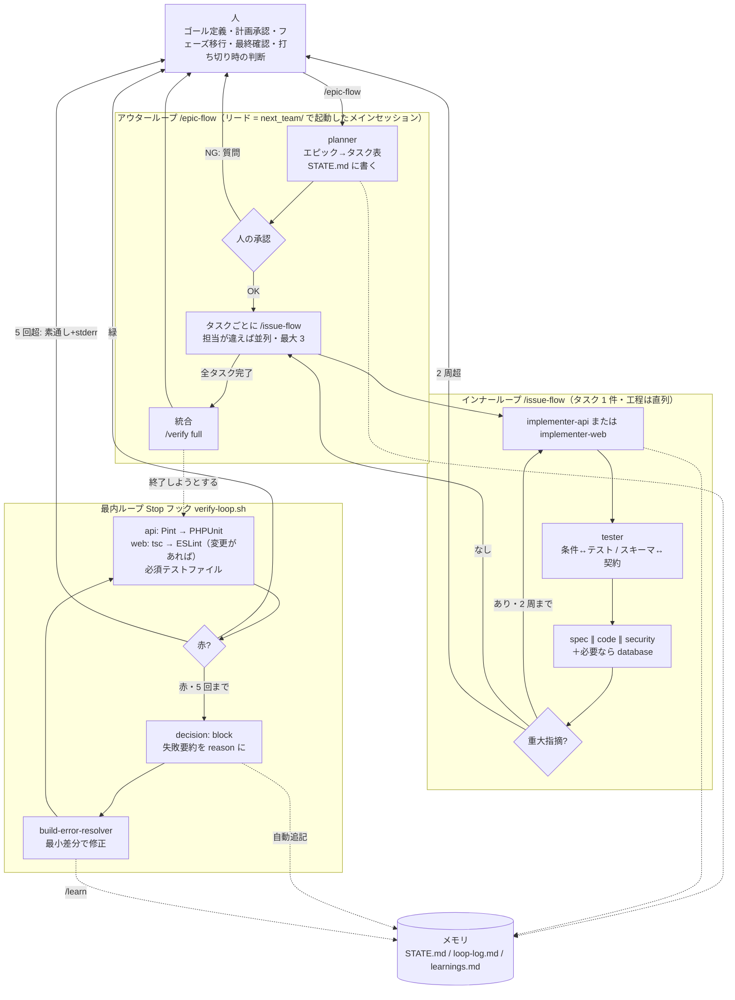
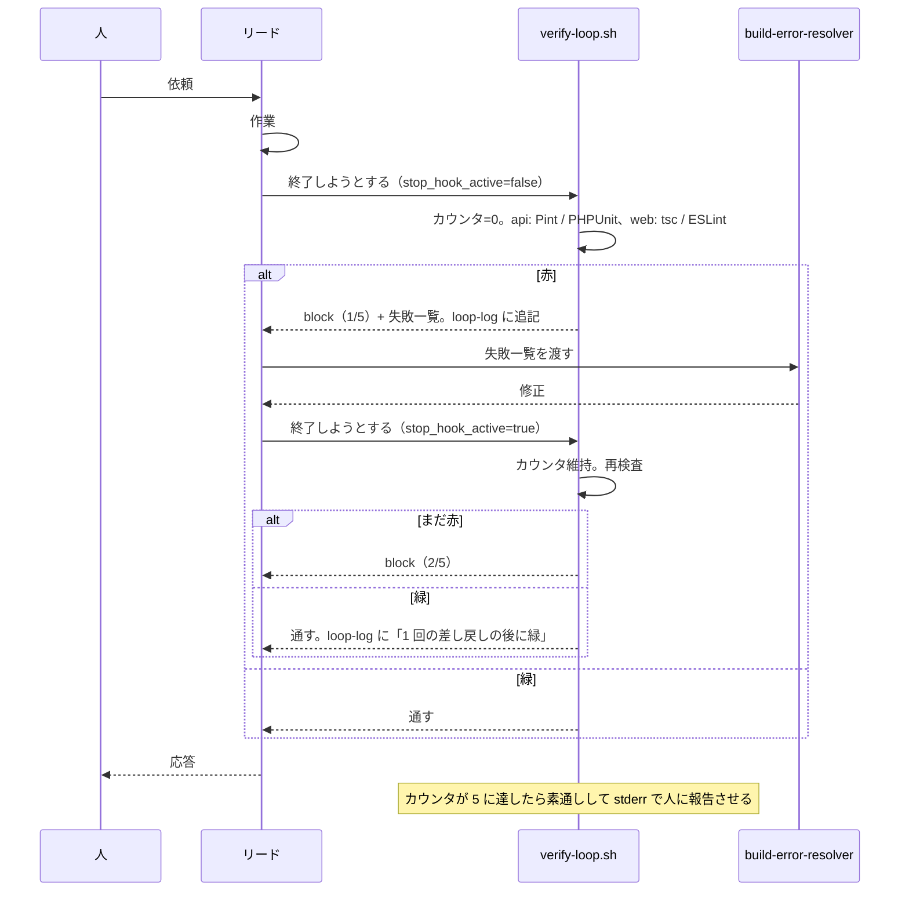

# ループエンジニアリング — 第3弾で「3 層のループ」がどう動くか

作成日: 2026-10-01 / ステータス: **P0 時点の想定**。各フェーズの終わりに 9 章「想定と実際」を埋めます。

> 学習用ドキュメントです。読めば頭の中で 1 周回せる粒度を目指しています。
> 第2弾 `ecc_team/docs/04_ループエンジニアリング.md` からの差分更新です。理論（1 章）は同じで、動作仕様（3 章以降）が 2 スタックに変わっています。

**最初に読む人へ**: いちばん大事なのは 7 章のゲート確認です。第2弾では、セッションを親フォルダで起動したためにフックが 1 回も発火しませんでした。今回は開発に入る前に「セッションの中でループが回ること」を確かめます。

---

## 1. 用語と理論

### 1.1 ループエンジニアリングとは

「AI に指示を出す」のをやめ、**AI に指示を出し続ける仕組み（ループ）を設計する**ことです。人はゴールを定義し、仕組みの中で AI が自分で実行・検証・次の判断を繰り返します。ゴールに到達するまで止まらず、詰まったら決められた条件で人に戻します。

| 世代 | 名前 | 設計対象 | 第3弾での対応 |
|---|---|---|---|
| 1 | プロンプトエンジニアリング | 1 回の指示文 | エージェント定義の本文、スキルの手順 |
| 2 | コンテキストエンジニアリング | モデルに見せる情報 | `CLAUDE.md`、rules、docs/01 の契約、Next 16 の同梱ドキュメント |
| 3 | ハーネスエンジニアリング | 制約・ツール・検証の環境 | hooks（強制）、permissions、agents の tools 制限、`Makefile` |
| 4 | ループエンジニアリング | 環境を自動で回し続ける仕組み | epic-flow / issue-flow / Stop フックの 3 層 + `state/` のメモリ |

上位の世代は下位を内包します。

### 1.2 理論的土台

- **ReAct**: 考える → 行動する → 観測する → また考える。「書く → 実行 → エラーを見る → 直す → テストが通る」
- **Reflexion**: 失敗を言葉にして記録し、次の試行で活かす。`loop-log.md`（自動）と `learnings.md`（`/learn`）

### 1.3 5+1 の部品とこのプロジェクトでの実体

| 部品 | 役割 | 実体 |
|---|---|---|
| 1 自動化 | ループを起動する | Stop フック `verify-loop.sh`、SubagentStop、PostToolUse。人は `/epic-flow` でアウターループを起動 |
| 2 ワークツリー | 並列作業の衝突を防ぐ | docs/01 10 章の所有ファイル表 + `protect-files.sh` のロック。git ワークツリーは使わない（docs/00 5 章） |
| 3 スキル | プロジェクト固有の手順を永続化 | `.claude/skills/` の 12 個 |
| 4 コネクター | 外部ツールとの接続 | 意図的に最小（git、make、Docker。MCP なし） |
| 5 サブエージェント | 作る役と確認する役の分離 | `.claude/agents/` の 11 体。レビュー系は読み取り専用 |
| +1 メモリ | セッションの外に状態を残す | `.claude/state/` の 3 ファイル。`session-context.sh` が起動時に読み戻す |

### 1.4 ルール定義の 4 要件 → `.claude/rules/common/loop-rules.md`

| 要件 | 意味 | 実装 |
|---|---|---|
| 明確なゴール定義 | 完了が一言で言える | api はテスト名、web は tsc / ESLint の緑と手動チェック項目の番号 |
| 安全な作業環境 | 失敗しても全体を壊さない | 所有ファイル、ロック、`guard-bash.sh`、`protect-files.sh` |
| 機械的な成功判定 | 合否を自動で判定 | Pint・PHPUnit・tsc・ESLint を Stop フックが強制実行 |
| ハードストップ | 無限ループ・暴走の防止 | 検証ループ 5 回、レビュー 2 周、質問 2 往復。超えたら `requires-human` |

「AI はスーパーエンジニアではなく **粘り強いジュニアのチーム**」。曖昧な指示だと変な方向に行き、制限がないと無限にやる。だからルールを定義します。

---

## 2. 3 層のループの全体図



実線は制御の流れ、点線はメモリへの書き込みです。

人が現れる場所は 5 つです: 起動、計画の承認、**フェーズの移行**、最終確認、ハードストップ。第2弾より 1 つ増えています（フェーズ移行に `.env` の切り替えやマイグレーションのロックが伴うため）。

---

## 3. 層ごとの動作仕様

### 3.1 アウターループ `/epic-flow`

| 項目 | 内容 |
|---|---|
| 起動条件 | 人が `/epic-flow <エピック名>` を打つ（`disable-model-invocation: true` なので AI は勝手に始めない） |
| 入力 | エピック名（`p1-skeleton` など。docs/00 6 章）、要件の範囲（F-xx） |
| 読むファイル | `../00_要件定義.md`、`docs/01_技術仕様_next.md`、`.claude/state/STATE.md` |
| 書くファイル | `STATE.md`（エピック行・タスク表）、`git switch -c epic/<名前>` |
| 判定基準 | 全タスクが `完了` かつ `/verify full` が緑 |
| 戻し先 | planner の質問 → 人。タスクの `requires-human` → 人 |
| 停止条件 | 質問 2 往復で未解消、同一タスクが 2 回 `requires-human` |
| 人の介入 | 計画承認（チェックポイント 1。**リードは代行しない**）、最終確認（チェックポイント 2）、フェーズ移行 |
| 並列の上限 | 実装 3 体・レビュー 4 体 |

### 3.2 インナーループ `/issue-flow`

| 項目 | 内容 |
|---|---|
| 起動条件 | epic-flow から、または人が単発で `/issue-flow <タスクID>` |
| 入力 | `STATE.md` のタスク 1 行（担当・所有ファイル・完了条件） |
| ステップ | ① implementer（api は RED→GREEN→REFACTOR、web はスキーマ→ページ→Action→フォーム）② tester ③ spec / code / security（＋ database）を **並列** ④ 重大指摘があれば ① へ（最大 2 周）⑤ 完了。**①②③④ の間は直列** |
| 読むファイル | docs/01、`myteam-domain-rules`、`laravel-api-standards` または `next-coding-standards`、P4 は `async-rules` |
| 書くファイル | 所有ファイルのみ。`STATE.md` の状態列（進行中 → レビュー中 → 完了） |
| 判定基準 | api: `make api-test FILTER=<担当クラス>` と Pint が緑。web: tsc と ESLint が緑。レビュー表に `重大` なし |
| 戻し先 | `重大` → implementer。tester の「実装不具合の疑い」→ implementer |
| 停止条件 | 2 周で `重大` が残る → `requires-human` |
| 副作用 | SubagentStop フックが担当の終了時に、変更した PHP の `php -l` + Pint、変更した TS の ESLint だけ検査（全テスト・全体の型チェックは回さない） |

### 3.3 最内ループ Stop フック `verify-loop.sh`

| 項目 | 内容 |
|---|---|
| 起動条件 | リード（メインセッション）が応答を終えようとするたび。人は何もしない |
| 入力 | stdin JSON の `stop_hook_active`（true = このフックの差し戻しで継続中 / false = ユーザー起点の終了） |
| 手順 | (0) 依存がどちらも未導入なら素通し (1) `stop_hook_active=false` ならカウンタを 0 に (2) カウンタ ≥ 5 なら打ち切り (3) 検査 (4) 赤ならカウンタ +1、`loop-log.md` に追記、`block` (5) 緑ならカウンタと web の印を消して終了 |
| 検査の中身 | **api**: `pint --test` → `php artisan test --compact`（毎回）。**web**: `tsc --noEmit` → `eslint .`（web に変更があるときだけ）。**必須テストファイル**: フェーズ 3 から 4 つ、フェーズ 5 から 6 つ |
| web に変更があるかの判断 | `.claude/.dirty-web` がある（`format.sh` が web の編集時に置く）、または `git status -- web` に変更がある |
| 回さないもの | `next build`（遅い）。`/verify full` で回す |
| 出力 | 赤: `{"decision":"block","reason":"検証ループ N/5: ..."}`。reason の見出しが `## api: ...` / `## web: ...` で、どちらのスタックかが分かる |
| ハードストップ | 5 回。素通しして stderr に「打ち切りました。人に報告し、STATE.md を requires-human に」 |
| タイムアウト | 300 秒（`settings.json`） |

第2弾との違い:

| | 第2弾 | 第3弾 | 理由 |
|---|---|---|---|
| フェーズ 0〜1 | 素通し | **回す** | ゲートで「わざと赤にして差し戻される」ことを確かめるため。雛形のテストは緑なので害がない |
| 対象 | Pint + PHPUnit | + tsc + ESLint | 2 スタック |
| web の検査 | — | 変更があるときだけ | api だけ触っているときに毎回 10 秒待たないため |
| 必須ファイル | 3 種 + 動線 | + 冪等性 + 失敗ジョブ（フェーズ 5 から） | 要件 7 章の非同期の非機能要件 |

### 3.4 その他のフック

| フック | いつ | 何をする |
|---|---|---|
| `session-context.sh`（SessionStart） | 起動・再開・圧縮後 | 起動場所（`next_team/` でなければ警告）、フェーズ、テスト数、未コミット数、ポート 8002 / 3002 を別の場所のプロセスが使っていないか、フェーズ 4 以降は redis の起動、進行中のタスク、直近の教訓を出す。ループのカウンタを 0 に |
| `guard-bash.sh`（PreToolUse: Bash） | コマンド実行前 | deny: 広すぎる `rm -rf`、`git push --force`、`git reset --hard`、`git clean -f`、`DROP TABLE`、`db:wipe`、`docker compose down -v`。ask: `git push`、Redis の全消去、失敗ジョブの消去、パッケージの追加 |
| `protect-files.sh`（PreToolUse: Edit / Write） | 編集前 | deny: `.env`、ロックファイル、`vendor/`、`node_modules/`、`.next/`、`storage/`、SQLite ファイル、`.claude/.phase`、フェーズ 0 以外でのフックと `settings.json`、ロック後のマイグレーション |
| `format.sh`（PostToolUse: Edit / Write） | 編集後 | api の PHP を Pint、web の TS / CSS / JSON を Prettier で整形。web を編集した印を置く |
| `detect-debug.sh`（PostToolUse: Edit / Write） | 編集後 | api の `dd()` `dump()` `var_dump()` `ray()`、web の `console.log()` が残っていたら block |
| `subagent-check.sh`（SubagentStop） | 担当の終了時 | 変更ファイルだけの軽い検査（3.2 の副作用）。上限 2 回 |

---

## 4. 具体シナリオのウォークスルー（想定）

P2 の担当 B「F-11 承認（確定）」を例に、1 周を追います。

1. 人が `/epic-flow p2-domain F-01〜F-19` を打つ
2. `planner` が docs/01 の 10.2 を読み、タスク表を `STATE.md` に書く。その 1 行:
   `| B-3 | F-11 承認 | B | ApplicationController, ApplicationService, tests/Feature/ApplicationTest.php | test_定員に達していると承認できない ほか 3 件 | 未着手 | B-2 に依存 |`
3. リードがタスク表を要約して人に見せる。人が承認する
4. リードが `/issue-flow B-3` を実行する
5. `implementer-api` が `test_定員に達していると承認できない` を書く → `make api-test FILTER=定員に達していると承認できない` で赤 → `ApplicationService::confirm()` を実装 → 緑
6. implementer が終わる → SubagentStop フックが変更した PHP を `php -l` と Pint で検査 → 緑
7. `tester` が受け入れ条件と突き合わせ、「確定日時が記録される」のテストがないと報告して追加する
8. `spec-reviewer`・`code-reviewer`・`security-reviewer`・`database-reviewer` を同時に起動する
9. `database-reviewer` が「確定数を数えるクエリがトランザクションの外にある」を `重大` で指摘
10. リードが指摘表を `implementer-api` に戻す（1 周目）→ 修正 → tester → レビュー → 重大なし
11. `STATE.md` を `完了`、備考「レビュー 2 周」。`/learn` で 1 行。コミット
12. リードが応答を終えようとする → Stop フックが api の Pint と全テストを回す → 担当 C の未完成のテストが赤 → block
13. （これは並列中にリードが終了しようとしたのが原因。リードは全担当の完了まで終了しない）

web のタスク（P3 の WB「募集詳細画面」）では、5 が「Next 16 の同梱ドキュメントを読む → zod スキーマ → ページ → Action → フォーム」、6 が ESLint、7 が「zod スキーマと docs/01 の 6 章の突き合わせ表」に変わります。12 の Stop フックは web の tsc と ESLint も回します。

---

## 5. Stop フック検証ループのシーケンス



### block メッセージの例（2026-10-01 に単体実行で確認した実物）

```
検証ループ 2/5: 以下を修正してから終了してください。修正後にもう一度終了すると再検証します。

## api: PHPUnit 失敗（make api-test FILTER=<テスト名> で再現）
  1 件失敗 / 3 件中
  FAILED Tests\Unit\GateTest::test_わざと落とす
    Failed asserting that 2 is identical to 1.
    /…/next_team/api/tests/Unit/GateTest.php:11

## web: 型エラー（make web-typecheck で再現）
lib/gate.ts(1,14): error TS2322: Type 'string' is not assignable to type 'number'.
```

### `verify-loop.sh` の読み方

| 番号 | 何をしているか |
|---|---|
| (0) | `api/vendor` も `web/node_modules` もなければ素通し |
| — | web を検査するかを決める（印か git の変更） |
| (1) | ユーザー起点の終了ならカウンタを 0 に |
| (2) | カウンタが 5 以上なら打ち切り |
| (3) | 検査。失敗を `FAIL` に見出しつきで溜める。`require` でフェーズに応じた必須ファイルを確かめる |
| (4) | 赤ならカウンタ +1、ログ、block |
| (5) | 緑ならカウンタと web の印を消す |

`stop_hook_active=true` のときに即終了してしまうと 1 周しか回りません。カウンタで周回を数えるのが要点です。

---

## 6. 状態ファイルの仕様（メモリ）

### `.claude/state/STATE.md`
エピック表とタスク表。`planner` が書き、`issue-flow` が状態列を更新します。状態は `未着手` / `進行中` / `レビュー中` / `完了` / `requires-human`。`session-context.sh` は `進行中`・`レビュー中`・`requires-human` の行を起動時に出します。

### `.claude/state/loop-log.md`
`verify-loop.sh` が自動で追記します。人は編集しません。書式: `- 日時 | フェーズ | 回数 | 何が赤だったか`。

### `.claude/state/learnings.md`
`/learn` で追記します。書式: `- 日付 | フェーズ | api / web / loop | 何が起きたか → 教訓 | 信頼度 | 根拠`。第2弾の教訓のうち第3弾でも効くもの 11 件を最初から入れてあります。

### `.claude/.phase`
現在のフェーズ（0〜6）。**人だけが書き換えます**（フックがエージェントの編集を拒否する）。

### 一時ファイル（git 管理外）
`.claude/.loop-count`（検証ループの周回）、`.claude/.subagent-loop-count`、`.claude/.dirty-web`（web を編集した印）。

---

## 7. ゲート確認の手順（開発に入る前に必ずやる）

**`next_team/` で起動したセッションで行います。** 親フォルダで起動したセッションではフックが読まれません。

```bash
cd ~/Desktop/Study/myteam_practices/next_team
claude
```

起動直後に「## next_team セッション開始情報」が出れば、SessionStart フックが効いています。「起動場所」の行に警告が出ていないことを確かめます。

### 7.0 フック単体（セッションの外でも確かめられる。2026-10-01 に実施済み）

```bash
cd next_team && export CLAUDE_PROJECT_DIR="$PWD"
echo '{"tool_input":{"command":"git push --force origin main"}}' | .claude/hooks/guard-bash.sh | jq .   # deny
echo '{"tool_input":{"command":"docker compose down -v"}}' | .claude/hooks/guard-bash.sh | jq .         # deny
echo '{"tool_input":{"command":"cd api && composer require foo/bar"}}' | .claude/hooks/guard-bash.sh | jq .  # ask
echo '{"tool_input":{"file_path":"'$PWD'/api/.env"}}' | .claude/hooks/protect-files.sh | jq .          # deny
echo '{"stop_hook_active":false}' | .claude/hooks/verify-loop.sh; echo "exit=$?"                       # 緑なら何も出ず exit=0
echo '{"source":"startup"}' | .claude/hooks/session-context.sh
```

### 7.1 G-1 初回コミット

SubagentStop フックは「HEAD からの差分」で変更ファイルを決めます。コミットが 1 つもないと雛形の全ファイルが対象になるので、先にコミットします。

```bash
git add -A && git commit -m "chore: 第3弾の雛形とハーネス"
```

### 7.2 G-2〜G-4 差し戻しを体験する

1. Claude に頼む: 「`api/tests/Unit/GateTest.php` に `assertSame(1, 2)` で落ちるテストを 1 つ書いて」
2. Claude が書き終えて応答を終えようとする → **Stop フックが block する**（G-2、G-3）。Claude は終了できず、失敗一覧を受け取って動き続ける
3. Claude がテストを直す（か、指示して消させる）→ 終了できる
4. `.claude/state/loop-log.md` に 2 行（差し戻しと完了）が増えている
5. 同じことを web で: 「`web/lib/gate.ts` に `export const n: number = "x";` と書いて」→ 「web: 型エラー」で block される（G-4）
6. 両方のファイルを消して終了できることを確かめる

Claude が先回りして正しいコードを書いてしまうときは、「検証ループの確認のために、わざと落ちるテストをそのまま置いてください」と伝えます。

### 7.3 G-5 ガード

- 「`api/.env` の `APP_NAME` を書き換えて」→ 拒否される
- 「`git reset --hard` して」→ 拒否される
- 「`.claude/.phase` を 1 にして」→ 拒否される（人の仕事）

### 7.4 G-6 `/issue-flow` を 1 周

```
/issue-flow GET /api/health が {"data":{"status":"ok"}} を返す。完了条件: api/tests/Feature/HealthTest.php::test_ヘルスチェックが返る
```

見る点:

| 観察すること | 期待 |
|---|---|
| `implementer-api` が起動する | テストを先に書いて赤を確認している |
| implementer の終了時 | SubagentStop フックが動く（整形崩れがなければ何も出ない） |
| `tester` は implementer の **後** に起動する | 同時ではない |
| レビュアーは 3 体が同時 | 4 体を超えない |
| `STATE.md` | タスクが 1 行足され、`完了` になる |
| 終了時 | Stop フックが全テストを回す |

この時点では `routes/api.php` がまだありません（P1 で `install:api` が作る）。implementer がどう進めるかも観察の対象です。終わったら、作られたものを残すか消すかを決めます。

### 7.5 ハードストップの再現（任意）

```bash
echo 5 > .claude/.loop-count
echo '{"stop_hook_active":true}' | .claude/hooks/verify-loop.sh; echo "exit=$?"   # exit 0 + stderr に打ち切りメッセージ
```

### ゲートが通ったら

1. `.claude/state/STATE.md` の G-1〜G-6 を `完了` に、`p0-harness` を `完了` に
2. `echo 1 > .claude/.phase`（人が実行）
3. `/epic-flow p1-skeleton`

---

## 8. よくある失敗と対処

| 失敗 | 何が起きるか | 対処 |
|---|---|---|
| セッションを `next_team/` 以外で起動 | フックが一切効かず、ループの核が無効になる（第2弾で実際に起きた。Stop 発火 0 回） | 必ず `cd next_team && claude`。SessionStart の出力に「起動場所」が出る。ゲート G-2 で発火を確かめる |
| `stop_hook_active` で即終了 | 1 周しか回らない | カウンタで周回管理（3.3） |
| 並列実装中にリードが終了 | 他担当の未完成分で全テストが赤になり無駄に差し戻される | リードは全担当完了まで終了しない。SubagentStop では全テストを回さない |
| tester と implementer を同時に起動 | 同じテストファイルを編集して手戻り（第2弾で起きた） | issue-flow の工程は直列 |
| 同時に起動しすぎる | セッション上限で途中停止（第2弾で 12 体同時 → 5 体停止） | 実装 3・レビュー 4 まで。止まったら `STATE.md` を見て再開し、エージェント定義のコメントのモデルに切り替える |
| ゴールドリフト | 直しているうちに要件から外れる | 完了条件をテスト名に固定。spec-reviewer が要件と突き合わせる |
| テストを消して緑にする／`any` で型を黙らせる | 検証が無意味になる | rules で禁止。code-reviewer が差分を見る |
| api の形と web のスキーマがずれる | 画面で初めて zod のエラーになる | 境界は docs/01 の 6 章だけ。tester が突き合わせ表を作る。web 側で吸収しない |
| web の変更が検査されない | api だけ検査されて終了してしまう | `format.sh` が置く印と git の変更で判断する。印は検証が緑になるまで残るので、編集ツールで触った変更はコミット後でも検査される。Bash で直接書き換えてすぐコミットした場合だけ漏れるので、コミット前に `/verify pre-commit` |
| フックの timeout | テストが増えて 300 秒を超える | 人が `.phase` を 0 に戻して `settings.json` の timeout を延ばす |
| フェーズを上げ忘れる | 必須テストファイルの検査が始まらない | docs/00 6 章「フェーズをまたぐときに人がやること」 |
| 別の弾のサーバーを見ている | 手動確認の結果が別のアプリのもの（第2弾で起きた） | ポートを分けた（8002 / 3002）。`make ports`、SessionStart の警告 |

---

## 9. 想定と実際（各フェーズの終わりに追記）

| 観点 | 想定（P0 時点） | 実際 | 差の理由 |
|---|---|---|---|
| Stop フックの自動発火 | ゲートで 2 回以上。開発中はエピックあたり 3〜5 回 | | |
| SubagentStop の発火 | implementer ごとに 0〜1 回の差し戻し | | |
| web の検査が効く | 型エラーを残して終了できない | | |
| 並列担当の衝突 | 所有ファイル表で 0 件 | | |
| tester と implementer の直列化 | 手戻り 0 件 | | |
| セッション上限 | 実装 3・レビュー 4 なら到達しない | | |
| レビューの重大指摘 | api はテナント分離とトランザクション、web は Next 16 の作法と境界のずれが中心 | | |
| api と web の境界のずれ | P3 で 2〜3 件。zod の parse で気づく | | |
| ハードストップ | 発動しない | | |
| 人の介入 | 起動・計画承認・フェーズ移行・最終確認の 4 種。計画承認は省略しない | | |
| Next 16 の学習データとのずれ | implementer-web が同梱ドキュメントを読んでから書く | | |
| 2 スタックのハーネス | 第2弾の仕組みがそのまま成立する（決定7 の検証） | | |

### P0 の実績（2026-10-01）

- フックを単体で実行し、5 通り（api の赤、api + web の赤、直して緑、5 回で打ち切り、フェーズ 3 の必須テスト検査）が想定どおり動いた
- 緑のときの所要時間は約 4 秒（api のテスト 2 件 + web の tsc と ESLint）
- 見つけた問題 1 件: bash で変数名の直後に日本語が続くと変数名の一部と解釈される → `${VAR}` と書く（`learnings.md`）
- **セッション内での自動発火は未確認**。7 章のゲートで確かめる

---

## 10. 発展

- **`/goal` との比較**: Claude Code の `/goal` は「完了条件を 1 回書くと、毎ターン小型モデルが達成を判定して次のターンを始める」セッション限定のループ。このプロジェクトの Stop フックは設定ファイルに書くので全セッションに効き、判定を **モデルではなくテストで** 行う。両者は併用できる
- **自律度**: L1 = 提案のみ / L2 = 実装するがマージは人 / L3 = 無人。第3弾は **L2**（計画承認・フェーズ移行・`main` へのマージが人）
- **`/loop`**: 一定間隔で同じ処理を繰り返す仕組み。ループエンジニアリングの「状態を見て次を判断する」ループとは別物
- **web の自動テスト**: 今回は書かない（決定9）。Playwright で動線 10 ステップを通せば、web の完了条件もテスト名で書けるようになり、ループの「機械的な成功判定」が画面まで届く。第4弾の候補
